# EXP-CH3：C0 与历史B10准消融——补充结果卡

> 原实验完成时间：09月18日 10:39（北京时间）  
> 补充整理时间：10月03日 23:04（北京时间）  
> 日志聚类区间补充时间：10月07日 02:09（北京时间）  
> 定性分析补充时间：10月07日 11:10（北京时间）  
> 俯视场景图补充时间：10月07日 11:17（北京时间）  
> 当前状态：**C0训练、validation-1000配对开环评价及固定safety40配对闭环评价均已完成。**  
> 证据等级：**历史对照准消融**；不是严格单变量因果实验，也不是正式安全保证。

## 1. 实验目的与核心结论

本实验研究的问题是：在相同HDP主体架构、训练数据、轨迹表示和名义优化设置下，移除位置重建辅助项后，长时域开环误差与闭环规划表现是否发生变化。

本轮结果形成了一个完整但为负的“开环—闭环”实验闭环：

1. 历史B10在1秒ADE/FDE和3秒ADE上更低；C0在3秒FDE以及5～8秒ADE/FDE均值上更低。
2. B10在全程ADE/FDE上分别有51.40%和51.37%的配对观测优于C0，但平均误差反而更高，说明差异主要由长时域尾部而不是多数样本的一致变化驱动。
3. 按预先固定规则选取的4个定性案例同时包含时域交叉、C0长时优势和B10长时优势，与“均值受双侧长尾差异驱动”的定量结果一致。
4. 固定safety40闭环中，C0的route progress、TTC和comfort均值略高，但发生1个相对B10新增的责任碰撞，使综合分从0.896331降至0.884712。
5. 因而，本实验不支持“开环监督误差改善必然带来闭环综合性能或安全改善”；也不支持“位置重建辅助项已经被严格因果证明有效或无效”。

本实验最重要的科学认识是：

> **连续误差指标的平均改善不能抵消离散且严重的安全失败；开环轨迹拟合质量不能替代闭环安全评价。**

## 2. 模型身份与实验协议

### 2.1 对照模型

| 模型 | 位置重建辅助项权重 | 训练身份 | 评价权重 | Epoch10 checkpoint SHA256 |
|---|---:|---|---|---|
| C0 | 0 | 新训练，seed=3407，从Diffusion Planner Encoder warm-start开始 | EMA | `afb07593c2c989372ad5d11e39b13b532f65a457121b302f11c4b00e5c02aeb0` |
| 历史B10 | 0.01 | 历史HDP B Epoch10，经历共同Epoch1～4、分叉和恢复训练 | EMA | `22ec0cf6be7cc89a3cf8414cddd0c7446ce2737ddc4e44b23e50dbeeeb0b29ce` |

C0完整初始化SHA256为`0df19230ccd06ae4a25cf37013a662bcc1aa716f05a9150183b1224705262586`。历史B10缺少同阶段的完整初始化报告，无法证明两者Decoder初值和全部随机流一致。因此，本文将该实验定义为**历史对照准消融**。

### 2.2 训练与评价协议

| 环节 | 协议 |
|---|---|
| 训练数据 | 306,801个唯一NPZ，44个logs；训练输入hash门禁通过 |
| C0训练 | 10 epochs，batch size 8，constant learning rate `5e-5`，前三轮冻结Encoder，EMA开启 |
| 开环数据 | validation-1000，1000个唯一开发场景，与训练集token交集为0 |
| 开环重复 | 每模型3次，共3000组配对观测 |
| 开环随机控制 | 公共随机数，seed=3407；10步扩散；noise scale=0.1 |
| 闭环数据 | 固定safety40，40场景、8个logs、五个预注册研究分组 |
| 闭环模拟 | `closed_loop_nonreactive_agents`，推理seed=0 |
| 闭环完成情况 | B10与C0均完成40/40，runner failure均为0 |
| 闭环区间 | 以8个日志为整组进行bootstrap重采样 |

C0训练10轮耗时约7小时59分，Epoch10记录loss为`0.00311742`；历史B10 Epoch10记录loss为`0.00906237`。两个loss的定义不同：C0的total loss不包含位置重建辅助项，因此**不能根据训练loss数值判断C0优于B10**。

## 3. validation-1000配对开环结果

### 3.1 分时域平均误差

下表差值定义为历史B10−C0。对于ADE/FDE等误差指标，负值表示B10误差更低，正值表示C0误差更低。聚类区间采用与R0/C0实验一致的口径：先对每个场景的3次公共随机数推理求平均，再以10个nuPlan日志为整组对逐场配对差进行10,000次有放回bootstrap。

| 时域/指标 | C0均值 | 历史B10均值 | B10−C0 | 10日志聚类95%区间 | B10改善观测比例 | 均值更优模型 |
|---|---:|---:|---:|---:|---:|---|
| 1s ADE (m) | 0.112250 | **0.102182** | -0.010068 | [-0.020812, -0.000880] | 66.20% | B10 |
| 1s FDE (m) | 0.249811 | **0.226291** | -0.023520 | [-0.046510, -0.004351] | 64.83% | B10 |
| 3s ADE (m) | 0.533223 | **0.520001** | -0.013222 | [-0.038449, +0.008298] | 57.60% | B10 |
| 3s FDE (m) | **1.215244** | 1.233526 | +0.018282 | [-0.023543, +0.058158] | 50.07% | C0 |
| 5s ADE (m) | **1.044908** | 1.073409 | +0.028501 | [-0.014951, +0.078695] | 51.13% | C0 |
| 5s FDE (m) | **2.408967** | 2.576265 | +0.167298 | [+0.017701, +0.381069] | 48.63% | C0 |
| 8s/全程 ADE (m) | **2.075229** | 2.194442 | +0.119213 | [+0.012857, +0.265138] | 51.40% | C0 |
| 8s/终点 FDE (m) | **5.364922** | 5.739802 | +0.374880 | [+0.099281, +0.743459] | 51.37% | C0 |

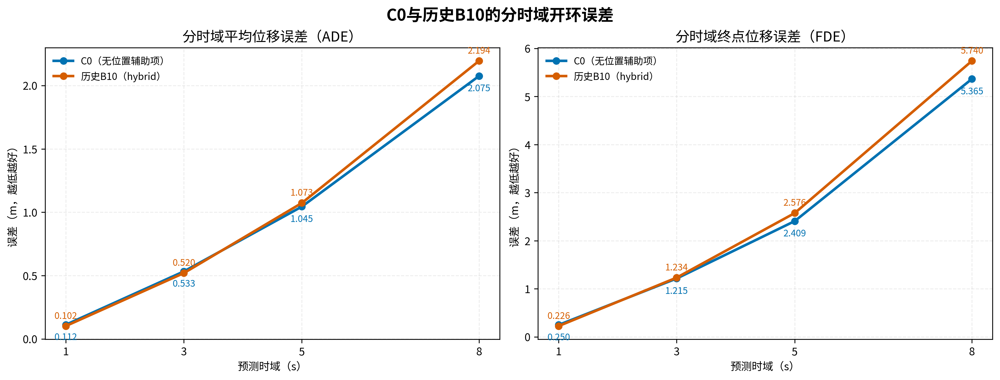

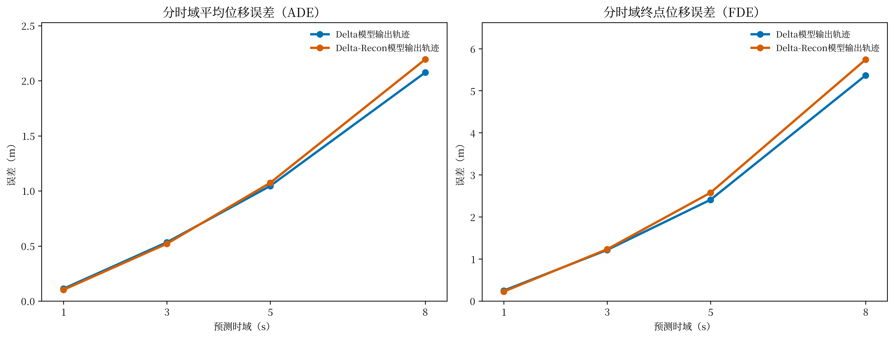

图中可以看到明显的时域交叉：B10的短时位置误差较低，但优势没有保持到长时域；从3秒FDE开始，C0的均值逐步低于B10，5～8秒差距进一步扩大。聚类区间进一步表明：B10的1秒ADE/FDE优势以及C0的5秒FDE、8秒ADE/FDE优势在10个日志层面均未跨越0；3秒ADE/FDE和5秒ADE的区间跨越0。这一结果不等价于C0闭环策略更好，只说明两者的误差随预测时域增长的方式不同。

### 3.2 模型误差分布摘要

| 指标 | C0 mean±std | C0 P50 | C0 P90 | B10 mean±std | B10 P50 | B10 P90 |
|---|---:|---:|---:|---:|---:|---:|
| 1s ADE (m) | 0.1123±0.1448 | 0.0499 | 0.3014 | 0.1022±0.1259 | 0.0544 | 0.2755 |
| 3s ADE (m) | 0.5332±0.7220 | 0.2062 | 1.5862 | 0.5200±0.6737 | 0.1933 | 1.5293 |
| 5s ADE (m) | 1.0449±1.3758 | 0.4261 | 2.9745 | 1.0734±1.3458 | 0.5348 | 3.0840 |
| 8s ADE (m) | 2.0752±2.4857 | 1.2583 | 5.5717 | 2.1944±2.5223 | 1.3062 | 5.8827 |
| 1s FDE (m) | 0.2498±0.3315 | 0.0980 | 0.6891 | 0.2263±0.2878 | 0.0979 | 0.6496 |
| 3s FDE (m) | 1.2152±1.6576 | 0.3920 | 3.5857 | 1.2335±1.6199 | 0.4542 | 3.6896 |
| 5s FDE (m) | 2.4090±3.1343 | 1.1816 | 6.8169 | 2.5763±3.1712 | 1.3103 | 7.1812 |
| 8s FDE (m) | 5.3649±6.1936 | 3.2387 | 13.2271 | 5.7398±6.4568 | 3.4492 | 14.0050 |

两个模型的误差分布都具有明显长尾，均值显著高于中位数。因此只比较均值不足以判断模型在典型场景和困难场景中的行为。

### 3.3 逐观测配对差的分位数

| 配对指标（B10−C0） | 均值 | P10 | P50 | P90 | 解释 |
|---|---:|---:|---:|---:|---|
| 1s ADE (m) | -0.0101 | -0.0893 | -0.0041 | +0.0567 | 典型观测中B10略优 |
| 3s ADE (m) | -0.0132 | -0.2785 | -0.0058 | +0.2584 | 中位数仍偏向B10，但两侧差异扩大 |
| 5s ADE (m) | +0.0285 | -0.4819 | -0.0013 | +0.5450 | 均值转向C0，中位数接近0 |
| 8s ADE (m) | +0.1192 | -0.7770 | -0.0031 | +1.1908 | B10正向退化尾部更明显 |
| 1s FDE (m) | -0.0235 | -0.1867 | -0.0084 | +0.1313 | B10短时终点误差略优 |
| 3s FDE (m) | +0.0183 | -0.5858 | -0.0001 | +0.6682 | 中位数几乎为0 |
| 5s FDE (m) | +0.1673 | -1.1034 | +0.0032 | +1.6014 | 长时尾部开始偏向C0 |
| 8s FDE (m) | +0.3749 | -1.8436 | -0.0046 | +3.1277 | 均值与中位数方向不同，尾部主导均值 |

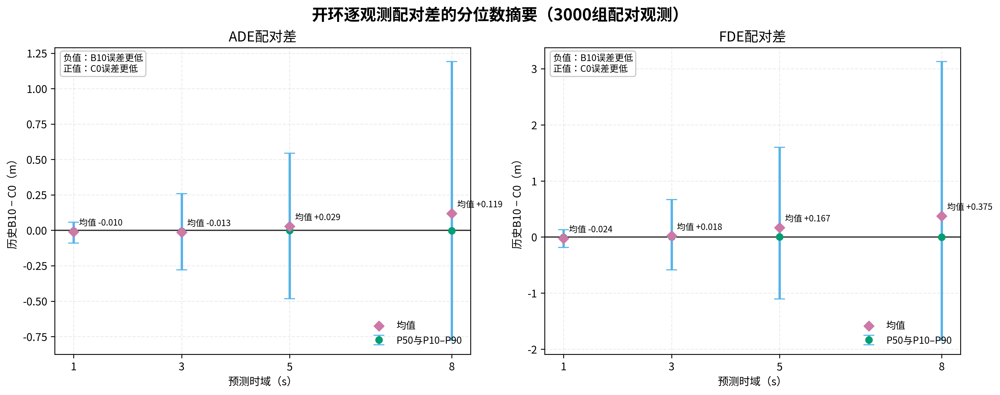

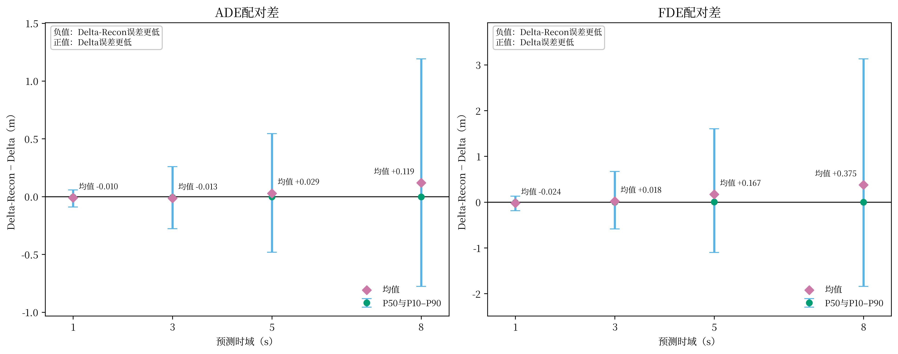

该图是3000组真实配对观测的**汇总分位数图**，不是由原始样本重绘的直方图或小提琴图。当前结果JSON只保存了均值、标准差和P10/P50/P90，没有保存3000组逐观测数组，因此不能从现有文件无损恢复完整分布。图中最重要的现象是：5～8秒配对差均值转为正值，但中位数仍接近0，说明C0的长时均值优势来自尾部改善，而不是绝大多数场景的小幅一致改善。

### 3.4 航向误差

| 指标 | C0均值 | 历史B10均值 | B10−C0 | 10日志聚类95%区间 | B10改善观测比例 |
|---|---:|---:|---:|---:|---:|
| 全程heading MAE (rad) | **0.029027** | 0.032485 | +0.003458 | [+0.000786, +0.007015] | 35.53% |
| 终点heading FDE (rad) | **0.058680** | 0.059803 | +0.001123 | [-0.004924, +0.007642] | 42.57% |
| 1s heading MAE (rad) | **0.011607** | 0.013757 | +0.002150 | [+0.001183, +0.003246] | 26.87% |
| 3s heading MAE (rad) | **0.014176** | 0.015441 | +0.001265 | [+0.000734, +0.001830] | 34.13% |
| 5s heading MAE (rad) | **0.018540** | 0.020679 | +0.002139 | [+0.000702, +0.003874] | 30.63% |

C0在列出的航向均值上均低于B10。采用与3.1相同的日志聚类口径后，全程及1/3/5秒heading MAE的`B10−C0`区间均为正，而终点heading FDE区间跨越0。这些航向误差仍属于开环模仿指标，不能直接解释为车辆闭环转向更安全。

### 3.5 运动学描述量

| 描述量 | C0均值 | 历史B10均值 | B10−C0 | 10日志聚类95%区间 | B10数值更高比例 |
|---|---:|---:|---:|---:|---:|
| 平均速度 (m/s) | 3.5681 | 3.5891 | +0.0209 | [-0.0162, +0.0601] | 47.83% |
| 最大速度 (m/s) | 4.8283 | 4.9010 | +0.0727 | [+0.0301, +0.1121] | 65.03% |
| 平均加速度描述量 (m/s²) | 0.4622 | 0.5993 | +0.1371 | [+0.1059, +0.1737] | 95.33% |
| 最大加速度描述量 (m/s²) | 2.2394 | 2.4568 | +0.2175 | [+0.0239, +0.4047] | 73.93% |
| 平均jerk描述量 (m/s³) | 4.4670 | 7.8283 | +3.3612 | [+2.5563, +4.2669] | 99.10% |
| 最大jerk描述量 (m/s³) | 21.9337 | 28.4309 | +6.4972 | [+3.7284, +9.9676] | 80.20% |
| 平均绝对曲率描述量 (1/m) | 117.8024 | 209.7537 | +91.9513 | [+36.2487, +161.5398] | 83.77% |
| 最大绝对曲率描述量 (1/m) | 1907.9070 | 1796.3551 | -111.5519 | [-642.6648, +446.4089] | 73.70% |

日志聚类区间显示，除平均速度和最大曲率外，B10−C0的其余运动学描述量区间均为正。这些数值来自原开环评价器的有限差分描述量，只用于说明局部变化趋势。本表仍不是后续R0/C0中心差分口径；尤其曲率会被近零位移放大，绝对值异常。为支持下节定性分析，补跑评价现已额外保存C0、B10的3次逐点轨迹，但不改变本表的原始计算口径。因此本节不作为Hybrid Loss有效性或官方comfort的主要证据，论文主结论应优先使用ADE/FDE、航向误差和官方闭环指标。

### 3.6 代表性场景定性分析

定性分析仅用于解释第3.1～3.3节的误差结构，定量配对结果仍是主要证据。为避免根据可视化效果主观挑选案例，所有场景都在看图前按固定规则选出：首先以专家8秒终点位移不小于10 m筛得511个动态场景，然后基于每个场景3次公共随机数推理的均值，分别选取：

1. `B10−C0` 8秒ADE最接近动态场景中位数的典型案例；
2. 1秒ADE上B10更优、但8秒ADE上C0更优的时域交叉案例；
3. `B10−C0` 8秒ADE最接近P90的C0长时优势案例；
4. `B10−C0` 8秒ADE最接近P10的B10长时优势案例。

每个场景展示的重复次数，是3次中8秒ADE差最接近该场景3次均值的一次，而不是人工选择的最优或最差轨迹。下表的ADE均为3次推理均值，差值定义为`Delta-Recon−Delta`；正值表示Delta误差更低。

| 案例 | 场景token | 展示重复 | 1s ADE Delta / Delta-Recon (m) | 8s ADE Delta / Delta-Recon (m) | 8s ADE差 (m) |
|---|---|---:|---:|---:|---:|
| 动态场景中位 | `67483ca79fa25c5d` | 3 | 0.186 / **0.131** | **0.921** / 1.009 | +0.088 |
| 短期/长期交叉 | `26243ae5c0935e9d` | 3 | 0.451 / **0.278** | **4.868** / 5.325 | +0.457 |
| Delta长时优势P90 | `a7dba56182eb533d` | 2 | 0.160 / **0.157** | **2.496** / 3.897 | +1.401 |
| Delta-Recon长时优势P10 | `fd60e1ef1c785a25` | 2 | 0.167 / **0.119** | 5.620 / **4.344** | -1.276 |

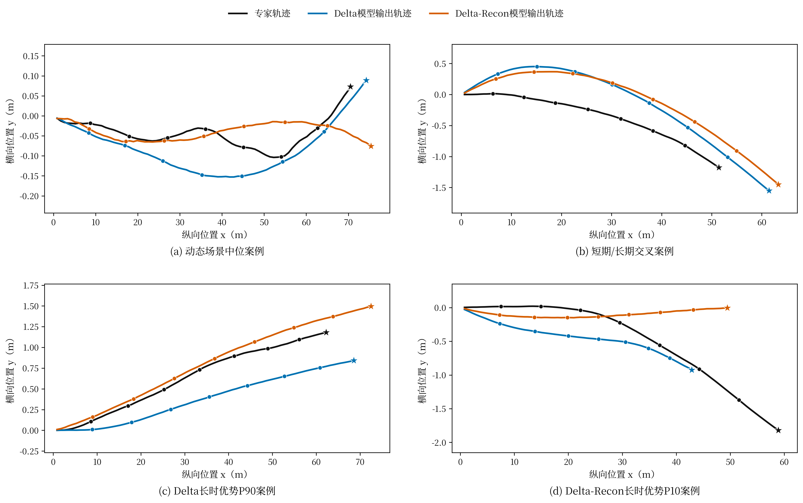

图中黑色为专家轨迹，蓝色为Delta（C0）模型输出，橙色为Delta-Recon（历史B10）模型输出；圆点表示每1秒的时间对齐位置，星号表示8秒终点。

- 图(a)是最接近动态场景中位差异的案例。Delta-Recon在1～5秒更接近专家，但后程方向变化不足，Delta的8秒ADE最终低0.088 m，直观展示了“短时优势与长时优势不一致”。
- 图(b)是明确的时域交叉案例：Delta-Recon的1秒ADE低0.173 m，但Delta的8秒ADE低0.457 m。这说明辅助重建项与基础目标对不同时域的影响方向可能不同。
- 图(c)中Delta的8秒ADE/FDE分别低1.401/3.904 m，显示Delta-Recon在部分长时场景中存在更明显的累积偏移，与长时均值由尾部差异驱动的定量结果一致。
- 图(d)是反向案例，Delta-Recon的8秒ADE/FDE分别低1.276/6.446 m，说明Delta并非在所有动态场景都占优，不能用少量正例宣称统一改善。

#### 3.6.1 四个案例的俯视场景与轨迹走廊

下列四张图均使用处理缓存中的nuPlan矢量道路、规划路线和当前交通参与者，不是示意图。左图保留场景全局关系，右图在同一局部坐标系下放大三条原始轨迹；圆点每1秒一个，星号为8秒终点。

**（1）动态场景中位案例 `67483ca79fa25c5d`**

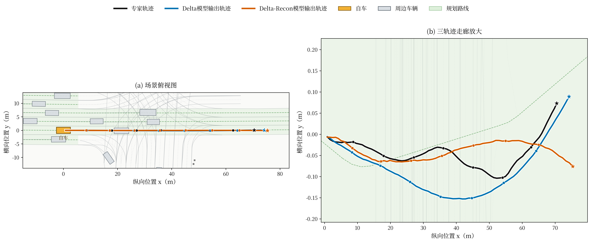

全局视图中三条轨迹均沿直行规划路线向前，差异在普通地图尺度下几乎不可见。走廊放大后可见，Delta-Recon中段更接近专家，但末段未跟随专家和Delta向横向正方向回转，对应其较高的8秒误差。

**（2）短期/长期交叉案例 `26243ae5c0935e9d`**

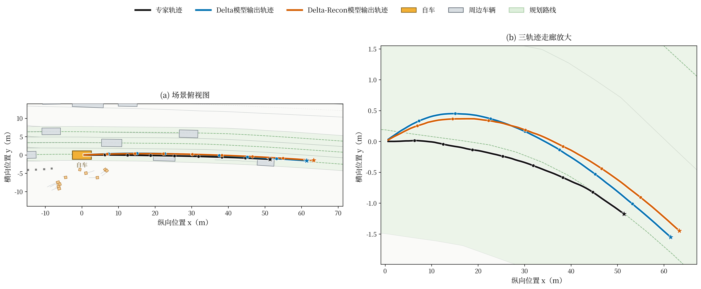

专家轨迹逐渐向横向负方向转移，两个模型的前段则先出现正向偏移，并在后程超过专家轨迹的纵向终点。Delta-Recon的早期时间对齐误差更小，但Delta后程更快向专家轨迹方向收敛，因而出现短期和长期排序反转。

**（3）Delta长时优势P90案例 `a7dba56182eb533d`**

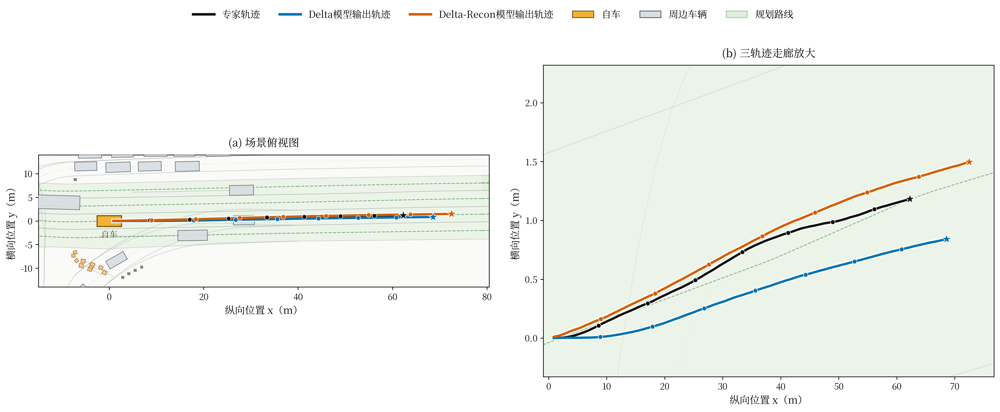

三条轨迹都位于规划道路走廊内，但两个模型均存在不同程度的前向超调。Delta-Recon虽然在横向形状上跟随专家的上升趋势，但前向终点更远；Delta仍有横向偏差，但时间对齐的综合位置误差更低。这说明ADE/FDE反映的是纵横向合成误差，不应仅凭单一方向的视觉接近程度判断模型优劣。

**（4）Delta-Recon长时优势P10案例 `fd60e1ef1c785a25`**

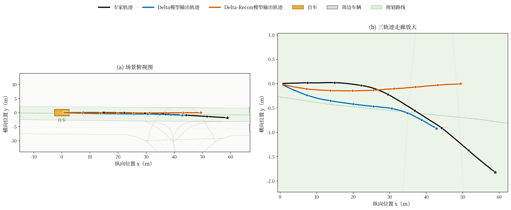

该场景的专家轨迹在后程明显向横向负方向转移。Delta在横向趋势上更接近专家，但纵向前进不足更严重；Delta-Recon几乎未跟随专家的横向转移，但其纵向终点更接近专家，最终获得更低的ADE/FDE。该反例进一步表明，只报告合成位置误差会隐藏纵向进度与横向跟踪之间的权衡。

因此，定性证据与定量结果共同支持一个有限结论：**C0与历史B10的差异主要表现为时域误差分配和长尾案例的改变，而非某一模型在全部场景的一致占优。** 由于B10为历史训练路径模型，该差异仍不能严格因果归因于位置重建辅助项。俯视图虽然补充了当前矢量地图和交通参与者，但没有呈现其未来演化或与自车的闭环响应，仍不能仅凭静态图判定道路合规性或安全性。

## 4. 固定safety40配对闭环结果

### 4.1 全部官方指标

差值定义为C0−B10，所有官方指标均为越大越好。区间按8个日志整组bootstrap重采样。

| 指标 | B10 | C0 | C0−B10 | 8日志聚类95%区间 | 胜/负/平 |
|---|---:|---:|---:|---|---:|
| 综合score | **0.896331** | 0.884712 | -0.011619 | [-0.042394, +0.003998] | 14/6/20 |
| 无责任碰撞 NC | **0.937500** | 0.925000 | -0.012500 | [-0.039474, 0.000000] | 1/1/38 |
| 可行驶区域 DA | 0.975000 | 0.975000 | 0.000000 | [0.000000, 0.000000] | 0/0/40 |
| 正在取得进展 | 1.000000 | 1.000000 | 0.000000 | [0.000000, 0.000000] | 0/0/40 |
| 行驶方向合规 | 1.000000 | 1.000000 | 0.000000 | [0.000000, 0.000000] | 0/0/40 |
| 沿专家路线进展 | 0.951599 | **0.956648** | +0.005049 | [-0.005136, +0.012206] | 14/7/19 |
| TTC合规 | 0.900000 | **0.925000** | +0.025000 | [0.000000, +0.078947] | 1/0/39 |
| 限速合规 | **0.995509** | 0.993682 | -0.001827 | [-0.005480, 0.000000] | 0/2/38 |
| 舒适性 | 0.950000 | **0.975000** | +0.025000 | [0.000000, +0.078947] | 1/0/39 |

B10和C0的平均轨迹推理时间分别为0.24019秒和0.24105秒，差约0.00086秒；在本轮协议下未观察到有意义的推理效率差异。

综合分差值的日志聚类95%区间包含0，不能宣称C0在总体上显著劣于B10；同样也不能用route progress、TTC和comfort的正向均值宣称C0总体更优。最需要保留的事实是：C0出现了一个相对B10新增的责任碰撞。

### 4.2 40场逐场综合分变化

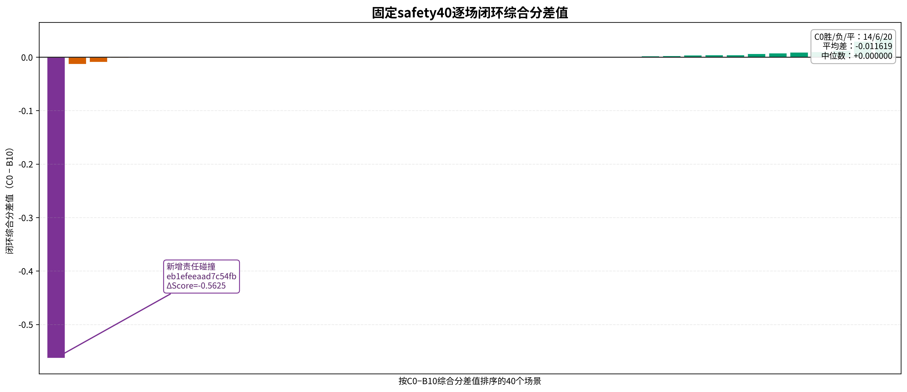

C0逐场综合分胜14场、负6场、平20场，中位差为0。最大负差场景`eb1efeeaad7c54fb`的综合分差为-0.5625，远大于其余退化场景；最大的4个负差占全部负向综合分降幅的99.84%。因此总体均值下降不是40个场景普遍变差，而是由少数尾部失败，特别是单个碰撞事件主导。

### 4.3 五个预注册研究分组

| 分组 | N | B10 score | C0 score | Δscore | Δroute progress | ΔNC | ΔDA | ΔTTC | Δcomfort | score胜/负/平 |
|---|---:|---:|---:|---:|---:|---:|---:|---:|---:|---:|
| 路口 | 12 | 0.907473 | 0.910371 | +0.002898 | +0.006408 | 0.000000 | 0.000000 | 0.000000 | 0.000000 | 4/2/6 |
| 车辆交互 | 10 | 0.849315 | 0.793983 | **-0.055332** | +0.002938 | **-0.100000** | 0.000000 | 0.000000 | +0.100000 | 3/3/4 |
| 行人及规则 | 8 | 0.966197 | 0.972511 | +0.006314 | +0.025589 | 0.000000 | 0.000000 | 0.000000 | 0.000000 | 5/0/3 |
| 动态与环境 | 6 | 0.958432 | 0.958980 | +0.000548 | +0.001754 | 0.000000 | 0.000000 | 0.000000 | 0.000000 | 2/1/3 |
| 基础能力 | 4 | 0.747562 | 0.747562 | 0.000000 | -0.029887 | +0.125000 | 0.000000 | +0.250000 | 0.000000 | 0/0/4 |

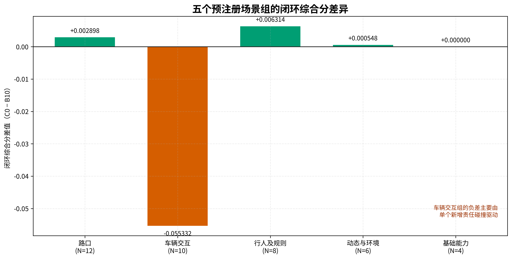

车辆交互组是唯一出现明显综合分负差的预注册组，但该组的均值主要由一个新增责任碰撞拉低。现有40场结果可以定位风险方向，却不足以推断C0在一般车辆交互场景中必然更差。

### 4.4 八个日志的聚类层面结果

| 日志 | 场景数 | 平均Δscore | 平均ΔNC | 平均Δroute progress |
|---|---:|---:|---:|---:|
| `2021.06.07.12.54.00_veh-35_01843_02314` | 5 | +0.000652 | 0.000000 | +0.002086 |
| `2021.06.08.12.54.54_veh-26_04262_04732` | 5 | 0.000000 | 0.000000 | 0.000000 |
| `2021.06.08.14.35.24_veh-26_02555_03004` | 5 | **-0.112201** | **-0.100000** | -0.022954 |
| `2021.06.08.16.31.33_veh-38_01589_02072` | 6 | +0.005374 | 0.000000 | +0.017196 |
| `2021.07.24.20.37.45_veh-17_00015_00375` | 6 | +0.001654 | 0.000000 | +0.012473 |
| `2021.07.24.23.50.16_veh-17_01696_02071` | 5 | +0.001686 | 0.000000 | +0.005394 |
| `2021.08.09.17.55.59_veh-28_00021_00307` | 1 | 0.000000 | 0.000000 | 0.000000 |
| `2021.10.05.07.10.04_veh-52_01442_01802` | 7 | +0.006059 | 0.000000 | +0.014473 |

八个日志中只有`2021.06.08.14.35.24_veh-26_02555_03004`出现大幅平均退化，而且该日志同时包含新增责任碰撞场景。这解释了为什么按日志聚类得到的总体score区间较宽且跨越0。

### 4.5 主要增益与退化场景

| 方向 | token | 分组 | 官方场景类型 | B10 score | C0 score | Δscore | 主要变化 |
|---|---|---|---|---:|---:|---:|---|
| 最大退化 | `eb1efeeaad7c54fb` | 车辆交互 | traversing_traffic_light_intersection | 0.562500 | 0.000000 | **-0.562500** | NC由1降至0；C0新增责任碰撞 |
| 退化 | `b60bda0bedee5fc0` | 动态与环境 | high_lateral_acceleration | 0.957864 | 0.945028 | -0.012837 | route progress下降0.041077 |
| 退化 | `d47ba9006f185159` | 车辆交互 | following_lane_with_slow_lead | 1.000000 | 0.991312 | -0.008688 | route progress下降0.027803 |
| 退化 | `d3f21c2df4375a87` | 路口 | traversing_traffic_light_intersection | 0.999863 | 0.998899 | -0.000964 | route progress小幅下降 |
| 退化 | `bc70712ca75e59f8` | 车辆交互 | traversing_traffic_light_intersection | 0.996912 | 0.996118 | -0.000794 | route progress小幅下降 |
| 最大增益 | `0722d0ee3d825e71` | 行人及规则 | stopping_at_stop_sign_without_lead | 0.906595 | 0.941915 | **+0.035320** | route progress提高0.113024 |
| 增益 | `4caef18639fc5e34` | 路口 | traversing_traffic_light_intersection | 0.971082 | 1.000000 | +0.028918 | route progress提高0.092538 |
| 增益 | `225c1c9765af5ecd` | 车辆交互 | following_lane_with_slow_lead | 0.964729 | 0.976677 | +0.011947 | route progress提高0.038231 |
| 增益 | `3ac0113dc1d85ddf` | 动态与环境 | high_lateral_acceleration | 0.799595 | 0.808866 | +0.009271 | route progress提高0.029666 |

## 5. 新增责任碰撞案例

| 字段 | 内容 |
|---|---|
| token | `eb1efeeaad7c54fb` |
| 日志 | `2021.06.08.14.35.24_veh-26_02555_03004` |
| 地图 | `us-nv-las-vegas-strip` |
| 预注册分组 | vehicle_interaction |
| 官方场景类型 | traversing_traffic_light_intersection |
| 选择标签 | near_multiple_vehicles |
| 全部标签 | near_multiple_vehicles、on_intersection、on_traffic_light_intersection、traversing_intersection、traversing_traffic_light_intersection |
| 25米内最大车辆数 | 18 |
| 最近车辆距离 | 3.788 m |
| 最近行人距离 | 5.144 m |
| B10：score / NC / comfort | 0.5625 / 1 / 0 |
| C0：score / NC / comfort | 0 / 0 / 1 |

这个案例说明标量均值之间可能存在不可接受的补偿：C0在该场景的comfort从0升至1，但产生责任碰撞后综合分归零。它直接支持后续研究采用“安全约束或候选安全门控优先于一般性能优化”的技术动机；它不能单独证明碰撞由Hybrid Loss或其移除造成。

## 6. 对第三章科学问题的回答

### 6.1 可以由本实验支持的结论

1. C0与历史B10的开环差异具有时域依赖性，不存在一个模型在所有时域上全面占优。
2. C0在5～8秒平均ADE/FDE和总体航向均值上更低，但该优势主要体现在分布尾部。
3. 开环长时域平均误差更低没有转化为闭环综合分提升。
4. 闭环均值层面的route progress、TTC和comfort改善不能抵消新增责任碰撞。
5. 只优化连续的模仿误差或标量综合目标不足以保证安全，后续需要显式安全约束、可行候选筛选和参考能力保持。

### 6.2 不能由本实验支持的结论

1. 不能宣称Hybrid Loss必然改善或损害闭环安全。
2. 不能宣称C0总体显著劣于B10，因为score的日志聚类95%区间包含0。
3. 不能把40场、单推理seed开发集结果外推为完整Test14上的普遍结论。
4. 不能把有限差分运动学描述量等同于官方comfort或动力学可行性证明。
5. 不能根据两个定义不同的训练loss比较收敛质量。

## 7. 局限性与后续实验位置

| 局限性 | 对结论的影响 | 后续处理 |
|---|---|---|
| 历史B10初始化与训练路径不完全受控 | 无法将差异严格归因于位置重建辅助项 | 若需要因果结论，应从同一初始化训练新的严格C1 |
| 单训练seed、闭环单推理seed | 未覆盖训练与采样随机性 | 中期最低闭环可保留为开发证据，正式论文补独立重复 |
| safety40仅40场、8个logs | 适合机制诊断，不代表总体泛化 | 在机制稳定后扩大到Test14或更大冻结集合 |
| 原开环JSON未保存逐观测数组与轨迹 | 原摄要无法单独重画完整分布 | 本次已在相同协议下重跑3次并保存逐场指标及轨迹；新增结果与原始摘要分开存档 |
| 非反应式闭环 | 不能覆盖交互主体对规划行为的响应 | 后续按研究需求增加反应式闭环验证 |

本实验在第三章中的正确角色不是“证明Hybrid Loss有效”，而是提供一个有数据支撑的机制观察：**轨迹监督设计改变了不同预测时域和尾部样本的误差结构，但开环改善与闭环安全之间存在明显目标错配。** 该观察自然引出后续安全约束后训练，而不是停留在继续调整监督loss权重。

## 8. 原始证据与复现入口

- C0初始化报告：[initialization_report.json](/home/yanjun/NewDisk/Diffusion-Planner/HDP-nuplan/tmp/chapter3_hybrid_ablation_v1/C0/training_log/chapter3-C0-hybrid0/2026-09-17-22:47:24/initialization_report.json)
- C0训练日志：[C0.log](/home/yanjun/NewDisk/Diffusion-Planner/HDP-nuplan/tmp/chapter3_hybrid_ablation_v1/C0.log)
- 开环评价结果：[open_loop_results.json](/home/yanjun/NewDisk/Diffusion-Planner/HDP-nuplan/tmp/chapter3_hybrid_ablation_v1/post_c0/open_loop_results.json)
- 开环日志聚类区间：[clustered_intervals.json](/home/yanjun/NewDisk/Diffusion-Planner/HDP-nuplan/tmp/chapter3_hybrid_ablation_v1/post_c0/clustered_open_loop_recalculation/clustered_intervals.json)
- 逐场配对指标：[paired_per_scene_metrics.npz](/home/yanjun/NewDisk/Diffusion-Planner/HDP-nuplan/tmp/chapter3_hybrid_ablation_v1/post_c0/clustered_open_loop_recalculation/paired_per_scene_metrics.npz)
- 日志聚类补算脚本：[compute_ch3_c0_b10_clustered_intervals.py](/home/yanjun/NewDisk/Diffusion-Planner/HDP-nuplan/scripts/compute_ch3_c0_b10_clustered_intervals.py)
- 定性案例选择与指标：[qualitative_analysis.json](/home/yanjun/NewDisk/Diffusion-Planner/HDP-nuplan/doc_hdp_nuplan/phd_midterm/stage_results/EXP_CH3_C0_vs_historical_B10/figures/qualitative_analysis.json)
- 定性分析生成脚本：[analyze_ch3_c0_b10_qualitative.py](/home/yanjun/NewDisk/Diffusion-Planner/HDP-nuplan/scripts/analyze_ch3_c0_b10_qualitative.py)
- 开环结果摘要：[open_loop_summary.md](/home/yanjun/NewDisk/Diffusion-Planner/HDP-nuplan/tmp/chapter3_hybrid_ablation_v1/post_c0/open_loop_summary.md)
- 闭环冻结协议：[protocol.json](/home/yanjun/NewDisk/Diffusion-Planner/HDP-nuplan/tmp/chapter3_closed_loop/EXP_CH3_C0_B10_safety40_0918/protocol.json)
- 闭环完整配对结果：[paired_results.json](/home/yanjun/NewDisk/Diffusion-Planner/HDP-nuplan/tmp/chapter3_closed_loop/EXP_CH3_C0_B10_safety40_0918/paired_results.json)
- B10逐场结果：[B10.summary.json](/home/yanjun/NewDisk/Diffusion-Planner/HDP-nuplan/tmp/chapter3_closed_loop/EXP_CH3_C0_B10_safety40_0918/B10.summary.json)
- C0逐场结果：[C0.summary.json](/home/yanjun/NewDisk/Diffusion-Planner/HDP-nuplan/tmp/chapter3_closed_loop/EXP_CH3_C0_B10_safety40_0918/C0.summary.json)
- 可提交核心证据：[closed_loop_evidence.json](closed_loop_evidence.json)
- 图表生成脚本：[generate_ch3_c0_b10_supplement_figures.py](/home/yanjun/NewDisk/Diffusion-Planner/HDP-nuplan/scripts/generate_ch3_c0_b10_supplement_figures.py)
