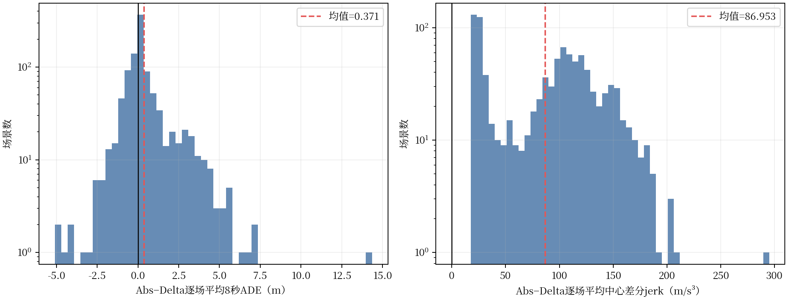
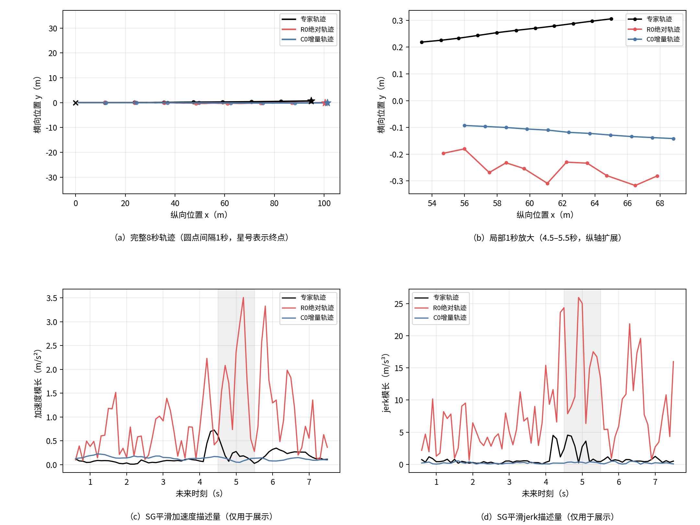
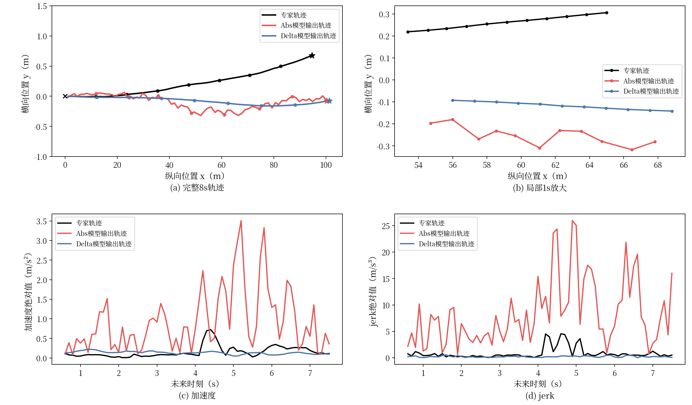
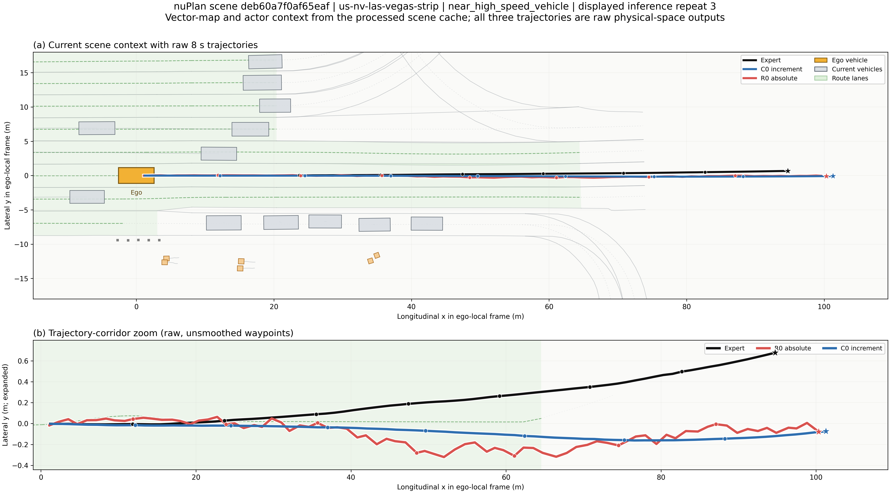
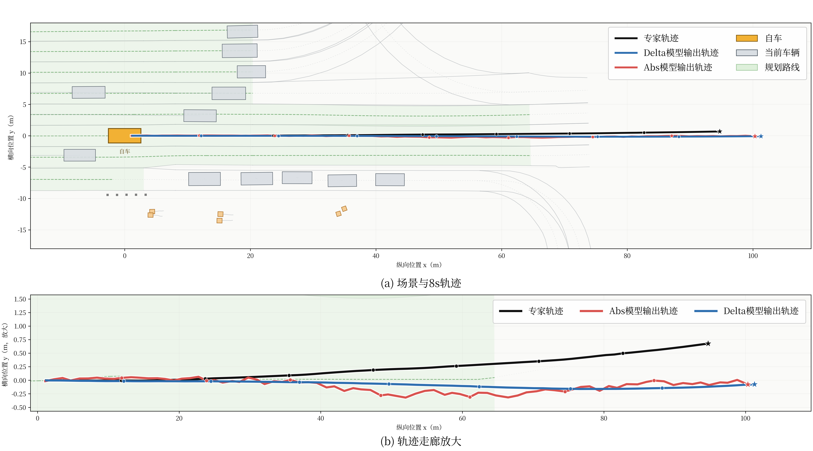

# EXP-CH3-R0/C0：绝对位置与增量轨迹表示配对实验分析（运动学重新计算）

> 分析时间：10月03日 15:20（北京时间）  
> 当前状态：R0/C0训练身份核对、validation-1000三次公共随机数评测、逐场配对统计、日志聚类bootstrap和轨迹可视化均已完成。  
> 结论层级：开发验证集上的轨迹表示受控实验；尚未执行R0闭环评测。  
> 运动学重算：10月03日 20:44（北京时间），采用仅基于物理空间XY位置的标准中心有限差分；原始分析文件和原始图未覆盖。

## 1. 科学问题

在保持HDP架构、训练数据、初始化、优化超参数和扩散参数化基本一致的条件下，扩散状态中的XY通道应直接表示ego-local绝对waypoint，还是表示相邻未来帧之间的位移增量？重点检验：

1. 两种表示如何影响1、3、5和8秒位置误差；
2. 增量表示是否提供局部连续性归纳偏置；
3. 两种表示的差异是普遍小幅变化，还是由少数尾部场景主导；
4. 开环结果是否足以支持进入闭环评测。

## 2. 实验臂与控制变量

| 属性 | R0 | C0 |
|---|---|---|
| 模型 | HDP | HDP |
| XY扩散状态 | ego-local绝对waypoint | 相邻帧位移增量 |
| 航向通道 | `cos(yaw), sin(yaw)` | `cos(yaw), sin(yaw)` |
| diffusion model/supervision | `x_start -> x_start` | `x_start -> x_start` |
| Hybrid Loss | 0 | 0 |
| detach window | 0 | 0 |
| 训练数据 | 306,801 NPZ、44 logs | 同左 |
| seed | 3407 | 3407 |
| 初始学习率 | `5e-5` | `5e-5` |
| Encoder冻结 | Epoch 1～3 | Epoch 1～3 |
| 训练轮数 | 10 | 10 |
| 初始化model SHA256 | `0df19230...26586` | 相同 |
| 目标normalizer | mean=`[10,0,0,0]`, std=`[20,20,1,1]` | mean=`[0,0,0,0]`, std=`[0.5,0.5,1,1]` |

不同目标normalizer是两种物理表示的必要组成部分，不是意外混杂：绝对位置与逐帧位移具有不同量纲分布。R0在Epoch 5后曾从完整checkpoint恢复；模型、EMA、优化器、scheduler和epoch均恢复，但checkpoint不包含Python/NumPy/PyTorch RNG状态。因此本实验具有相同初始化和高度一致的训练协议，但不能声称Epoch 6～10与C0使用了逐batch完全相同的增强及扩散噪声序列。

## 3. 正确性审计

代码和运行产物核对结果如下：

- 训练目标先由物理空间轨迹通过`encode_trajectory_representation`转换；R0保持绝对XY，C0执行一次相邻帧差分；
- R0使用仓库根目录绝对轨迹normalizer，C0使用HDP增量normalizer；
- 采样后两者均先执行各自normalizer的inverse；R0直接输出绝对waypoint，C0只执行一次`cumsum`；
- 开环指标统一接收物理空间`[x,y,cos(yaw),sin(yaw)]`，没有对R0漏积分或对C0重复积分；
- 两模型均从EMA权重推理；
- Epoch 10 checkpoint审计通过，R0 checkpoint SHA256为`0f434302...1e33`；
- 1000个场景、3次重复、每模型3000个观测全部完成，场景顺序和采样seed相同；
- 所有预测和指标均为有限值。

因此当前未发现能够解释R0异常运动学数值的评测实现错误。

## 4. validation-1000配对开环结果

误差指标均为越低越好。区间采用10个nuPlan日志为聚类单元，对每个日志的逐场配对差`R0-C0`执行10,000次有放回bootstrap；区间完全大于0表示R0误差较高。

| 指标 | R0 | C0 | R0-C0 | 日志聚类95%区间 |
|---|---:|---:|---:|---:|
| 1s ADE (m) | 0.127480 | **0.112250** | +0.015230 | [+0.004478, +0.026173] |
| 1s FDE (m) | **0.248706** | 0.249811 | -0.001105 | [-0.030181, +0.029848] |
| 3s ADE (m) | 0.560137 | **0.533223** | +0.026914 | [-0.016982, +0.066708] |
| 3s FDE (m) | 1.313629 | **1.215244** | +0.098386 | [-0.007240, +0.231415] |
| 5s ADE (m) | 1.177455 | **1.044908** | +0.132547 | [+0.020584, +0.301398] |
| 5s FDE (m) | 2.894549 | **2.408967** | +0.485582 | [+0.085150, +1.141198] |
| 8s ADE (m) | 2.446007 | **2.075229** | +0.370778 | [+0.060406, +0.889177] |
| 8s FDE (m) | 6.387174 | **5.364922** | +1.022252 | [+0.123884, +2.505094] |
| heading MAE (rad) | 0.033568 | **0.029027** | +0.004541 | [-0.000359, +0.010305] |
| heading FDE (rad) | 0.062327 | **0.058680** | +0.003647 | [-0.002297, +0.012194] |

主要数值关系：

- 相对R0，C0的5秒ADE/FDE分别低11.26%和16.77%；
- 相对R0，C0的8秒ADE/FDE分别低15.16%和16.00%；
- 1秒FDE均值几乎相同，聚类区间跨0；
- 5秒和8秒位置误差差值的聚类区间均未跨0，支持C0在该开发集上的长时平均误差优势。


## 5. 平均值与逐场胜率并不等价

本节图中的每个样本现在严格对应一个场景：先对同一场景的3次公共随机数推理结果求均值，再统计1000个场景的配对差。横轴均定义为`R0-C0`，正值表示R0指标更高、C0更好；黑线为0，红色虚线为1000个逐场差值的均值，纵轴采用对数刻度。

在1000个场景中，R0的8秒ADE低于C0的比例为49.00%，8秒FDE低于C0的比例也为49.00%，均接近一半。然而R0的8秒ADE/FDE均值分别高0.370778 m和1.022252 m；逐场差值P90分别为2.274785 m和6.264916 m。

这说明结果不能解释成“R0在绝大多数场景都产生更大的位置误差”。更准确的解释是：

> 两种方案在约半数场景中各有位置误差优势，但R0绝对位置方案具有更重的负向尾部，少数大幅退化使长时域平均误差显著升高。

最大R0退化场景`us-nv-las-vegas-strip_ba2d0b67e51458f5`中，三次重复平均8秒ADE从C0的3.682457 m升至R0的18.048067 m，FDE从5.780770 m升至46.074871 m。另一方面，在`us-nv-las-vegas-strip_4f2d18d75fe45c1b`中，R0的8秒FDE低于C0约14.958 m，说明绝对表示并非对所有场景都更差。

新图左侧为逐场8秒ADE差值；右侧改为按本文件第6节标准中心差分重新计算的逐场平均jerk代理差值。右侧全部位于0以上，其统计解释见第6节。




## 6. 局部连续性与运动学描述量（标准中心差分重算）

### 6.1 计算定义

本次重新计算仅使用采样间隔为`dt=0.1 s`的物理空间XY轨迹，不使用`yaw_rad`、`cos_yaw`或`sin_yaw`。对于内部时刻，直接从位置计算与时刻对齐的标准中心有限差分：

```text
velocity[i]     = (p[i+1] - p[i-1]) / (2 dt)
acceleration[i] = (p[i+1] - 2 p[i] + p[i-1]) / dt²
jerk[i]         = (p[i+2] - 2 p[i+1] + 2 p[i-1] - p[i-2]) / (2 dt³)
```

每一级均先计算二维向量，再取欧氏模长并沿有效时间点平均。速度和加速度使用第2～79个未来点，jerk使用第3～78个未来点；缺少完整中心差分模板的端点不参与均值，不使用单边外推，也不接入当前车辆速度或加速度。这样避免端点近似影响模型间比较。

### 6.2 中心差分运动学代理结果

| 描述量 | Expert | R0 | C0 | R0-C0 | 日志聚类95%区间 |
|---|---:|---:|---:|---:|---:|
| 平均速度 (m/s) | 3.500273 | 3.748068 | 3.566982 | +0.181086 | [+0.075161, +0.365833] |
| 平均加速度代理 (m/s²) | 0.630603 | 13.482404 | **0.447333** | +13.035071 | [+10.263505, +15.804914] |
| 平均jerk代理 (m/s³) | 3.295453 | 88.709230 | **1.755931** | +86.953299 | [+67.886721, +106.387049] |

区间仍以10个nuPlan日志为聚类单元，对每个日志的逐场配对差`R0-C0`执行10,000次有放回bootstrap。三个指标的区间均完全大于0。R0加速度代理约为C0的30.14倍，中心差分jerk代理约为C0的50.52倍。C0与专家轨迹处于相近数量级，而R0明显偏高。

全部3000个场景—重复配对观测中，R0的平均加速度代理和中心差分jerk代理均高于C0；先对3次重复求均值后，1000个场景的差值也全部为正。因此差异不是由少数离群场景或端点近似造成。

### 6.3 与原计算方法的差异

| 指标 | 原相邻点逐级差分：R0/C0 | 新标准中心差分：R0/C0 | 变化解释 |
|---|---:|---:|---|
| 平均速度 (m/s) | 3.837037 / 3.568140 | 3.748068 / 3.566982 | 中心速度与时刻对齐，并排除首尾点 |
| 平均加速度代理 (m/s²) | 13.344954 / 0.462158 | 13.482404 / 0.447333 | 直接三点二阶中心差分，结论基本不变 |
| 平均jerk代理 (m/s³) | 240.200211 / 4.467034 | 88.709230 / 1.755931 | 五点三阶中心差分会抑制部分最高频交替变化，绝对值明显降低 |

jerk数值对差分模板敏感，原方法不应与新方法混用。新方法降低了两模型的jerk绝对量级，但没有改变模型排序、配对方向或结论：R0在全部配对观测中仍具有更高的中心差分jerk代理。

### 6.4 相邻航点粗糙度

为防止中心差分过滤最高频交替抖动，同时报告不带时间尺度放大的原始位置差分：

| 原始离散粗糙度 | Expert | R0 | C0 | R0-C0 | 日志聚类95%区间 |
|---|---:|---:|---:|---:|---:|
| 平均二阶位置差分模长 (m) | 0.006306 | 0.134824 | **0.004473** | +0.130351 | [+0.102635, +0.158049] |
| 平均三阶位置差分模长 (m) | 0.008332 | 0.244945 | **0.004172** | +0.240772 | [+0.189743, +0.291537] |

二阶差分直接描述相邻位移向量变化，三阶差分描述该变化在相邻采样间的再次变化。两项中R0在全部配对观测中均高于C0，说明中心差分jerk下降不是因为R0原始轨迹已经平滑，而是差分模板对高频分量的响应不同。

为避免同时展示过多极端案例，定性图只保留一个按预先定义规则选择的代表性动态场景：先限制专家8秒终点距离不小于10 m，共511个场景；再选择逐场中心jerk差最接近该子集P90的场景，而不是最大异常值。最终场景为`us-nv-las-vegas-strip_deb60a7f0af65eaf`，专家终点距离94.725079 m，三次重复平均中心jerk为R0 149.160092 m/s³、C0 2.380874 m/s³，差值146.779217 m/s³。图中展示与三次重复平均差最接近的第3次真实采样轨迹，不对三条随机轨迹取平均。

复合图左上给出完整8秒XY轨迹，圆点间隔1秒、星号为终点；右上放大R0与C0二阶位置差异最明显的4.5～5.5秒区间，并明确扩大纵轴尺度。为避免原始10 Hz位置噪声主导案例图纵轴，下方两幅曲线仅在可视化时采用11点窗口、3阶局部多项式的Savitzky–Golay导数估计。该平滑只作用于本图下方两条运动学曲线，不改变本节中心差分统计表、逐场分布、场景选择或任何定量结论；上方轨迹和航点仍为未经平滑的原始预测。





**结果分析：** 两种表示在全局8秒轨迹上大致重合，但局部放大后差异明显：Abs轨迹存在高频横向波动，并引起更大的加速度和jerk峰值；Delta轨迹更平滑。该案例说明增量表示对动态连续性更有利，但不能单独证明其轨迹精度更高。

下图为同一场景的高清俯视实况图。它基于该nuPlan样本的处理缓存绘制，而不是相机照片：上半部分包含真实矢量道路、规划路线、当前自车、周边车辆/行人及其过去观测轨迹，并叠加未经平滑的Expert、C0和R0未来8秒轨迹；下半部分扩大横向坐标，以便区分全局视图中高度重合的三条轨迹。圆点间隔1秒，星号为各轨迹终点，仍使用与上一图相同的第3次真实推理。





**结果分析：** 两个模型均生成了沿规划路线向前的轨迹，但都未完全跟随专家轨迹逐渐增大的横向偏移，且终点纵向位置更远。走廊放大图进一步显示，Delta偏移连续而Abs存在明显局部振荡，与上图的运动学结果一致；但静态俯视图不能替代闭环碰撞与安全性评测。

### 6.5 按专家终点位移分层

| 专家8秒终点位移 | 场景数 | R0中心jerk | C0中心jerk | R0-C0 |
|---|---:|---:|---:|---:|
| `<1 m` | 434 | 55.114941 | 0.981671 | +54.133270 |
| `1～10 m` | 55 | 93.887600 | 1.789915 | +92.097685 |
| `10～30 m` | 113 | 107.305925 | 2.313025 | +104.992900 |
| `>=30 m` | 398 | 119.346628 | 2.437359 | +116.909270 |

四个运动距离区间中的R0-C0均为正，说明重新计算后的差异同时存在于静止/微动和长距离运动场景。

综合中心差分、相邻航点粗糙度、专家轨迹参照和分层结果，可以支持的机制解释是：绝对waypoint方案的每个时间点可以产生相对独立的位置误差；增量方案则对相邻位移建立更直接的结构联系。该解释与当前数值和可视化一致，但由于两组实验还使用了各自匹配的目标normalizer，不能把全部差异严格归因于轨迹表示本身，也不能上升为对所有模型和数据集成立的理论结论。

## 7. 当前可以写入第三章的结论

> 在统一HDP架构、相同训练数据、相同初始化指纹和一致主要优化协议下，采用相邻帧位移增量作为扩散状态，相比直接生成绝对waypoint，在validation-1000开发集上获得了更低的5～8秒ADE/FDE，并在标准中心有限差分下显著降低了加速度与jerk代理。逐场分析表明，两种表示在长时位置误差上的胜率接近，但绝对位置表示出现更重的负向尾部，同时在全部配对观测中表现出更高的中心差分运动学代理和相邻航点粗糙度。这说明增量表示的主要价值不仅是降低平均位置误差，更在于向生成过程引入相邻时刻运动连续性的结构先验。

这个结果补上了此前DP/B10系统比较无法提供的轨迹表示证据，并支持第三章选择增量表示作为B10和后续RL后训练的统一策略输出空间。

## 8. 不能写出的结论

当前结果不能用于声称：

1. 增量表示在所有数据集、所有模型或所有闭环指标上必然优于绝对表示；
2. 标准中心有限差分加速度/jerk代理等同于nuPlan官方comfort、车辆真实执行量或硬动力学可行性；
3. C0与R0的后五轮具有逐batch相同随机轨迹；
4. R0一定会在safety40上发生碰撞或取得更低综合分；
5. Hybrid Loss改善了增量表示的长时积分漂移——R0/C0均未启用Hybrid Loss；
6. 三次推理重复等同于三个独立训练seed。

## 9. 是否立即执行R0 safety40

当前不建议把R0 safety40列为第一优先级。原因是：

- 轨迹表示问题已经由1000场景、三次重复、逐场配对、日志聚类区间和可视化形成闭环；
- R0存在普遍的高频运动学波动，直接进入闭环主要可能再次证明它不是合适基础策略；
- 第三章已有C0/B10 safety40用于建立“开环改善不保证闭环安全”的核心认识；
- 当前更有价值的是把本结果纳入第三章，再继续分析Hybrid准消融和开环—闭环错位。

若最终论文需要回答“轨迹表示是否影响官方闭环comfort”，再在冻结safety40上补做R0即可，不应根据新结果更换场景。

## 10. 证据文件

- 三模型三次重复汇总：[open_loop_summary.md](../../../../tmp/chapter3_representation_ablation_v1/post_r0/open_loop_summary.md)
- R0审计：[r0_checkpoint_audit.json](../../../../tmp/chapter3_representation_ablation_v1/post_r0/r0_checkpoint_audit.json)
- 原始逐场统计：[analysis_summary.json](../../../../tmp/chapter3_representation_ablation_v1/paired_diagnostics/analysis_summary.json)，SHA256 `2d7055f5...d988a`
- 中心差分重算统计：[centered_kinematics_summary.json](../../../../tmp/chapter3_representation_ablation_v1/paired_diagnostics_centered/centered_kinematics_summary.json)，SHA256 `607f2f03...53a5`
- 逐场轨迹和指标：[paired_per_scene_data.npz](../../../../tmp/chapter3_representation_ablation_v1/paired_diagnostics/paired_per_scene_data.npz)，SHA256 `92ff3360...9cb6`
- 原分析脚本：[analyze_chapter3_representation_ablation.py](../../../../scripts/analyze_chapter3_representation_ablation.py)
- 中心差分重算脚本：[recalculate_chapter3_kinematics_centered.py](../../../../scripts/recalculate_chapter3_kinematics_centered.py)
