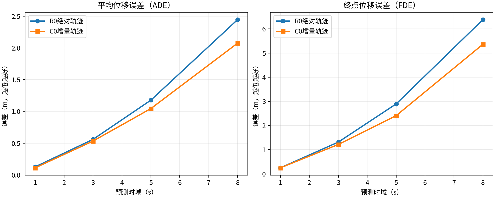
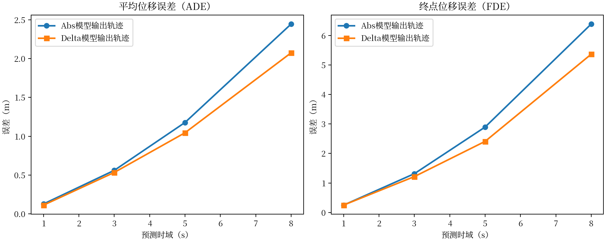
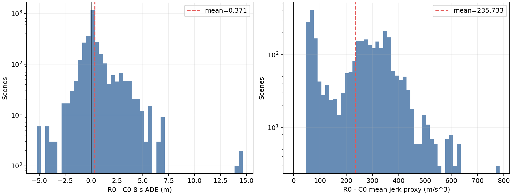
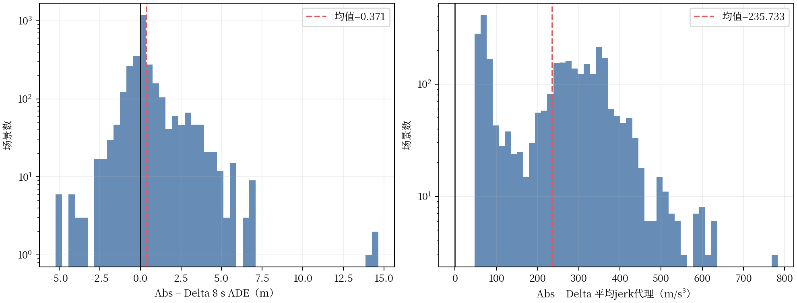
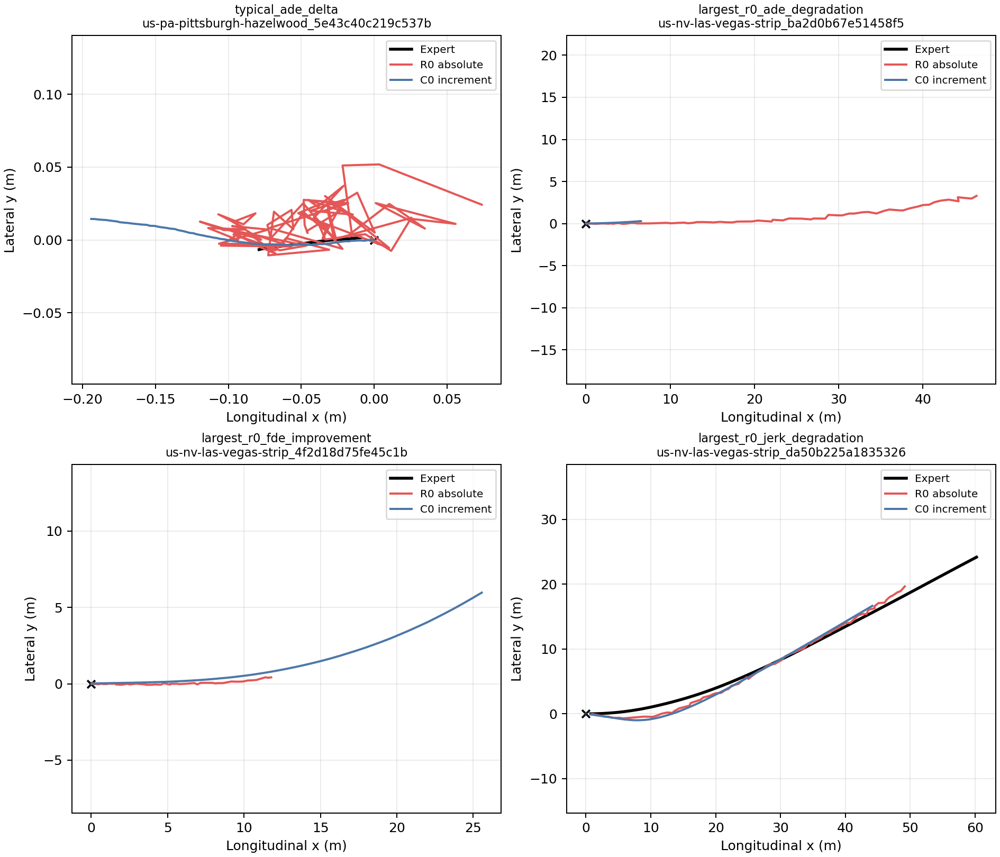
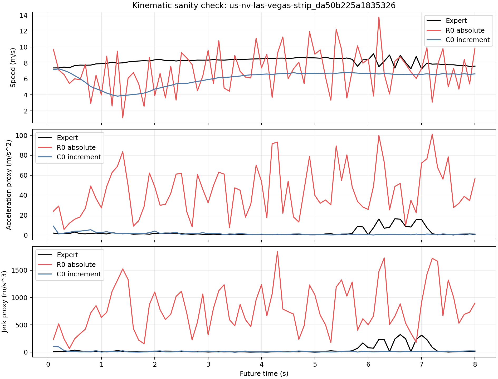

# EXP-CH3-R0/C0：绝对位置与增量轨迹表示配对实验分析

> 分析时间：10月03日 15:20（北京时间）  
> 当前状态：R0/C0训练身份核对、validation-1000三次公共随机数评测、逐场配对统计、日志聚类bootstrap和轨迹可视化均已完成。  
> 结论层级：开发验证集上的轨迹表示受控实验；尚未执行R0闭环评测。

## 1. 科学问题

在保持HDP架构、训练数据、初始化、优化超参数和扩散参数化基本一致的条件下，扩散状态中的XY通道应直接表示ego-local绝对waypoint，还是表示相邻未来帧之间的位移增量？重点检验：

1. 两种表示如何影响1、3、5和8秒位置误差；
2. 增量表示是否提供局部连续性归纳偏置；
3. 两种表示的差异是普遍小幅变化，还是由少数尾部场景主导；
4. 开环结果是否足以支持进入闭环评测。

## 2. 实验臂与控制变量

| 属性 | R0 | C0 |
|---|---|---|
| 模型 | HDP | HDP |
| XY扩散状态 | ego-local绝对waypoint | 相邻帧位移增量 |
| 航向通道 | `cos(yaw), sin(yaw)` | `cos(yaw), sin(yaw)` |
| diffusion model/supervision | `x_start -> x_start` | `x_start -> x_start` |
| Hybrid Loss | 0 | 0 |
| detach window | 0 | 0 |
| 训练数据 | 306,801 NPZ、44 logs | 同左 |
| seed | 3407 | 3407 |
| 初始学习率 | `5e-5` | `5e-5` |
| Encoder冻结 | Epoch 1～3 | Epoch 1～3 |
| 训练轮数 | 10 | 10 |
| 初始化model SHA256 | `0df19230...26586` | 相同 |
| 目标normalizer | mean=`[10,0,0,0]`, std=`[20,20,1,1]` | mean=`[0,0,0,0]`, std=`[0.5,0.5,1,1]` |

不同目标normalizer是两种物理表示的必要组成部分，不是意外混杂：绝对位置与逐帧位移具有不同量纲分布。R0在Epoch 5后曾从完整checkpoint恢复；模型、EMA、优化器、scheduler和epoch均恢复，但checkpoint不包含Python/NumPy/PyTorch RNG状态。因此本实验具有相同初始化和高度一致的训练协议，但不能声称Epoch 6～10与C0使用了逐batch完全相同的增强及扩散噪声序列。

## 3. 正确性审计

代码和运行产物核对结果如下：

- 训练目标先由物理空间轨迹通过`encode_trajectory_representation`转换；R0保持绝对XY，C0执行一次相邻帧差分；
- R0使用仓库根目录绝对轨迹normalizer，C0使用HDP增量normalizer；
- 采样后两者均先执行各自normalizer的inverse；R0直接输出绝对waypoint，C0只执行一次`cumsum`；
- 开环指标统一接收物理空间`[x,y,cos(yaw),sin(yaw)]`，没有对R0漏积分或对C0重复积分；
- 两模型均从EMA权重推理；
- Epoch 10 checkpoint审计通过，R0 checkpoint SHA256为`0f434302...1e33`；
- 1000个场景、3次重复、每模型3000个观测全部完成，场景顺序和采样seed相同；
- 所有预测和指标均为有限值。

因此当前未发现能够解释R0异常运动学数值的评测实现错误。

## 4. validation-1000配对开环结果

误差指标均为越低越好。区间采用10个nuPlan日志为聚类单元，对每个日志的逐场配对差`R0-C0`执行10,000次有放回bootstrap；区间完全大于0表示R0误差较高。

| 指标 | R0 | C0 | R0-C0 | 日志聚类95%区间 |
|---|---:|---:|---:|---:|
| 1s ADE (m) | 0.127480 | **0.112250** | +0.015230 | [+0.004478, +0.026173] |
| 1s FDE (m) | **0.248706** | 0.249811 | -0.001105 | [-0.030181, +0.029848] |
| 3s ADE (m) | 0.560137 | **0.533223** | +0.026914 | [-0.016982, +0.066708] |
| 3s FDE (m) | 1.313629 | **1.215244** | +0.098386 | [-0.007240, +0.231415] |
| 5s ADE (m) | 1.177455 | **1.044908** | +0.132547 | [+0.020584, +0.301398] |
| 5s FDE (m) | 2.894549 | **2.408967** | +0.485582 | [+0.085150, +1.141198] |
| 8s ADE (m) | 2.446007 | **2.075229** | +0.370778 | [+0.060406, +0.889177] |
| 8s FDE (m) | 6.387174 | **5.364922** | +1.022252 | [+0.123884, +2.505094] |
| heading MAE (rad) | 0.033568 | **0.029027** | +0.004541 | [-0.000359, +0.010305] |
| heading FDE (rad) | 0.062327 | **0.058680** | +0.003647 | [-0.002297, +0.012194] |

主要数值关系：

- 相对R0，C0的5秒ADE/FDE分别低11.26%和16.77%；
- 相对R0，C0的8秒ADE/FDE分别低15.16%和16.00%；
- 1秒FDE均值几乎相同，聚类区间跨0；
- 5秒和8秒位置误差差值的聚类区间均未跨0，支持C0在该开发集上的长时平均误差优势。

## 5. 平均值与逐场胜率并不等价

在3000个场景—重复配对观测中，R0的8秒ADE低于C0的比例为49.03%，8秒FDE低于C0的比例为48.97%，均接近一半。然而R0的8秒ADE/FDE均值分别高0.370778 m和1.022252 m；其差值P90分别达到2.307804 m和6.373987 m。

这说明结果不能解释成“R0在绝大多数场景都产生更大的位置误差”。更准确的解释是：

> 两种表示在约半数场景中各有位置误差优势，但R0绝对位置表示具有更重的负向尾部，少数大幅退化使长时域平均误差显著升高。

最大R0退化场景`us-nv-las-vegas-strip_ba2d0b67e51458f5`中，三次重复平均8秒ADE从C0的3.682457 m升至R0的18.048067 m，FDE从5.780770 m升至46.074871 m。另一方面，在`us-nv-las-vegas-strip_4f2d18d75fe45c1b`中，R0的8秒FDE低于C0约14.958 m，说明绝对表示并非对所有场景都更差。

## 6. 局部连续性与运动学描述量

| 描述量 | R0 | C0 | R0-C0 | 日志聚类95%区间 |
|---|---:|---:|---:|---:|
| 平均速度 (m/s) | 3.837037 | 3.568140 | +0.268897 | [+0.152611, +0.468457] |
| 平均加速度代理 (m/s²) | 13.344954 | **0.462158** | +12.882795 | [+10.158610, +15.610588] |
| 平均jerk代理 (m/s³) | 240.200211 | **4.467034** | +235.733170 | [+185.952098, +285.197386] |

R0加速度代理约为C0的28.88倍，jerk代理约为53.77倍。更重要的是，全部3000个配对观测中，R0的平均加速度和平均jerk均高于C0，不是由单一离群场景造成。轨迹可视化显示，R0生成点沿总体路线方向前进，但相邻点存在明显前后或横向锯齿；C0的位移序列更连续。

按专家轨迹8秒终点位移分层后，R0-C0平均jerk差在四个区间均为正：

| 专家终点位移 | 场景数 | R0 jerk | C0 jerk | R0-C0 |
|---|---:|---:|---:|---:|
| `<1 m` | 434 | 146.038 | 2.313 | +143.724 |
| `1～10 m` | 55 | 260.088 | 4.464 | +255.624 |
| `10～30 m` | 113 | 289.997 | 5.803 | +284.195 |
| `>=30 m` | 398 | 325.993 | 6.437 | +319.557 |

因此高频抖动同时存在于静止/微动和长距离运动场景。合理的机制解释是：绝对waypoint的每个时间点可以独立产生小位置误差，经过0.1秒有限差分后会放大为速度、加速度和jerk波动；增量表示直接约束相邻帧位移，提供了局部连续性归纳偏置。该解释与数值和可视化一致，但不能上升为对所有网络和数据集都成立的理论定理。

## 7. 当前可以写入第三章的结论

> 在统一HDP架构、相同训练数据、相同初始化指纹和一致主要优化协议下，采用相邻帧位移增量作为扩散状态，相比直接生成绝对waypoint，在validation-1000开发集上获得了更低的5～8秒ADE/FDE，并显著降低了有限差分加速度与jerk。逐场分析表明，两种表示在长时位置误差上的胜率接近，但绝对位置表示出现更重的负向尾部，同时在全部配对观测中表现出更高的局部运动波动。这说明增量表示的主要价值不仅是降低平均位置误差，更在于向生成过程引入相邻时刻运动连续性的结构先验。

这个结果补上了此前DP/B10系统比较无法提供的轨迹表示证据，并支持第三章选择增量表示作为B10和后续RL后训练的统一策略输出空间。

## 8. 不能写出的结论

当前结果不能用于声称：

1. 增量表示在所有数据集、所有模型或所有闭环指标上必然优于绝对表示；
2. 有限差分加速度/jerk等同于nuPlan官方comfort或硬动力学可行性；
3. C0与R0的后五轮具有逐batch相同随机轨迹；
4. R0一定会在safety40上发生碰撞或取得更低综合分；
5. Hybrid Loss改善了增量表示的长时积分漂移——R0/C0均未启用Hybrid Loss；
6. 三次推理重复等同于三个独立训练seed。

## 9. 是否立即执行R0 safety40

当前不建议把R0 safety40列为第一优先级。原因是：

- 轨迹表示问题已经由1000场景、三次重复、逐场配对、日志聚类区间和可视化形成闭环；
- R0存在普遍的高频运动学波动，直接进入闭环主要可能再次证明它不是合适基础策略；
- 第三章已有C0/B10 safety40用于建立“开环改善不保证闭环安全”的核心认识；
- 当前更有价值的是把本结果纳入第三章，再继续分析Hybrid准消融和开环—闭环错位。

若最终论文需要回答“轨迹表示是否影响官方闭环comfort”，再在冻结safety40上补做R0即可，不应根据新结果更换场景。

## 10. 证据文件

- 三模型三次重复汇总：[open_loop_summary.md](../../../../tmp/chapter3_representation_ablation_v1/post_r0/open_loop_summary.md)
- R0审计：[r0_checkpoint_audit.json](../../../../tmp/chapter3_representation_ablation_v1/post_r0/r0_checkpoint_audit.json)
- 本次逐场统计：[analysis_summary.json](../../../../tmp/chapter3_representation_ablation_v1/paired_diagnostics/analysis_summary.json)，SHA256 `2d7055f5...d988a`
- 逐场轨迹和指标：[paired_per_scene_data.npz](../../../../tmp/chapter3_representation_ablation_v1/paired_diagnostics/paired_per_scene_data.npz)，SHA256 `92ff3360...9cb6`
- 分析脚本：[analyze_chapter3_representation_ablation.py](../../../../scripts/analyze_chapter3_representation_ablation.py)
