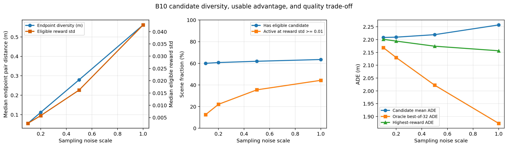

# 第四章：B10多候选分布质量与有效优势信号诊断

> 建立时间：10月03日21时  
> 实验性质：只读推理诊断，不更新模型参数  
> 当前阶段：先执行100场景、10日志均衡的噪声尺度试验，通过后扩展到validation-1000

## 1. 本实验回答的问题

第四章的后训练链路为“同场景多候选采样—轨迹级奖励—组内优势—奖励加权扩散更新”。本实验先验证其必要前提：B10能否生成有差异、有效且至少部分安全的候选，以及当前奖励能否在候选组内产生强度足够的排序信号。

## 2. 历史事实

此前早期10k监督模型在`group=4、steps=5、noise=0.1`下，组内reward标准差中位数仅为`0.007111`，终点两两距离中位数仅为`0.098388 m`。将noise提高至`0.2`后，两者分别提高到`0.014335`和`0.197904 m`。因此“候选差异很小”是已有真实观察，但该结果不是当前完整数据B10、也不是正式`group=32、steps=6`协议，必须重新测量。

## 3. 原因假设

1. 当前采样入口把标准正态初始状态乘以`noise_scale=0.1`；对于以标准正态先验为起点的VP-SDE/DPM采样，这会显著压缩初始潜变量差异。
2. B10采用单专家监督、`x_start`回归和MSE类目标，没有显式多模态标签或多样性目标，条件去噪容易收敛到较窄的条件轨迹分布。
3. 路线和场景条件本身会强约束轨迹；在简单、近单模态场景中，多条样本趋同不一定是实现错误。
4. 增加group size只能提高观察到尾部样本的概率，不会自动增大单对候选之间的分布宽度。
5. 旧实验只用终点距离描述几何差异，可能漏掉中间时域差异；新实验同时报告整轨迹两两距离、纵向和横向终点方差。
6. 奖励由连续代理量构成；轨迹差异很小时，reward差异自然更小。若再按极小组内标准差归一化，会把弱差异放大成看似显著的advantage。
7. 历史5步与10步结果方向一致，说明采样步数不是首要嫌疑；本轮先固定正式6步，只控制初始噪声尺度。

## 4. 受控实验设计

- 模型：完整训练B10 Epoch10，优先加载EMA；
- 候选数：32；
- 扩散步数：6；
- 初始噪声尺度：`0.1/0.2/0.5/1.0`；
- 公共随机数：四个尺度复用相同标准正态底噪声，仅改变乘法尺度；
- 奖励与安全资格：复用M4安全参考后训练的正式参数；
- Pilot数据：validation-1000中按10个日志各取10场，共100场；
- Full数据：Pilot确认无实现或显存问题后运行完整validation-1000。

核心指标包括候选终点及整轨迹两两距离、reward全组/安全集合标准差、合格候选比例、无合格候选组比例、有效优势组比例、无碰撞与可行驶区域比例、best-of-32相对组均值及单候选的reward增益，以及reward-progress相关性。

## 5. 判定原则

- 若`noise=0.1`仍表现为低几何差异和低reward方差，而提高noise近似单调增大两者，则历史问题主要来自探索尺度不足。
- 若提高noise只增加几何差异，却降低安全合格比例，说明不能用无限增噪解决探索，后续需要安全感知或结构化候选生成。
- 若几何差异充足但安全集合内reward标准差仍很小，瓶颈转向奖励分辨率或安全门后的有效候选数量。
- 若`argmax reward`候选经常不合格，则标量reward排序与安全约束冲突，直接构成第五章安全约束后训练的实验动机。
- 本实验不使用轨迹增强作为正式结论，因为整条轨迹平移会人为制造多样性，不能证明B10自身的生成分布具有多样性。

## 6. validation-1000正式结果（10月03日21时24分）

完整实验处理1000个开发验证场景；每个噪声尺度生成32,000条轨迹，四个尺度共生成128,000条轨迹。全部候选均为有限值，运行过程无失败。四个尺度复用相同底噪声，因而下面的变化主要反映`noise_scale`的作用。

### 6.1 候选差异与有效优势信号

| noise | 终点两两距离P50/m | 整轨迹两两距离P50/m | 安全集reward std P50 | 有安全候选组 | 当前阈值`1e-6`有效组 | 较稳健阈值`0.01`有效组 |
|---:|---:|---:|---:|---:|---:|---:|
| 0.1 | 0.055530 | 0.025200 | 0.000166 | 60.0% | 56.8% | 12.6% |
| 0.2 | 0.112021 | 0.050084 | 0.000386 | 60.7% | 58.2% | 22.1% |
| 0.5 | 0.279462 | 0.124225 | 0.001183 | 61.9% | 60.2% | 35.5% |
| 1.0 | 0.561602 | 0.238900 | 0.004124 | 63.5% | 62.4% | 44.3% |

`noise=0.1`下，候选终点两两距离中位数只有5.6厘米，整条8秒轨迹逐时刻两两距离中位数只有2.5厘米。若只考察至少有2条合格候选的596个场景，安全集合reward标准差中位数为`0.002649`，仍明显低于`0.01`。因此“同一场景候选差异非常小”在当前完整数据B10和正式32候选配置上得到确认。

几何差异随噪声尺度近似成比例增加，说明初始潜变量缩放是主要原因，而不是group维实现错误。当前后训练配置把`rl_min_reward_std`设为`1e-6`，导致大量reward差异很弱的组仍被视为有效；按`0.01`衡量，正式`noise=0.1`下只有12.6%的场景具有较明确的安全集合内部排序信号。

### 6.2 安全覆盖呈场景级二极化

| noise | 无安全候选组 | 全部32条均安全合格组 | 混合安全/不安全组 | 无碰撞候选比例 | TTC合格候选比例 |
|---:|---:|---:|---:|---:|---:|
| 0.1 | 400 | 589 | 11 | 92.47% | 61.24% |
| 0.2 | 393 | 585 | 22 | 92.50% | 61.28% |
| 0.5 | 381 | 571 | 48 | 92.51% | 61.22% |
| 1.0 | 365 | 548 | 87 | 92.38% | 60.97% |

正式配置下400个场景没有任何合格候选，其中382个场景连一条TTC合格候选都没有；另一方面，589个场景的32条候选全部合格，只有11个场景真正形成安全与不安全候选并存的边界。即使把噪声扩大10倍，仍有365个场景在所有尺度下持续没有合格候选。

这说明当前安全资格更多表现为场景级“全有或全无”，而不是候选级可学习排序。`group_size=32`只能更密集地采样同一窄分布，无法解决其支持集没有安全轨迹的问题。

进一步按专家8秒路径长度分层：449个静止/微动场景（不超过2 m）在`noise=0.1`下有安全候选的比例为74.39%，551个运动场景仅为48.28%。无安全候选组的专家路径长度中位数为26.20 m，而有安全候选组仅为0.04 m。当前合格覆盖明显偏向容易的静止场景，真正运动和交互场景仍是主要缺口。

### 6.3 多样性与轨迹质量的权衡

| noise | 候选平均ADE/m | 单候选ADE/m | Oracle best-of-32 ADE/m | 最高reward候选ADE/m |
|---:|---:|---:|---:|---:|
| 0.1 | 2.208324 | 2.207712 | 2.168482 | 2.201193 |
| 0.2 | 2.209528 | 2.208274 | 2.129990 | 2.194123 |
| 0.5 | 2.219198 | 2.215631 | 2.022314 | 2.174282 |
| 1.0 | 2.257206 | 2.247227 | 1.873353 | 2.156449 |

增大噪声使候选平均ADE略有恶化：`noise=1.0`相对`0.1`增加`0.048883 m`。但更宽的候选集合显著改善oracle best-of-32 ADE，平均降低`0.295128 m`；当前代理reward选择的最高分候选ADE也平均降低`0.044743 m`。这说明B10在更大噪声下确实能覆盖更好的轨迹，但奖励选择只回收了部分潜在收益。

在`noise=0.1`且存在至少2条合格候选的场景中，reward-progress相关系数中位数为`0.946234`，最高reward相对组均值的reward增益中位数仅`0.005086`。奖励排序大多沿进度方向变化，但正式采样尺度下信号幅度很弱。

## 7. 原因结论

当前“多候选差异小”不是单一实现错误，而是三层因素叠加：

1. **首要直接原因：**`noise_scale=0.1`把DPM初始潜变量差异压缩了10倍；噪声尺度实验已给出近似线性的几何响应。
2. **模型与数据原因：**单专家、MSE式`x_start`监督和强场景/路线条件形成较窄的条件分布，静止场景尤其接近确定性输出。
3. **任务支持集原因：**约36.5%场景即使在`noise=1.0`下仍没有安全合格候选，说明单纯增噪不能把原本不在模型支持集中的安全高质量行为创造出来。

此外，当前`rl_min_reward_std=1e-6`会允许非常弱的差异进入组内标准化和策略更新。它不能制造真实信息，只会把微小reward差异放大成相似量级的标准化advantage。

## 8. 对第四章下一步的直接含义

1. 不应直接把正式采样噪声从0.1永久改为1.0；需要先在`0.2/0.5`之间选择质量—探索折中，并用闭环门禁验证。
2. 先将`rl_min_reward_std`作为单因素进行门槛消融，至少比较`1e-6`与`0.01`，避免弱信号更新。
3. 对无合格候选组必须跳过rollout回归或使用结构化安全候选生成，不能从全不安全组中强行标准化优势。
4. 下一项机制实验应优先研究“安全且有进度候选覆盖率”，而不是继续增大group size。
5. 最高reward候选的开环误差只回收部分oracle收益，后续还需要校准代理reward与官方闭环指标的一致性。

## 9. 可复查产物

- 诊断程序：`scripts/diagnose_b10_candidate_distribution.py`
- 绘图程序：`scripts/plot_b10_candidate_diagnostics.py`
- 汇总图：`doc_hdp_nuplan/phd_midterm/stage_results/EXP_CH4_B10_candidate_diagnostics/B10候选多样性与有效优势诊断.png`
- 100场景Pilot：`tmp/chapter4_candidate_diagnostics/b10_pilot100_noise_sweep.json`
- validation-1000完整结果：`tmp/chapter4_candidate_diagnostics/b10_validation1000_noise_sweep_v2.json`
- 完整结果SHA-256：`1ccf3f472866ef4b69b8ddab86f40a8c8c4d0171a6cfbe096c27f3bda0b117b6`
- B10 checkpoint SHA-256：`22ec0cf6be7cc89a3cf8414cddd0c7446ce2737ddc4e44b23e50dbeeeb0b29ce`

本结果来自开发验证集上的离线代理奖励诊断，不等同于官方闭环安全结论；安全门使用固定邻车未来，不能描述reactive interaction。
