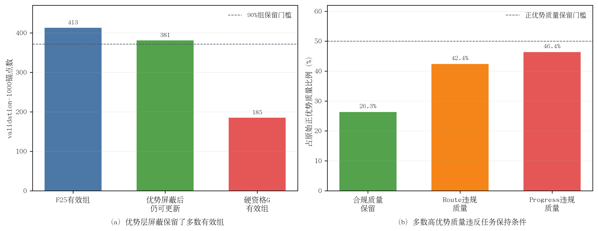

# 任务保持优势权重屏蔽审计结果

> 完成时间：10月05日15时19分  
> 最终判定：组覆盖通过、正优势质量保留失败，不接入训练  
> 原始结果：`advantage_update_mask_validation1000.json`，SHA-256 `2327189fb8011b65f054dc973b04c82d66fefae5d81ba3a60191fa9fc41904c7`

## 1. 核心结果

| 指标 | 数值 | 门槛 | 判定 |
|---|---:|---:|---|
| F25质量空间有效组 | 413/1000 | `>=40%` | 通过 |
| 屏蔽后仍有合规正优势目标的有效组 | 381/413 | `>=90%` | **通过：92.25%** |
| 原始正优势质量总和 | 3445.952494 | — | 诊断量 |
| 保留的合规正优势质量 | 907.103102 | `>=50%` | **未通过：26.32%** |
| Route违规正优势质量 | 42.41% | — | 诊断量 |
| Progress违规正优势质量 | 46.38% | — | 诊断量 |
| 最终非零权重任务合规率 | 100% | 100% | 通过 |

论文排版可使用矢量版：[advantage_update_mask.pdf](figures/advantage_update_mask.pdf)。

**图4-x 任务保持优势权重屏蔽审计。**（a）在优势层屏蔽违规候选可保留381/413个有效组，明显优于候选资格硬门的185个有效组；（b）但仅26.3%的原始正优势质量满足route与progress双重保持条件，未达到50%门槛。

## 2. 约束后移解决了“组支持坍缩”

H不删除F25安全候选，完整安全组仍用于计算`D_s`和组内优势，因此F25的413个有效组保持不变。屏蔽后381组仍有至少1条任务合规正优势候选，保留率92.25%，通过90%门槛。相比G只有185个有效组，约束后移恢复了196个可更新组。

这验证了“安全资格先行、任务约束作用于更新目标”的分层设计方向：route/progress不需要和collision/risk/TTC/DA一样在组统计前删除候选。

## 3. 当前Reward的高优势方向仍存在明显错配

尽管组覆盖充足，H只保留26.32%的正优势质量。按单项统计，42.41%的正优势质量违反route边界，46.38%违反progress边界；两者存在重叠，因此不能相加解释为总违规比例。

这一结果比“Top-1 route cost高出`7.6e-5`”更强：问题不只集中在一个最终Top-1，而是当前对齐reward赋予的大部分正优势质量与逐场任务保持条件不一致。直接屏蔽后再沿用原有按安全候选数归一化，会把少量剩余权重异常放大。

## 4. 归一化风险诊断

在381个保留组中，任务合规正优势候选数中位数为1，193/381组只有1条；保留质量比例P10/P50分别为4.15%/21.23%。若仍按原安全候选数恢复组总权重，所需放大倍数的P50/P90为15.56/103.16，最大达到832.96倍，明显不适合作为稳定训练目标。

因此不能把H简单接入当前`positive_advantage`损失。若后续继续使用屏蔽，应改为仅在保留候选内部按候选数归一化，使单条候选权重均值为1，而不是把组总权重恢复到全部安全候选数；同时必须设置最小优势间隔，避免把极弱正优势放大。

## 5. 科学结论与下一步

本实验支持以下结论：

> 约束后移可以保留绝大多数可学习场景，但当前reward的大部分高优势质量仍与route/progress保持目标冲突；问题已从“候选支持不足”转化为“正优势方向与任务约束不一致”。

H未通过预注册总门禁，不启动训练。下一步应设计并只读验证“任务合规正优势内部归一化+最小优势间隔”的约束优势，而不是调低route门或直接放大剩余权重。该方法若不能在保持至少90%有效组的同时限制权重集中度，也应拒绝。

## 6. 证据位置

- 原始JSON：`/media/yanjun/拯救者PSSD/Diffusion-Planner-HDP/reward_audit/EXP_CH4_advantage_update_mask_1005/advantage_update_mask_validation1000.json`
- 运行日志：同目录`full.log`
- 审计实现：`scripts/audit_chapter4_da_aware_selection.py`
- 固化协议：[实验协议](实验协议.md)
