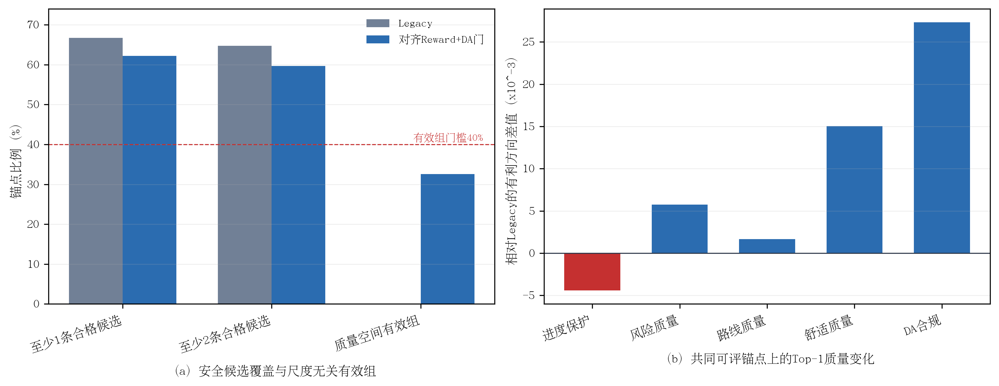

# NuPlan对齐Reward、DA硬门与尺度无关优势门审计结果

> 完成时间：10月05日10时21分  
> 最终结果：预注册总门禁未通过，暂不启动新reward后训练  
> 原始结果：`aligned_da_gate_validation1000_v2.json`，SHA-256 `da4ac508d1b2ec3de89019bfe130d91aa3129c2a56d7d96f23635d5666e70cb9`

## 1. 完整性

validation-1000全部完成，无运行失败。Legacy与不启用DA门的NuPlan对齐reward资格集合差异为0；三个分支使用同一批Repair `200→32`候选。DA门在780/1000个expert能够被lane corridor代理可靠覆盖的锚点上激活；其余220个锚点不因地图表示覆盖不足被错误拒绝。

## 2. DA门修复了Top-1 DA退化

在Legacy和DA门分支均至少存在一条安全候选的622个共同锚点上：

| 对齐Reward+DA门减Legacy | 均值差值 | 胜/负/平 | 结论 |
|---|---:|---:|---|
| 原始DA合规 | **+0.027331** | 19/2/601 | DA提高2.733个百分点 |
| Risk reward | **+0.005730** | 64/24/534 | 改善 |
| 截断8秒最小TTC | **+0.005867 s** | 118/75/429 | 改善 |
| No-collision | 0 | 0/0/622 | 保持 |
| Collision cost | -0.000001 | 0/1/621 | 未退化 |
| Route cost | **-0.001672** | 76/129/417 | 均值改善 |
| Comfort cost | **-0.015018** | 26/178/418 | 均值改善 |
| Progress guard | -0.004435 | 1/85/536 | 在预注册`-0.005`容差内 |
| ADE | +0.050617 m | 144/71/407 | 有小幅模仿偏移 |
| FDE | +0.164698 m | 164/51/407 | 有小幅模仿偏移 |

DA门相对无DA门的NuPlan对齐目标，在622个共同锚点中纠正22个原始DA不合规Top-1，同时没有制造新的DA不合规Top-1；相对Legacy则为19个改善、2个下降。后两个下降发生在expert corridor代理未激活硬门或不同安全约束共同作用的场景，不应被隐藏。

该结果证明，前一实验观察到的DA下降并不是NuPlan对齐reward不可避免的代价；将DA作为expert条件有效的不可补偿资格能够显著修复候选选择。

## 3. 修复代价是安全候选覆盖下降

| 指标 | Legacy/无DA门 | 对齐Reward+DA门 | 差值 | 门槛 |
|---|---:|---:|---:|---:|
| 平均合格候选数（32条中） | 19.491 | 17.751 | -1.740 | 诊断量 |
| 至少1条合格候选 | 66.7% | 62.2% | -4.5 pp | 不低于-5 pp，通过 |
| 至少2条合格候选 | 64.7% | 59.7% | **-5.0 pp** | 不低于-5 pp，边界通过 |

DA门没有造成大规模覆盖崩溃，但“至少2条候选”的覆盖恰好落在预注册下限。该结果说明DA门可用但余量很小，后续不能继续无代价地叠加更严格门槛。

首次原始JSON因二进制浮点将`0.597-0.647`表示为`-0.050000000000000044`，错误地把恰好`-5.0 pp`判断为失败。最终v2脚本仅为比较加入`1e-12`数值容差，并在完全相同协议下复跑；实验数值和总门禁结论均未改变。该修复记录必须保留，避免将数值边界错误包装成方法失败。

## 4. 尺度无关优势门没有通过

预注册质量空间离散度为

\[
D_s=\sqrt{\sum_k w_k\operatorname{Var}(q_k)},
\]

其中五个质量分量均归一化到`[0,1]`。使用预注册`D_s>=0.01`时，只有32.6%的锚点同时具有至少2条合格候选和足够质量离散度，低于40%门槛。因此总门禁为**未通过**，不能启动新reward训练。

阈值敏感性仅作为事后诊断：`0.005`对应41.9%，`0.0075`对应36.6%，`0.01`对应32.6%。虽然把阈值从0.01降到0.005会在数字上通过40%门槛，但不能根据结果直接降阈值，否则属于事后追逐通过。`[0.005,0.01)`区间新增约93个锚点，下一步必须检查这些边界组的候选排序是否对应真实、稳定的分量差异，而不是浮点噪声或不重要的小变化。

论文排版可使用矢量版：[aligned_da_gate_audit.pdf](figures/aligned_da_gate_audit.pdf)。

**图4-x NuPlan对齐reward、DA硬门与尺度无关优势门审计。**（a）DA硬门带来有限的安全候选覆盖下降，但质量空间有效组仅32.6%，未达到40%门槛；（b）在共同可评锚点上，DA、risk、route和comfort改善，progress guard在容差内下降。

## 5. 预注册判定

| 检查项 | 结果 |
|---|---|
| Top-1原始DA不下降 | 通过 |
| 至少1条合格候选下降不超过5 pp | 通过 |
| 至少2条合格候选下降不超过5 pp | 通过，恰在边界 |
| 质量空间有效组不少于40% | **未通过：32.6%** |
| Risk reward不下降 | 通过 |
| TTC下降不超过0.01 s | 通过 |
| No-collision不下降 | 通过 |
| Route cost增加不超过`1e-4` | 通过 |
| Comfort cost增加不超过`1e-4` | 通过 |
| Progress guard下降不超过0.005 | 通过 |

总计9/10项通过。唯一实质失败项是尺度无关有效组覆盖，不是DA、risk或progress退化。

## 6. 当前科学结论与下一步

本实验支持以下结论：

> 专家条件有效的DA不可补偿门能够修复NuPlan对齐reward的DA Top-1退化，并保留risk、TTC、route和comfort方向；但门控后具有足够归一化质量差异的可学习场景仍不足，尚不能直接进入后训练。

下一步不应继续调整reward权重，也不应直接把离散度阈值降到0.005。应单独审计93个边界锚点：检查Top/Bottom候选在progress、risk、TTC、DA、route和comfort上的实际差异、排名对微小数值扰动的稳定性，以及这些场景是否集中于静止/微动样本。若边界组具有稳定且有物理意义的差异，才能预注册0.005作为后训练门槛；否则需要进一步增强候选支持，而不是放宽信号门。

## 7. 证据位置

- 最终原始JSON：`/media/yanjun/拯救者PSSD/Diffusion-Planner-HDP/reward_audit/EXP_CH4_aligned_da_gate_audit_1005/aligned_da_gate_validation1000_v2.json`
- 最终日志：同目录`full_v2.log`
- 首次浮点边界结果：同目录`aligned_da_gate_validation1000.json`
- 审计实现：`scripts/audit_chapter4_aligned_da_gate.py`
- 固化协议：[实验协议](实验协议.md)
