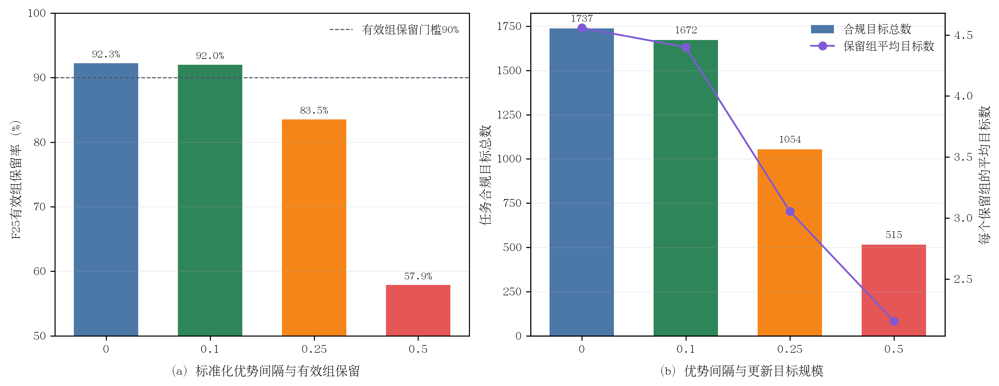

# 约束合规正目标集合与优势间隔实验结果

> 完成时间：10月05日15时34分  
> 最终判定：`m=0.1`通过目标构造门禁，允许进入代码实现与20步烟雾训练  
> 原始结果：`constraint_positive_targets_validation1000.json`，SHA-256 `130fbd0371faa1fc8083e1b9a49f60285507bacb3408ab36d71ee41bb6bc65d6`

## 1. 主要结果

| 标准化优势间隔`m` | 保留有效组 | 保留率 | 合规目标总数 | 保留组平均目标数 | 单目标组比例 | 判定 |
|---:|---:|---:|---:|---:|---:|---|
| 0 | 381/413 | 92.25% | 1737 | 4.559 | 50.66% | 通过 |
| **0.1** | **380/413** | **92.01%** | **1672** | **4.400** | 51.84% | **通过并选中** |
| 0.25 | 345/413 | 83.54% | 1054 | 3.055 | 54.49% | 未通过组保留门 |
| 0.5 | 239/413 | 57.87% | 515 | 2.155 | 58.16% | 未通过组保留门 |

论文排版可使用矢量版：[constraint_positive_targets.pdf](figures/constraint_positive_targets.pdf)。

**图4-x 约束合规正目标集合与优势间隔。**（a）`m=0`和`m=0.1`均保留超过90%的F25有效组，`m>=0.25`开始造成明显覆盖损失；（b）随间隔提高，任务合规目标总数和每组平均目标数持续下降，`m=0.1`是满足预注册门槛的最大间隔。

## 2. 为什么选择0.1而不是0

`m=0`与`m=0.1`的组保留率只相差0.24个百分点，目标数减少65条；但`m=0.1`显式排除了小于0.1个组内标准差的微弱优势，降低把数值近似或极弱偏好当作策略改进目标的风险。按照“通过门禁的最大间隔”规则，选择`m=0.1`，不是根据训练结果反向调参。

`m=0.25`虽然保留组平均仍有3.055条目标，但组覆盖下降到83.54%，说明进一步提高置信间隔会丢失过多场景，不能接受。

## 3. 为什么均匀目标权重比H的幅值归一化更安全

H失败的直接原因是只剩26.32%的正优势质量；若恢复原安全组总权重，会把少量目标放大。当前方案不恢复该质量，也不把总权重扩展到全部安全候选：集合内每条候选权重固定为1，集合外为0，因此最大非零权重与非零权重均值之比恒为1。

Reward在该方案中仍有两个作用：一是参与`D_s`之外的组内相对排序，二是决定候选是否超过`0.1`标准差间隔；但reward幅值不再直接决定梯度倍数。这使任务约束优先于标量reward强度，符合安全约束后训练的技术主线。

## 4. 证据边界与下一步

该实验只证明更新目标集合在冻结候选上具有足够覆盖和无幅值放大，不证明参数更新后的策略一定改善。下一步必须实现并测试三个彼此独立的训练信号：

1. 完整安全组上的质量空间有效组门；
2. route/progress任务合规`update_mask`；
3. `A>=0.1`的均匀正目标权重。

实现后先运行单元测试，再从B10执行20次optimizer update，并使用validation-1000公共随机数配对门禁。未经20步验证不得启动100步训练。

## 5. 证据位置

- 原始JSON：`/media/yanjun/拯救者PSSD/Diffusion-Planner-HDP/reward_audit/EXP_CH4_constraint_positive_targets_1005/constraint_positive_targets_validation1000.json`
- 运行日志：同目录`full.log`
- 审计实现：`scripts/audit_chapter4_da_aware_selection.py`
- 固化协议：[实验协议](实验协议.md)
