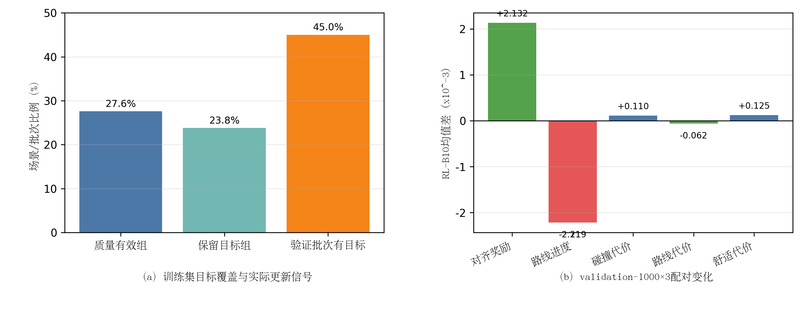

# 约束正样本后训练20步Smoke结果分析

> 结果固化：10月05日16时25分  
> 最终判定：实现成功，科学门禁失败，不进入`safety40`

## 1. 端到端实现结果

v3完整处理1000个训练场景，replay容量为1000，20/20个optimizer step均实际执行，跳过0步，未出现NaN或非有限梯度。rollout中质量有效组比例为26.7%，任务更新候选比例为17.47%；update抽样batch的有效组比例为27.5%，45%的batch具有回归目标，平均每组0.95条回归目标。

相对B10 EMA，20步后原始模型参数相对L2变化为`2.01e-5`，EMA为`9.40e-6`。因此模型确实发生了小而受控的变化，不是“流程跑完但权重未更新”。

## 2. validation-1000×3结果

| 指标 | B10 | 约束后训练20步 | RL−B10 | 判定 |
|---|---:|---:|---:|---|
| 对齐reward | 0.493625 | 0.495757 | +0.002132 | 均值提高，但P50为`-2.18e-6` |
| progress | 2.813021 | 2.810802 | **-0.002219** | 失败 |
| progress P10/P50 | — | — | **-0.005529/-0.001102** | 失败 |
| collision cost | 0.088484 | 0.088593 | +0.000110 | 小幅变差 |
| no-collision | 0.925000 | 0.925000 | 0 | 保持 |
| route cost | 0.223026 | 0.222963 | -0.000062 | 改善 |
| comfort cost | 0.342076 | 0.342201 | +0.000125 | 小幅变差 |
| ADE | 2.208081 m | 2.207426 m | -0.000655 m | 基本保持 |
| FDE | 5.770504 m | 5.768498 m | -0.002007 m | 基本保持 |

**图4-x 约束正样本后训练的目标覆盖与短步策略变化。**（a）在实际训练manifest上，质量有效组和任务合规目标覆盖明显低于validation预审计；（b）20步后对齐reward均值提高，但progress下降，collision与comfort cost也轻微增加，未形成方向一致的安全改进。

矢量图：[constraint_smoke_result.pdf](figures/constraint_smoke_result.pdf)。

## 3. 为什么reward均值提高仍然判失败

reward均值增加0.002132，但reward差值P50为轻微负值，仅40.5%的配对样本reward提高；均值包含少量较大安全质量变化的影响。与此同时，99.67%的样本没有progress提高，progress差值P10和P50均为负。因此本实验再次证明：

> 标量reward均值上升不能代替progress分布、安全代价和基础能力的联合门禁。

候选级route/progress约束只保证被选作回归目标的离线轨迹满足边界，不保证扩散网络对这些目标进行有限步函数逼近后，在新噪声采样下逐场单调保持。约束目标与策略级结果之间仍存在泛化间隙。

## 4. 同训练manifest审计揭示的分布差异

在相同1000训练场景上重新执行只读审计：

| 指标 | validation-1000预审计 | 本次训练manifest | 变化 |
|---|---:|---:|---:|
| 200池至少2条安全候选 | 61.4% | 54.3% | -7.1 pp |
| 200池`D_s>=0.01` | 39.6% | 24.3% | -15.3 pp |
| F25`D_s>=0.01` | 41.3% | 27.6% | -13.7 pp |
| margin=0.1有效组保留率 | 92.01% | **86.23%** | -5.78 pp |
| 保留组平均目标数 | 4.40 | 4.62 | +0.22 |

训练日志的26.7%与独立审计的27.6%接近，说明低覆盖不是实现计数错误。更重要的是，`margin=0.1`在训练manifest上没有达到预注册的90%有效组保留门槛；原先只在validation上选定该margin，不能保证训练分布同样成立。

训练manifest中，route和progress违规正优势质量分别占44.95%和41.70%，最终只保留34.38%的正优势质量。F25 Top-1相对B还表现为route cost增加0.000637、progress guard下降0.000721；虽然单项progress仍在0.005容差内，但候选目标整体对任务保持的支持比validation更弱。

## 5. 当前能够形成的科学结论

1. 质量空间组门、任务更新掩码和均匀正目标已经在正式后训练链路中实现并通过数值/掩码契约；
2. `validation-1000`上选择出的候选支持与margin门槛不能直接外推到训练场景分布；
3. 候选级约束合规不等价于策略级更新后指标单调，仍需处理函数逼近与跨场景泛化；
4. 当前20步模型不能作为安全改进候选，不进入闭环评测；
5. 该负结果否定的是当前固定阈值与训练数据使用方式，不是否定“优势层约束”这一层级设计。

## 6. 下一步优先级

当前不应调大学习率、增加更新步数或事后放宽`D_s/margin`。最高优先级是建立**训练分布感知的目标覆盖门禁**：在rollout阶段统计每个场景的`D_s`、任务合规目标数及route/progress裕量，只将通过既定目标覆盖条件的场景写入有效更新队列，并用未参与更新的独立validation继续做策略级接受。随后应做一次不更新参数的梯度贡献审计，比较rollout目标、expert anchor和reference anchor对progress方向的局部梯度是否冲突。

只有训练分布门禁和梯度方向审计通过，才允许新的20步实验；不得直接延长本checkpoint。
