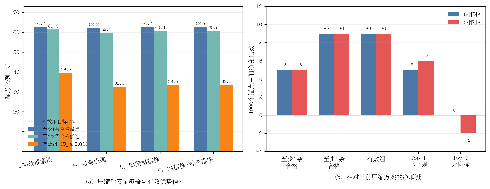

# DA-aware候选压缩顺序消融结果

> 完成时间：10月05日10时40分  
> 最终判定：B、C两个修复分支均未通过预注册门禁，不启动后训练  
> 原始结果：`da_aware_selection_validation1000_v2.json`，SHA-256 `7df31ff0f98e5496d285512110d8b8bf6ef1904faa3b9f856348e15ef0f22701`

## 1. 实验完整性

实验在固定B10 Epoch10 EMA、validation-1000、seed 3407和6步DPM-Solver下完成。A、B、C三个分支逐锚点共享完全相同的200条多尺度候选池，且均压缩为32条；唯一变化是DA资格进入压缩的时序，以及压缩时使用legacy还是NuPlan对齐reward。本实验只改变候选选择，不更新任何模型参数。

## 2. 主要结果

| 指标 | A：当前Repair | B：DA资格前移 | C：DA前移+对齐排序 |
|---|---:|---:|---:|
| 平均合格候选数（32条中） | 17.751 | 17.957 | 17.957 |
| 至少1条合格候选 | 62.2% | **62.7%** | **62.7%** |
| 至少2条合格候选 | 59.7% | **60.6%** | **60.6%** |
| `D_s>=0.01`有效组 | 32.6% | **33.5%** | **33.5%** |
| `D_s>=0.005`组 | 41.9% | 43.3% | **44.2%** |
| Top-1原始DA合规 | 70.0% | 70.5% | **70.6%** |
| Top-1无碰撞 | 94.4% | 94.4% | 94.2% |
| Top-1 risk reward | 0.624067 | 0.624638 | 0.626600 |
| Top-1截断TTC（s） | 2.454363 | 2.457046 | 2.462741 |
| Top-1 progress guard | 0.803157 | 0.803343 | 0.801748 |
| Top-1 route cost | 0.222401 | 0.222326 | 0.222596 |
| Top-1 comfort cost | 0.346560 | 0.346647 | **0.339263** |
| 候选平均ADE（m） | 2.228835 | **2.228222** | 2.229069 |
| Oracle ADE（m） | **1.720779** | 1.724093 | 1.741916 |

论文排版可使用矢量版：[da_aware_selection_ablation.pdf](figures/da_aware_selection_ablation.pdf)。

**图4-x DA-aware候选压缩顺序消融。**（a）200条搜索池中39.6%的锚点具有`D_s>=0.01`信号，压缩后降至32.6%～33.5%；把DA资格前移只小幅恢复安全覆盖与有效组；（b）在1000个固定锚点上，B相对A仅净增加5个“至少1条”、9个“至少2条”和9个有效组，C没有带来进一步的有效组净增，且减少2个无碰撞Top-1。

## 3. 单因素解释

### 3.1 DA资格前移有正效应，但效应量不足

B相对A在56/1000个锚点中增加了压缩后DA合格候选数，未在任何锚点减少合格候选数；最终净增加5个至少1条合格候选的锚点、9个至少2条合格候选的锚点，并净增加9个`D_s>=0.01`有效组。Top-1原始DA合规提高0.5个百分点，无碰撞保持不变，候选平均ADE微降0.000613 m。

这证明“在200条池阶段就施加DA资格”方向正确，但它只把有效组从32.6%提高到33.5%，远低于40%门槛；至少2条合格候选也只提高0.9个百分点，未达到预注册的3个百分点。资格时序不是当前信号不足的主要来源。

### 3.2 压缩时改用对齐reward没有提供额外有效信号

C与B使用相同DA资格，因此两者的合格候选数量完全相同。C相对A的`D_s>=0.01`有效组仍为33.5%，没有超过B；它只在较低的事后阈值`D_s>=0.005`上进一步增加0.9个百分点。C的comfort cost均值降低0.007296，但同时Top-1无碰撞下降0.2个百分点、route cost增加0.000194，Oracle ADE增加0.021137 m。

因此，对齐reward更适合用于最终组内排序或优势构造，不能替代候选支持修复。按照不可补偿安全门，C因2个新增碰撞Top-1直接失败，不能因comfort改善而接受。

## 4. 预注册判定

| 检查项 | B | C |
|---|---|---|
| 至少1条合格候选下降不超过1 pp | 通过 | 通过 |
| 至少2条合格候选提高至少3 pp | **未通过：+0.9 pp** | **未通过：+0.9 pp** |
| `D_s>=0.01`有效组不少于40% | **未通过：33.5%** | **未通过：33.5%** |
| Top-1 DA不下降 | 通过 | 通过 |
| Top-1无碰撞不下降 | 通过 | **未通过：-0.2 pp** |
| Risk、TTC、progress guard通过 | 通过 | 通过 |
| Route/comfort cost不增加超过`1e-4` | 通过 | **route未通过：+0.000194** |
| 候选平均ADE相对增加不超过1% | 通过 | 通过 |
| **总门禁** | **拒绝** | **拒绝** |

## 5. 200条搜索池与32条训练组的瓶颈分解

补充统计未改变A、B、C的任何数值。200条池使用最终NuPlan对齐reward和DA资格直接评价，结果如下：

| 指标 | 200条搜索池 | B：压缩后32条 | 压缩净损失 |
|---|---:|---:|---:|
| 至少1条合格候选 | 62.7% | 62.7% | 0 pp |
| 至少2条合格候选 | 61.4% | 60.6% | -0.8 pp |
| `D_s>=0.01`有效组 | **39.6%** | 33.5% | **-6.1 pp** |
| `D_s>=0.005`组 | **49.7%** | 43.3% | -6.4 pp |
| 平均DA合格候选数 | 107.089/200 | 17.957/32 | 不直接比较比例 |

逐锚点检查显示：200条池中396个有效组经B压缩后有64个变为无效，同时有3个原本低于门槛的池因极值子集方差增加而变为有效，净损失61个有效锚点。至少2条合格候选则有8个锚点在压缩中丢失，没有反向新增。

| 噪声尺度 | 池内条数 | 平均DA合格数 | 至少2条DA合格候选的锚点比例 |
|---:|---:|---:|---:|
| 0.1 | 40 | 21.627 | 54.8% |
| 0.5 | 64 | 34.631 | 56.8% |
| 1.0 | 32 | 17.203 | 57.7% |
| 1.5 | 32 | 16.978 | 59.3% |
| 2.0 | 32 | 16.650 | **59.8%** |

该分解说明存在两个不同层次的问题。第一，373/1000个锚点在200条池中仍没有DA合格候选，这是候选生成支持的硬上限，任何压缩算法都无法修复。第二，搜索池有效组比例已接近40%目标，但当前以整轨迹几何最远点为核心的压缩又丢失6.1个百分点，说明几何多样性不等于reward质量空间多样性。较高噪声尺度的“至少2条合格”覆盖并未更差，但当前最终配额对1.5和2.0尺度总计只保留3/32条。

## 6. 科学结论与下一步

本实验支持以下负结果：

> 将DA硬门从最终评价前移到200条搜索池的压缩阶段，只能恢复少量被压缩规则遗漏的合格候选；200条池本身的有效信号略低于目标，而当前几何压缩又额外丢失大量质量空间差异。资格时序和标量排序不是主要瓶颈，压缩表示与候选生成分布才是下一步的直接对象。

因此不能启动新的100步后训练。下一步保持同一200条候选池、DA资格和对齐reward不变，只把“整轨迹几何最远点压缩”替换为“归一化质量向量极值保留+质量空间最远点压缩”，并与是否放宽高噪声尺度固定配额形成单因素对照。目标是先回收64个被压缩丢失的有效组；若仍无法越过40%，再调整候选生成分布，而不是继续调标量reward权重。

## 7. 证据位置

- 最终原始JSON：`/media/yanjun/拯救者PSSD/Diffusion-Planner-HDP/reward_audit/EXP_CH4_da_aware_selection_1005/da_aware_selection_validation1000_v2.json`
- 最终运行日志：同目录`full_v2.log`
- 首轮三臂结果：同目录`da_aware_selection_validation1000.json`；其三臂汇总与最终结果逐项一致
- 实现：`scripts/audit_chapter4_da_aware_selection.py`
- 固化协议：[实验协议](实验协议.md)
