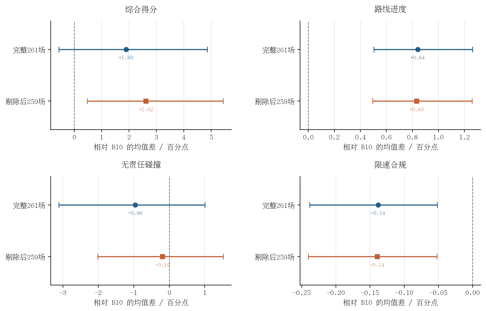

# Test14-random 剔除最差两场后的配对敏感性分析

> 分析时间：10月08日00时56分  
> 性质：对已经完成的 Test14-random 闭环结果进行事后敏感性分析；原始 261 场官方结果与安全验收决策保持不变。  
> 比较：历史 B10 与全量 306,801 场景后训练模型，逐场配对，均使用归档的同一次推理结果。

## 1. 为什么做这项分析

原始 Test14-random 中，综合得分下降最多的四场占全部负向得分变化量的 **96.17%**。这提示平均得分可能对少数严重失败场景高度敏感。本分析按**后训练模型相对 B10 的逐场综合得分差**从小到大排序，从最差四场中剔除最差的两场，重算剩余场景的全部官方指标及按驾驶日志聚类的 95% 区间。

这个筛选条件由已经观察到的结果决定。因此“剔除后”的区间只描述**固定剔除名单下剩余 259 场的差异**，不是对原始完整 Test14-random 总体性能的独立确认。

## 2. 被剔除的是哪两场

| 排名 | token | 场景类型 | B10 综合得分 | 后训练综合得分 | 配对差值 | 责任碰撞指标 B10→后训练 |
|---:|---|---|---:|---:|---:|---:|
| 1 | `7f50df6eea5c54e9` | high_lateral_acceleration | 0.998074 | 0.000000 | **−0.998074** | **1→0** |
| 2 | `2e56997063c057a0` | stationary | 0.839850 | 0.000000 | **−0.839850** | **1→0** |

两场都出现从“B10 无责任碰撞”到“后训练发生责任碰撞”的退化，且后训练综合得分归零。第 2 个 token 同时属于 Test14-hard；本分析仅剔除 random 中的这两条记录，**hard 的正式结果不变**。

两场得分下降之和为 **1.837925**，占原始 random 全部负向得分变化量 3.286789 的 **55.92%**。这说明它们对原始平均值和区间确实有较大影响。

## 3. 剔除前后的闭环指标

图中点是逐场均值差，横线是按 `log_name` 整组有放回重采样 **100,000 次**得到的 95% 百分位区间。两行分别基于完整 261 场和固定剔除后的 259 场，不能将两行当作两次独立实验。

**图　剔除最差两场前后 Test14-random 的配对闭环效应。**数值为“全量后训练 − B10”，单位为百分点。各子图横轴范围不同；区间反映已观测日志之间的变异，不包含训练 seed 或额外推理 seed 的不确定性。PDF 版本位于同目录。

| 官方闭环指标 | 完整 261 场均值差 | 剔除后 259 场均值差 | 剔除后日志聚类 95% 区间 | 剔除后胜/负/平 |
|---|---:|---:|---:|---:|
| 综合得分 ↑ | +0.018941 | **+0.026183** | **[+0.004727, +0.054421]** | 95/52/112 |
| 路线进度 ↑ | +0.008404 | **+0.008325** | **[+0.004941, +0.012575]** | 96/39/124 |
| 无责任碰撞 ↑ | −0.009579 | **−0.001931** | [−0.020147, +0.015209] | 3/3/253 |
| 可行驶区域合规 ↑ | +0.011494 | +0.011583 | [+0.000000, +0.031250] | 3/0/256 |
| 有效进度 ↑ | +0.015326 | +0.015444 | [+0.003636, +0.031496] | 4/0/255 |
| TTC 合规 ↑ | +0.003831 | +0.011583 | [−0.004115, +0.028926] | 4/1/254 |
| 限速合规 ↑ | −0.001383 | **−0.001395** | **[−0.002404, −0.000522]** | 19/40/200 |
| 舒适性 ↑ | +0.007663 | +0.007722 | [+0.000000, +0.020243] | 2/0/257 |
| 行驶方向合规 ↑ | 0.000000 | 0.000000 | [−0.005792, +0.005703] | 1/1/257 |

综合得分剔除后从 B10 的 **0.823539** 到后训练的 **0.849722**，配对均值差 **+0.026183**（2.6183 个百分点）。完整 261 场的综合得分区间为 **[−0.005577, +0.048602]**，跨越零；固定剔除后的区间变为 **[+0.004727, +0.054421]**。这个变化证明原始“综合得分区间跨零”的结论对两场极端失败比较敏感。

路线进度的均值差几乎不变：**+0.008404 → +0.008325**，剔除后区间仍高于零。因此，路线进度改善不是靠这两场的异常值形成的。

## 4. 安全问题是否也随之消失

没有。原始 261 场有 **5 场新增责任碰撞**；去掉上述两场后，仍有 **3 场新增责任碰撞**。剩余场景中也有 3 场碰撞指标改善，但无责任碰撞的均值差仍为 **−0.001931**，区间跨零。不能据此声称碰撞概率高置信变差，也不能声称安全已恢复到不低于 B10。

剩余两个最严重的负向场景为：

| token | 场景类型 | 综合得分差 | 责任碰撞指标 B10→后训练 |
|---|---|---:|---:|
| `78c5b673402b5861` | starting_right_turn | −0.687500 | 1→0 |
| `fa10175cddfa52fa` | near_multiple_vehicles | −0.635357 | 1→0 |

这两场占剔除后全部负向得分变化量的 **91.30%**。因此，尾部风险并非只由最差的两场组成；剔除后仍有严重的责任碰撞失效。另一个不受剔除影响的警告是限速合规：均值差仍为 **−0.001395**，其日志聚类区间仍完全低于零。

## 5. 对第四章结论的影响

这项分析使第四章的结论更具体：

1. **任务收益具有一定广度。** 去掉两场最极端的碰撞失效后，综合得分均值增益提高，路线进度增益基本保持；完整 261 场中得分改善/退化/不变为 95/54/112，剔除后为 95/52/112。
2. **平均得分的区间受极端尾部控制。** 剔除两场后，条件化的日志聚类综合得分区间高于零；原始完整 261 场仍必须报告区间跨零。
3. **安全约束尚未达到接受条件。** 剔除后仍有 3 场新增责任碰撞，限速合规仍退化；选择性删除失败场景不能构成替换 B10 的依据。

论文中可以写：

> 为考察闭环得分对极端失败场景的敏感性，进一步按逐场得分差剔除 Test14-random 中退化最严重的两场责任碰撞案例。剩余 259 场的综合得分配对均值差由 +0.018941 增至 +0.026183，其按驾驶日志聚类的 95% 区间为 [+0.004727, +0.054421]；路线进度均值差仍为 +0.008325，表明任务方向的改善并非由这两场异常值造成。然而，剔除后仍有 3 场新增责任碰撞，并且限速合规继续下降。由于剔除规则依据已观测得分事后确定，该结果仅用于描述负向尾部的影响，不能替代完整 261 场的正式评测，也不能证明当前模型已满足安全接受条件。

## 6. 复现和原始证据

- 只读分析脚本：`HDP-nuplan/scripts/analyze_full306801_test14_random_trim2.py`。
- 本次精确数值、剔除 token、原始文件 SHA256：`Test14_random剔除最差两场敏感性.json`。
- 图像：`figures/Test14_random剔除最差两场_配对敏感性.png`；同目录另有 PDF。
- 原始 261 场配对摘要：`/media/yanjun/拯救者PSSD/Diffusion-Planner-HDP/test14_outputs/EXP_CH4_full306801_vs_historical_B10_1006/test14-random_historical_B10_vs_full306801.json`。
- 原始完整闭环分析：[Test14 全量闭环评测结果与分析](Test14全量闭环评测结果与分析.md)。
- 全量训练效果主报告：[全量后训练有效性分析与论文图表](全量后训练有效性分析与论文图表.md)。
