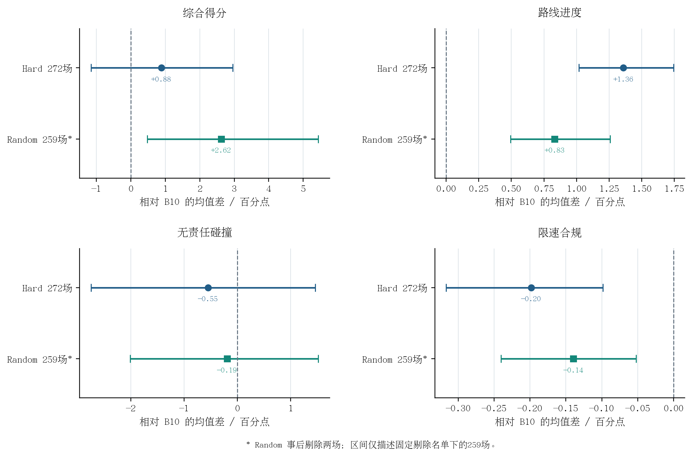
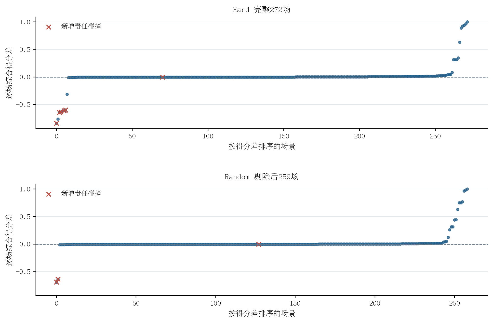

# 全量 306,801 场景安全约束后训练有效性综合分析

> 整理时间：10月08日01时06分  
> 本文统一分析口径：**Test14-hard 使用完整 272 场；Test14-random 使用按逐场得分差剔除最差两场后的 259 场**。  
> 对照：历史 HDP B10 与全量后训练 Epoch 2，均使用 EMA checkpoint。  
> 核心结论：后训练已经产生有效的任务改进信号，尤其是闭环路线进度；当前安全约束仍未通过责任碰撞和限速合规验收，模型不替换 B10。

## 1. 科学问题、比较对象和统计口径

本实验回答四个连续问题：

1. 306,801 场景的全量 rollout 是否真正留下足够多的安全、可区分且优于参考策略的训练目标？
2. 后训练是否使策略在独立数据上产生可测变化？
3. 这种变化能否转化为官方闭环任务表现的改善？
4. 改善是否同时保持责任碰撞、可行驶区域及限速等安全指标？

| 环节 | 数据与比较 | 本文采用的样本范围 | 作用 |
|---|---|---:|---|
| 训练目标审计 | mini-train 完整 Replay | 306,801 场景、307 分片 | 确认目标规模及更新覆盖 |
| 独立开环验证 | B10 与后训练，公共随机数配对 | validation-1000 × 3 = 3,000 对轨迹 | 检查策略变化及离线能力保持 |
| 闭环 hard | B10 与后训练逐场配对 | 完整 Test14-hard 272 场 | 在高难场景检验任务与安全表现 |
| 闭环 random | B10 与后训练逐场配对 | 固定剔除两场后的 Test14-random 259 场 | 分析其余 random 场景的任务收益及剩余风险 |

Test14 采用 nuPlan `closed_loop_nonreactive_agents`，推理 seed 为 0。B10 是经过 checkpoint、场景清单和逐场输出核验后复用的历史完整评测；新模型完成了全量闭环运行。hard 和剔除后的 random 仍有 **10 个重叠 token**，因此两套结果分开报告，不合并成独立样本总数。

模型身份固定为 B10 checkpoint SHA256 `22ec0cf6be7cc89a3cf8414cddd0c7446ce2737ddc4e44b23e50dbeeeb0b29ce`、后训练 Epoch 2 checkpoint SHA256 `41cf43c5a7b7a70663409bcb1260e6d549814b128b2b91cc0e94af93cf58763`；Test14 冻结清单 SHA256 为 `a6b495893945d719055d9841a91e1e637063da7f3d6b439c5e82077d5964230d`。

random 剔除的两场按后训练相对 B10 的综合得分差从小到大确定：

| token | 场景类型 | B10→后训练得分 | 配对差值 | 责任碰撞指标 |
|---|---|---:|---:|---:|
| `7f50df6eea5c54e9` | high_lateral_acceleration | 0.998074→0 | −0.998074 | 1→0 |
| `2e56997063c057a0` | stationary | 0.839850→0 | −0.839850 | 1→0 |

其中 `2e56997063c057a0` 也属于 hard；它在 hard 的完整 272 场结果中仍被保留。

这是观察结果后的**事后剔除**。本文把 259 场作为用户指定的主要 random 分析范围，但它不是新的盲测集。本文所报的 random 置信区间仅针对这份固定剔除名单下的 259 场，不能当作对原始 261 场总体增益的独立显著性证明。原始 261 场的完整结果仍保存在[全量 Test14 闭环报告](Test14全量闭环评测结果与分析.md)中。

## 2. 全量训练是否形成足够的有效目标

**图 4-X　全量 rollout 的候选筛选与目标组覆盖。**左图单位为候选轨迹，右图单位为场景组。88 条提案总数按固定协议计算；入库后各级数量来自对 307 个 Replay 分片的精确重构。PDF 矢量版本位于同目录。

**表 4-X　全量后训练的候选与目标支持**

| 阶段 | 数量 | 含义 |
|---|---:|---|
| 完成 rollout 并写入 Replay 的场景 | 306,801 | 全量 mini-train 场景均被处理 |
| 88 条/场景提案 | 26,998,488 | B10 自然、当前策略自然、中噪声和 guided 四类候选 |
| 88→32 压缩后候选 | 9,817,632 | 全量写入磁盘分片 Replay |
| 碰撞/DA 硬安全门合格候选 | 9,097,563 | 占压缩后候选的 92.6656% |
| 通过路线/进度/Reward 保持掩码 | 2,390,231 | 占压缩后候选的 24.3463% |
| 安全且质量离散度足够的激活组 | 37,145 | 占全量场景的 12.1072% |
| 含最终 RL 目标的场景组 | **30,159** | 占全量场景的 9.8302%；通过至少 30,000 组门禁 |
| 最终 RL 回归目标 | **167,730** | 每个目标组平均 5.5615 条 |
| 实际 optimizer 覆盖的目标组 | **30,159 / 30,159** | 100% 无放回访问，执行 30,159 次更新 |

这构成后训练**确实发生了有目标的参数更新**的第一层证据。此前小容量 Replay 或随机有放回采样可能让有效组被覆盖或漏访；本次 306,801 场景均被写入 Replay，所有 30,159 个目标组均被访问。需要准确表述的是：全量场景参加了 rollout，但只有通过完整约束的 30,159 个场景组形成 RL 回归目标，不能写成“306,801 场景全部产生了 RL 梯度”。

## 3. 独立 validation 是否证明策略已经改变

validation-1000 固定 1,000 个锚点，每个场景重复三次；两个模型在相同场景、重复轮次和采样随机数下生成单条轨迹，均使用 6 步去噪与 `noise_scale=0.1`。

**表 4-Y　validation-1000×3 的配对开环结果**

| 指标 | B10 | 后训练 | 差值（后训练−B10） | 解释 |
|---|---:|---:|---:|---|
| NuPlan 对齐离线 Reward ↑ | 0.538111 | 0.545102 | **+0.006991** | 配对中位差 +0.001242；61.8% 配对提高 |
| Progress 代理 ↑ | 2.813021 | 2.843505 | **+0.030484** | 均值提高，配对 P10 为 −0.020025 |
| DA 合规代理 ↑ | 0.874000 | 0.892667 | **+0.018667** | 提高 1.8667 个百分点 |
| Route cost ↓ | 0.223026 | 0.221708 | **−0.001318** | 路线代理改善 |
| No-collision 代理 ↑ | 0.925000 | 0.924667 | −0.000333 | 净减少 1/3,000 |
| Comfort cost ↓ | 0.342076 | 0.352829 | +0.010754 | 退化 |
| ADE / m ↓ | 2.208081 | 2.208096 | +0.000015 | 均值基本不变 |
| FDE / m ↓ | 5.770504 | 5.841854 | +0.071349 | 尾部使均值退化 |

Reward、进度、DA 和路线代理的配对变化说明模型已经产生可测的策略改变，且主要任务方向有改善。与此同时，原定离线 9 项门禁中的 progress P10、no-collision、comfort 和 FDE 未通过。开环碰撞、DA 和 TTC 均是缓存轨迹上的代理指标，不能代替官方闭环安全判断。

## 4. 闭环总体结果：hard 完整 272 场，random 剔除后 259 场

**图 4-Y　全量后训练相对 B10 的闭环配对效应。**点为场景加权均值差，横线为以驾驶日志为簇、有放回重采样 100,000 次得到的 95% 百分位区间。正方向表示指标上升。Random 259 场由事后剔除两场得到，其区间须按第 1 节说明解释。图中四个子图分别使用适合该指标的横轴范围。

**表 4-Z　九项官方闭环指标的逐场配对均值**

| 指标（均越大越好） | Hard B10 | Hard 后训练 | Hard 差值 | Random 259 B10 | Random 259 后训练 | Random 差值 |
|---|---:|---:|---:|---:|---:|---:|
| 综合得分 | 0.705304 | 0.714113 | +0.008809 | 0.823539 | 0.849722 | **+0.026183** |
| 无责任碰撞 | 0.867647 | 0.862132 | −0.005515 | 0.907336 | 0.905405 | −0.001931 |
| 可行驶区域合规 | 0.944853 | 0.941176 | −0.003676 | 0.965251 | 0.976834 | +0.011583 |
| 有效进度 | 0.948529 | 0.948529 | 0.000000 | 0.980695 | 0.996139 | +0.015444 |
| 行驶方向合规 | 0.985294 | 0.988971 | +0.003676 | 0.998069 | 0.998069 | 0.000000 |
| 路线进度 | 0.819141 | 0.832731 | **+0.013590** | 0.911556 | 0.919881 | **+0.008325** |
| TTC 合规 | 0.761029 | 0.775735 | +0.014706 | 0.868726 | 0.880309 | +0.011583 |
| 限速合规 | 0.974670 | 0.972686 | −0.001984 | 0.966225 | 0.964830 | −0.001395 |
| 舒适性 | 0.977941 | 0.981618 | +0.003676 | 0.976834 | 0.984556 | +0.007722 |

**表 4-Z（续）　关键指标的配对差值与日志聚类 95% 区间**

| 指标 | Hard 完整 272 场：差值 [区间] | Random 剔除后 259 场：差值 [区间] |
|---|---:|---:|
| 综合得分 | +0.008809 [−0.011610, +0.029606] | **+0.026183 [+0.004727, +0.054421]** |
| 路线进度 | **+0.013590 [+0.010188, +0.017436]** | **+0.008325 [+0.004941, +0.012575]** |
| 无责任碰撞 | −0.005515 [−0.027491, +0.014652] | −0.001931 [−0.020147, +0.015209] |
| 限速合规 | −0.001984 [−0.003169, −0.000985] | −0.001395 [−0.002404, −0.000522] |

### 4.1 最稳固的正结果：两套场景的闭环路线进度

- Hard 完整场景中，路线进度提高 **0.013590**，即 1.3590 个百分点；配对胜/负/平为 **144/47/81**，日志聚类区间完全高于零。
- Random 剔除后场景中，路线进度提高 **0.008325**，即 0.8325 个百分点；配对胜/负/平为 **96/39/124**，日志聚类区间也完全高于零。

Random 原始完整 261 场的路线进度增益为 **+0.008404**，剔除两场后仅变为 **+0.008325**。这个稳定性说明路线进度增益并不是由被剔除的两个极端场景制造的。结合独立 validation 的 progress 改善，可以把“**后训练改善闭环任务进度**”作为本次最有力的正结论。

### 4.2 综合得分：点估计提高，证据强度不同

- Hard 完整 272 场的综合得分由 **0.705304→0.714113**，均值差 **+0.008809**；逐场胜/负/平为 **115/56/101**。但其日志聚类区间跨零，因此不写成高置信总体得分提升。
- Random 剔除后 259 场的综合得分由 **0.823539→0.849722**，均值差 **+0.026183**；胜/负/平为 **95/52/112**。在固定剔除名单下，其日志聚类区间为 **[+0.004727, +0.054421]**。

Random 原始完整 261 场的综合得分均值差为 **+0.018941**，区间 **[−0.005577, +0.048602]**，跨零。剔除两场使区间转为正值，说明原始总体得分对这两场严重碰撞失效高度敏感；由于剔除依据已经观察到的得分确定，**不能把 259 场的正区间表述为原始 Test14-random 上的无条件高置信改进**。

## 5. 逐场分布说明了什么

**图 4-Z　逐场综合得分差与新增责任碰撞。**每个点是同一场景的“后训练−B10”得分，分别在 hard 和剔除后的 random 内排序；红色叉号为 B10 无责任碰撞而后训练发生责任碰撞的场景。两幅图不共享场景排序。

| 场景集合 | 得分改善 | 退化 | 不变 | 新增责任碰撞 |
|---|---:|---:|---:|---:|
| Hard 完整 272 场 | 115 | 56 | 101 | **6** |
| Random 剔除后 259 场 | 95 | 52 | 112 | **3** |

两套集合都呈现“改善场景多于退化场景”的分布，但少数严重失效形成长负尾。Random 被剔除的两场各发生新责任碰撞、后训练综合得分归零，合计占原始 random 全部负向得分变化量的 **55.92%**。剔除后，剩余两个最严重的得分退化场景仍分别为 **−0.687500** 和 **−0.635357**，都伴随新增责任碰撞；它们占剩余负向得分变化量的 **91.30%**。因此，尾部安全问题没有随两场剔除而消失。

## 6. 安全约束是否已实现“安全保持”

**尚未实现。**

1. Hard 的无责任碰撞均值差为 **−0.005515**，有 6 场新增责任碰撞；其置信区间跨零，不能断言总体碰撞率高置信上升，但零新增碰撞安全门明确失败。
2. Random 剔除后无责任碰撞均值差为 **−0.001931**，仍有 3 场新增责任碰撞；也有 3 场碰撞指标改善。这说明风险在场景间交换，不能称为事件级安全保持。
3. 限速合规在 hard 与剔除后的 random 中分别下降 **0.001984** 和 **0.001395**；两套日志聚类区间均完全低于零，提示当前训练目标对该维度的保持不足。
4. 可行驶区域在 hard 中下降 **0.003676**，random 剔除后提高 **0.011583**；不能把 random 的改善推广为所有场景的 DA 安全改进。

这次结果支持“**有安全筛选与参考锚定机制的后训练能够改善任务进度**”，但不支持“**当前约束保证安全单调改进**”。按照已采用的模型接受规则，后训练 checkpoint 继续作为研究候选，B10 保持为已接受基线。

## 7. 第四章可以形成的科学认识

**认识一：有效目标支持与覆盖足以使模型学动。** 30,159 个目标组、167,730 条正优势轨迹及 100% 目标组覆盖，与 validation 和闭环中的可测策略变化构成完整证据链。

**认识二：任务改进主要体现在路线进度。** Hard 完整集合与 random 剔除集合的路线进度区间均高于零，而且 random 剔除前后均值差几乎不变。因此该结论比“总体得分提高”更稳固。

**认识三：极端安全事件决定策略能否被接受。** Random 的两场最差碰撞失效显著影响综合得分区间，但剔除后仍有三场新责任碰撞，hard 也有六场新责任碰撞。候选级离线安全门和参考预测锚定尚不能覆盖所有闭环执行风险。

**认识四：不能将整个流程的净效果直接归因于单个组件。** 本次同时使用多来源候选、Reward、DA/碰撞门、任务保持、专家/参考锚定及全目标组覆盖。与 B10 的比较证明整套流程的效果；各组件的独立贡献仍需对应消融证据支撑。

一句话概括本阶段结果：

> **全量安全约束后训练已经实现可测且跨两套场景的闭环任务进度改进；当前安全约束尚未阻止新增责任碰撞和限速退化，因此方法“有效”，但模型仍不能通过安全替换验收。**

## 8. 可直接用于论文的结果分析底稿

> 为验证所提出的安全约束后训练流程能否在完整 nuPlan mini-train 数据上形成有效策略改进，本文从 B10 监督学习模型出发，对 306,801 个场景执行一轮候选 rollout。每个场景构造 88 条多来源候选，并压缩为 32 条训练候选。对 307 个磁盘 Replay 分片进行逐项审计后，获得 37,145 个具有充分安全质量离散度的激活组，其中 30,159 个场景组包含符合参考策略相对优势与任务保持约束的候选，共计 167,730 条 RL 回归目标；后续更新对所有目标组实现 100% 无放回覆盖。该结果表明，全量训练确实形成了规模明确且被完整访问的学习目标。

> 在独立 validation-1000 的三次公共随机数配对评价中，后训练模型相对 B10 的离线 Reward、progress 与可行驶区域合规代理分别提高 0.006991、0.030484 和 0.018667，表明策略已发生可测的任务方向变化。进一步在官方闭环仿真中，Test14-hard 完整 272 场的路线进度由 0.819141 提高至 0.832731；Test14-random 在固定剔除两场严重碰撞失效后的 259 场中，由 0.911556 提高至 0.919881。对应配对差值为 +0.013590 和 +0.008325，按驾驶日志聚类得到的 95% 区间均高于零。Hard 的综合得分差为 +0.008809，区间跨零；random 剔除后的综合得分差为 +0.026183，其条件化区间为 [+0.004727, +0.054421]。由于 random 的两场剔除由已观测得分事后决定，后一个区间仅用于尾部敏感性分析，不能替代完整 261 场的正式结论。

> 尽管任务进度改善，hard 完整集合与 random 剔除集合仍分别出现 6 场和 3 场新增责任碰撞，限速合规也均发生小幅退化。由此可见，候选安全筛选、任务保持掩码和参考策略锚定有助于形成有效的任务优化信号，但当前训练期安全代理尚不足以保证闭环事件级安全保持。因此，该 checkpoint 可作为后训练有效性的研究证据，尚不满足替换 B10 的安全接受条件。

## 9. 证据与复现

- 训练参数、Replay 身份、损失与更新流程：[全量后训练流程详解](../../../HDP_全量306801场景安全约束后训练流程详解.md)。
- 训练目标精确计数及图表输入：`figures/全量后训练_图表数据.json`，原始 Replay 位于 `/media/yanjun/拯救者PSSD/Diffusion-Planner-HDP/simulation_outputs/training_outputs/EXP_CH4_guided_safeset_full306801_seed2026_v3_1006/replay/`。
- validation 原始结果：`/media/yanjun/拯救者PSSD/Diffusion-Planner-HDP/validation_outputs/EXP_CH4_full306801_vs_B10_validation1000x3_1006/B10_vs_full306801.json`。
- Hard 完整分析：`/media/yanjun/拯救者PSSD/Diffusion-Planner-HDP/test14_outputs/EXP_CH4_full306801_vs_historical_B10_1006/extended_paired_analysis.json`。
- Random 剔除名单、259 场重算结果与输入 SHA256：`Test14_random剔除最差两场敏感性.json`；详情见[剔除最差两场的敏感性分析](Test14_random剔除最差两场的敏感性分析.md)。
- 本文两张闭环图的生成脚本：`HDP-nuplan/scripts/plot_full306801_integrated_effectiveness.py`；训练支持图的生成脚本：`HDP-nuplan/scripts/plot_full306801_posttraining_evidence.py`。三张图均提供 PNG 和 PDF，使用宋体类中文衬线字体。
- 原始 Test14-hard 272/272、Test14-random 261/261 均成功完成。本文 random 259 场是对完整结果的分析筛选，不是重新运行 259 场仿真。
