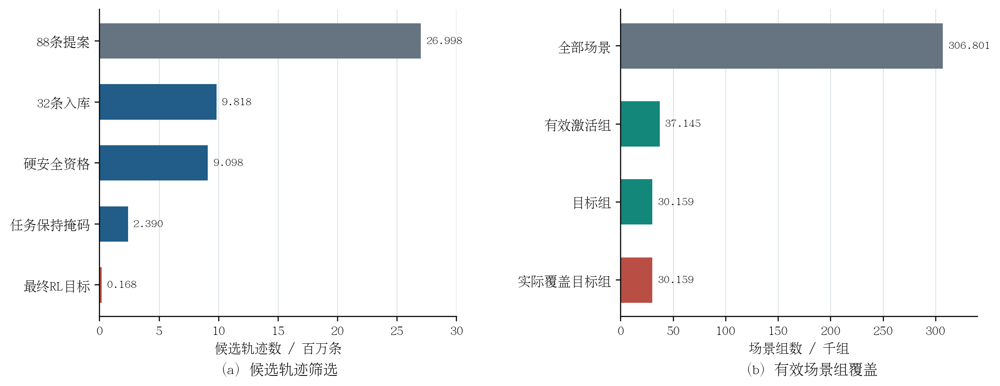
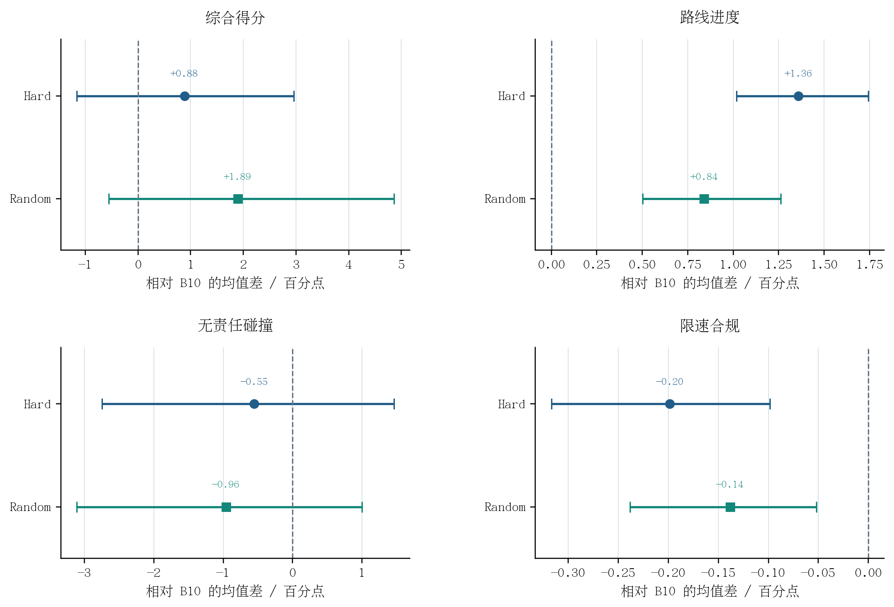
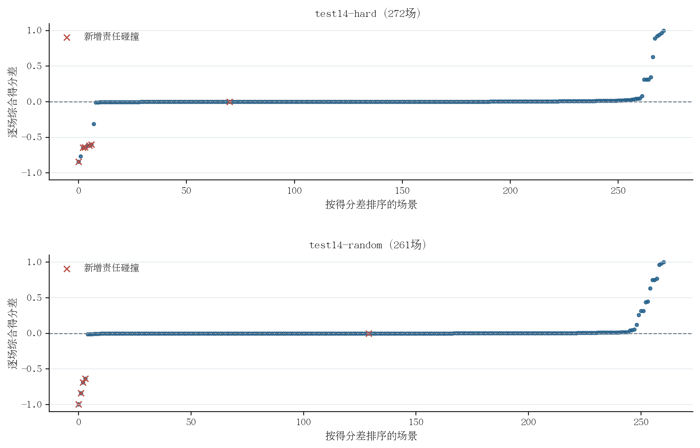

# 全量 306,801 场景安全约束后训练：有效性分析与论文图表

> 本文保留原始 Test14-random 261 场口径。采用 hard 完整 272 场、random 事后剔除两场 259 场的当前统一分析，请阅读[全量后训练有效性综合分析](全量306801后训练有效性综合分析_hard完整_random剔除两场.md)。

> 整理时间：10月08日00时41分  
> 比较对象：历史 HDP B10 与全量后训练 Epoch 2，均使用 EMA 权重。  
> 结论口径：本实验支持“后训练获得有效学习信号，并提高闭环路线进度”；目前不支持“策略已满足安全保持要求”或“可以替换 B10”。

## 1. 应当怎样证明“有效”

本章把“有效”拆成三个可检验的问题，避免只看训练 loss 或综合得分：

| 问题 | 所需证据 | 本次判断 |
|---|---|---|
| 是否获得可学习的训练目标？ | 全量 Replay 审计、目标组数量、目标组实际覆盖 | **是**：30,159 个目标组、167,730 条最终 RL 目标，目标组 100% 访问 |
| 策略是否改变且任务表现改善？ | 独立 validation 的配对变化、Test14 官方闭环指标 | **部分成立**：两套 Test14 的路线进度均提高，日志聚类区间均高于零；综合得分点估计提高但区间跨零 |
| 安全约束是否足以接受新策略？ | 官方责任碰撞、可行驶区域、限速及负向尾部 | **否**：责任碰撞点估计和限速合规在两套 Test14 上均下降，出现 10 个不同 token 的新增责任碰撞 |

因此，论文中建议使用“**有效的任务改进信号**”而非“**已验证的安全单调改进**”描述这次实验。

## 2. 图 4-X：有效训练信号是否足够

**图 4-X　全量 rollout 后的候选轨迹筛选与有效场景组覆盖。**（a）为候选轨迹级数量；（b）为场景组级数量，两幅图的统计单位不同。88 条提案的总量按协议配置乘以场景数得到；其余候选和组数由 307 个正式 Replay 分片逐一重构。图中使用宋体类中文衬线字体，可下载同目录 PDF 作为论文矢量图。

**表 4-X　全量后训练的数据支持与目标覆盖**

| 阶段 | 数量 | 分母及解释 |
|---|---:|---|
| 完成 rollout 并进入 Replay 的场景组 | 306,801 | 全量 mini-train 场景 |
| 88 条/场景生成的提案 | 26,998,488 | 按协议计算；未把 88 条全部写入 Replay |
| 88→32 压缩后入库候选 | 9,817,632 | 306,801 × 32 |
| 碰撞/DA 硬门合格候选 | 9,097,563 | 入库候选的 92.6656% |
| 通过路线/进度/Reward 保持掩码的候选 | 2,390,231 | 入库候选的 24.3463% |
| 具有足够安全质量离散度的激活组 | 37,145 | 全部场景组的 12.1072% |
| 最终含正优势目标的组 | 30,159 | 全部场景组的 9.8302%；激活组的 81.1926% |
| 最终 RL 回归目标 | 167,730 | 每目标组平均 5.5615 条 |
| 实际进入 optimizer 的目标组 | 30,159 | 目标组覆盖率 100%，执行 30,159 次 optimizer step |

这张图证明训练任务规模已达到预设的至少 30,000 个目标组门槛，并且这些目标组全部被无放回访问。它同时揭示限制：最终有目标的场景只占全量场景约 9.83%；剩余场景仍保留在 Replay 中，但不会凭不合格的候选产生 RL 回归梯度。门槛仅超出 159 组，未来改变筛选阈值或数据划分时，必须重新进行全量目标审计。

## 3. 表 4-Y：独立 validation 是否显示方向正确的策略变化

在固定 validation-1000 上，以相同采样随机数配对比较 B10 和后训练模型：每个场景重复三次，共 3,000 对轨迹；推理均为 6 步、`noise_scale=0.1`、单候选。

**表 4-Y　validation-1000×3 配对开环评价**

| 指标 | B10 | 全量后训练 | 后训练 − B10 | 解释 |
|---|---:|---:|---:|---|
| NuPlan 对齐离线 Reward ↑ | 0.538111 | 0.545102 | +0.006991 | 配对 Reward 中位差 +0.001242，61.8% 配对提高 |
| Progress 代理 ↑ | 2.813021 | 2.843505 | +0.030484 | 均值提高，配对 P10 为 −0.020025 |
| DA 合规代理 ↑ | 0.874000 | 0.892667 | +0.018667 | 提高 1.8667 个百分点 |
| Route cost ↓ | 0.223026 | 0.221708 | −0.001318 | 改善 |
| No-collision 代理 ↑ | 0.925000 | 0.924667 | −0.000333 | 净减少 1/3,000 |
| Comfort cost ↓ | 0.342076 | 0.352829 | +0.010754 | 退化 |
| ADE / m ↓ | 2.208081 | 2.208096 | +0.000015 | 均值基本不变 |
| FDE / m ↓ | 5.770504 | 5.841854 | +0.071349 | 均值退化，尽管配对中位差为 −0.069164 m |

这些指标说明策略已经产生可测的任务方向变化；但离线接受门禁 9 项中有 4 项未通过，分别是 progress P10、no-collision、comfort 和 FDE。因此 validation 是“有效更新”的中间证据，不是“安全新策略可接受”的最终证据。表中的 collision、DA 和 progress 均为开环代理，不能代替官方闭环指标。

## 4. 图 4-Y 和表 4-Z：闭环任务收益及其置信区间

**图 4-Y　全量后训练相对 B10 的 Test14 配对闭环效应。**点为逐场均值差，横线为按驾驶日志聚类、有放回重采样 100,000 次得到的 95% 百分位区间；正方向表示指标提高。综合得分与责任碰撞的区间跨零，路线进度区间在两套集合中均高于零，限速合规区间在两套集合中均低于零。图中各子图独立设置横轴范围，不应仅凭线段长度比较不同指标的不确定性。

**表 4-Z　Test14 全量闭环配对结果（后训练 − B10）**

| 指标 | Test14-hard（272 场） | 日志聚类 95% 区间 | Test14-random（261 场） | 日志聚类 95% 区间 |
|---|---:|---:|---:|---:|
| 综合得分 | +0.008809 | [−0.011610, +0.029606] | +0.018941 | [−0.005577, +0.048602] |
| 路线进度 | **+0.013590** | **[+0.010188, +0.017436]** | **+0.008404** | **[+0.005026, +0.012623]** |
| 无责任碰撞 | −0.005515 | [−0.027491, +0.014652] | −0.009579 | [−0.031120, +0.010034] |
| 限速合规 | −0.001984 | [−0.003169, −0.000985] | −0.001383 | [−0.002383, −0.000518] |
| 可行驶区域合规 | −0.003676 | [−0.017007, +0.007752] | +0.011494 | [+0.000000, +0.031034] |

最稳固的正结果是闭环路线进度，而非综合得分的高置信提升：hard 和 random 的进度增益分别为 **1.3590** 和 **0.8404** 个百分点，两套日志聚类区间都严格为正。综合得分分别提高 0.8809 和 1.8941 个百分点，但区间均跨零，不能写成“显著提高综合得分”。

评价使用 `closed_loop_nonreactive_agents`、推理 seed 0。B10 采用经 checkpoint、Test14 清单和逐场结果重新校验的历史完整运行；新模型是本次全量运行。hard 与 random 有 11 个重叠 token，所以不把 533 条记录当作 533 个独立场景进行合并统计。

## 5. 图 4-Z：为什么平均收益仍不足以接受模型

**图 4-Z　Test14 逐场综合得分差值及新增责任碰撞。**每个点代表同一场景“后训练 − B10”的综合得分；场景分别按差值排序。红色叉号标出 B10 无责任碰撞而新模型发生责任碰撞的场景，叉号也可能落在零差值附近，因为该场景的 B10 总分原本就可能为零。

| 集合 | 综合得分改善 | 退化 | 不变 | 新增责任碰撞事件 |
|---|---:|---:|---:|---:|
| Test14-hard | 115 | 56 | 101 | 6 |
| Test14-random | 95 | 54 | 112 | 5 |

由于两个集合存在一个共同的新增碰撞 token，新增责任碰撞合计为 **10 个不同场景**，不是 11 个独立场景。图中可以看到：得分改善场景多于退化场景，但少量负向尾部幅度很大。现有配对分析显示，最差 4 个场景分别占 hard 和 random 总负向得分变化量的 56.15% 和 96.17%。安全研究不能用多数小幅改善来抵消这些事件。

针对 random 中最差四场里的最差两场，另作[事后剔除敏感性分析](Test14_random剔除最差两场的敏感性分析.md)：剩余 259 场的综合得分均值差为 +0.026183，条件化日志聚类 95% 区间为 [+0.004727, +0.054421]；路线进度增益基本不变，但仍有 3 场新增责任碰撞。该分析不替代上述完整 261 场的正式结果。

## 6. 可直接用于论文的结果分析段落

> 为检验所提出的安全约束后训练流程能否在全量数据上产生有效学习信号，首先对 306,801 个 mini-train 场景执行一次完整候选 rollout。每个场景生成 88 条多来源候选，并压缩为 32 条训练候选。对全部 307 个磁盘 Replay 分片进行训练前审计后，得到 37,145 个满足安全质量离散度要求的激活组，其中 30,159 个场景组包含至少一条符合任务保持及正优势条件的候选，共形成 167,730 条 RL 回归目标。后续更新对上述 30,159 个目标组实现无放回全覆盖，说明全量训练并未因 Replay 容量或随机采样而丢失有效目标组。

> 独立 validation-1000 的三次公共随机数配对评价显示，后训练模型相对 B10 的平均离线 Reward 和 progress 分别提高 0.006991 和 0.030484，可行驶区域合规代理提高 0.018667。不过，no-collision 代理、comfort cost 和 FDE 存在退化，表明离线目标增益尚未同时满足全部安全与轨迹质量门禁。为进一步检验实际规划效果，在 Test14-hard 和 Test14-random 上进行完整非反应式闭环仿真。两套集合的路线进度分别提高 0.013590 和 0.008404，按驾驶日志聚类得到的 95% 区间均高于零；综合得分点估计分别提高 0.008809 和 0.018941，但其区间均跨零。

> 尽管闭环任务进度获得稳定改善，无责任碰撞指标在 hard 和 random 上分别下降 0.005515 和 0.009579，限速合规亦一致小幅下降。逐场审计发现 10 个不同场景产生新增责任碰撞。由此可见，所提出的候选生成、目标筛选及全量覆盖机制已经使后训练获得有效的任务改进信号，但当前安全代理和参考保持约束尚不足以保证闭环事件级安全不退化。按照预设的安全接受原则，后训练 checkpoint 保留为研究模型，B10 继续作为已接受基线。

## 7. 结论边界和后续论证要求

1. 本次全量实验同时采用多来源候选、NuPlan 对齐 Reward、硬安全门、任务保持、锚定和覆盖式更新。因此，B10 对比证明的是**整套后训练流程的净效果**；若要把路线进度增益归因于某一个组件，需要相同场景、相同预算的单因素消融。
2. 综合得分的点估计提高，但日志聚类区间跨零；不要将其表述为高置信总体优势。
3. 责任碰撞的点估计下降，但区间也跨零；可以准确表述为“出现新增碰撞，未通过零新增碰撞安全门”，不能据此断言总体碰撞概率已经高置信上升。
4. 限速合规在两套集合的日志聚类区间均低于零，是需要单独解释的负向结果。现有训练缓存没有独立 speeding 事件标签，这一机制缺口值得在失效审计中检查。
5. 目前只有一个训练 seed 和一个闭环推理 seed；按日志聚类得到的区间不覆盖训练随机性或推理随机性。
6. 候选生成时使用的专家未来与邻车未来仅用于训练期 proposal 构造和离线评分；Test14 部署推理未启用 guided denoising。论文方法图应清楚区分训练分支与推理分支。

## 8. 图表与证据文件

- 三张图的 PNG、PDF 和汇总 JSON：`figures/`。
- 可重复生成图表的脚本：`HDP-nuplan/scripts/plot_full306801_posttraining_evidence.py`。脚本只读取既有实验文件，不进行训练或仿真。
- Replay：`/media/yanjun/拯救者PSSD/Diffusion-Planner-HDP/simulation_outputs/training_outputs/EXP_CH4_guided_safeset_full306801_seed2026_v3_1006/replay/`。
- validation 原始 JSON：`/media/yanjun/拯救者PSSD/Diffusion-Planner-HDP/validation_outputs/EXP_CH4_full306801_vs_B10_validation1000x3_1006/B10_vs_full306801.json`。
- Test14 配对扩展分析：`/media/yanjun/拯救者PSSD/Diffusion-Planner-HDP/test14_outputs/EXP_CH4_full306801_vs_historical_B10_1006/extended_paired_analysis.json`。
- 完整训练流程：[HDP 全量 306,801 场景安全约束后训练流程详解](../../../HDP_全量306801场景安全约束后训练流程详解.md)。
- 完整闭环失效与边界：[Test14 全量闭环评测结果与分析](Test14全量闭环评测结果与分析.md)。
