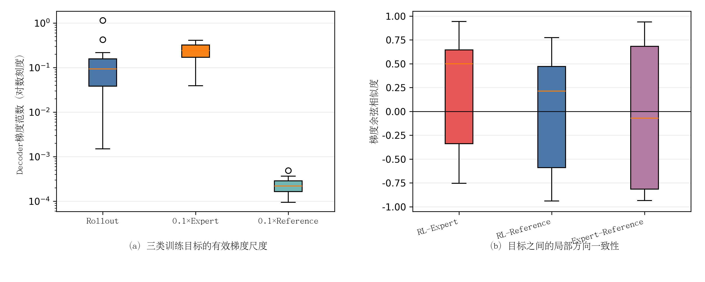

# 约束后训练三目标梯度冲突审计结果

> 完成时间：10月05日16时36分  
> 判定：Expert anchor尺度主导，存在局部冲突；Reference anchor不是当前瓶颈

## 1. 实验完整性

固定64个训练场景形成32个batch，其中15个batch具有至少1条约束rollout回归目标。梯度在20步candidate EMA处、训练时可更新的decoder参数上计算。脚本没有创建optimizer，没有调用`optimizer.step()`，模型权重未改变。

## 2. 梯度尺度

| 分量 | 梯度范数均值 | P50 | P90 |
|---|---:|---:|---:|
| Rollout | 0.177866 | 0.092608 | 0.341138 |
| `0.1×Expert anchor` | **0.243447** | **0.239816** | 0.350395 |
| `0.1×Reference anchor` | 0.000234 | 0.000219 | 0.000342 |

`0.1×Expert`与rollout梯度范数之比P50为2.735，80%的有效batch中expert梯度更大；该比值P90达到27.60，说明统一`expert_anchor_weight=0.1`在稀疏均匀正目标下并不代表“只占10%的更新作用”。原因是rollout仅对少数目标赋单位权重且不再放大，而expert loss始终覆盖整条专家轨迹。

`0.1×Reference`与rollout梯度范数之比P50仅0.0020，当前20步漂移下几乎不影响更新方向。因此不能把本次progress下降归因于reference anchor过强。

## 3. 梯度方向

| 梯度对 | cosine均值 | P10 | P50 | P90 | cosine<0比例 |
|---|---:|---:|---:|---:|---:|
| RL—Expert | 0.240 | -0.700 | **0.500** | 0.929 | 33.3% |
| RL—Reference | 0.002 | -0.765 | 0.214 | 0.574 | 40.0% |
| Expert—Reference | -0.094 | -0.911 | -0.072 | 0.892 | 60.0% |

**图4-x 约束后训练三类目标的decoder梯度尺度与局部方向。**（a）加权Expert梯度通常大于稀疏rollout梯度，而Reference梯度小两个到三个数量级；（b）RL与Expert总体中位方向一致，但约三分之一有效batch存在负余弦冲突，场景间异质性明显。

矢量图：[gradient_conflict_audit.pdf](figures/gradient_conflict_audit.pdf)。

## 4. 科学解释

结果不支持“anchor普遍把RL方向反转”这一简单解释，因为RL—Expert cosine中位数为正。更准确的结论是：

1. 新的均匀正目标避免了数十倍权重放大，但也显著降低rollout梯度尺度；
2. 固定expert权重在多数batch成为主要更新来源，使任务改进信号被稀释；
3. 三分之一有效batch存在RL—Expert局部冲突，统一加权无法处理场景异质性；
4. reference anchor当前过弱，不是优先调节对象；
5. 该审计解释了“策略变化很小”的一部分原因，但仅凭梯度夹角不能证明progress下降的全部因果来源。

## 5. 下一步约束

不应直接删除expert anchor，也不应恢复按候选数放大rollout权重。下一步应在训练分布目标覆盖门通过之后，只读比较两种尺度控制：

- 按实际梯度范数限制expert/rollout比值，但保留expert方向；
- 对RL—Expert负余弦batch使用投影或跳过，而不是全局降低anchor。

任何新规则必须先报告目标覆盖、梯度比值和负余弦比例，再允许新的20步训练；当前证据不足以授权长训练。
