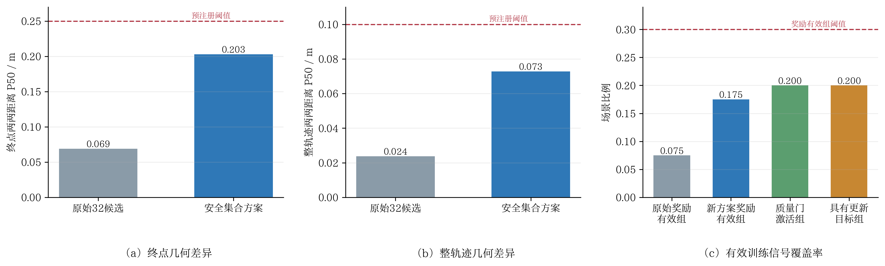

# Guided Safe-Set训练前最小验证实验

> 实验时间：10月05日  
> 实验性质：训练前、单seed、40场景配对诊断；模型权重未更新。  
> 结论：**方案带来明确改善，但尚未解决候选区分度与有效训练信号不足问题，当前不应进入训练。**

> 版本边界：本页结果对应第一版“8自然＋12全局精英＋12全局多样”压缩和仅自由走廊启用Guidance的实现。后续加入的16条中等扰动显式配额及冲突场景减速Guidance尚未重新验证，不能与本页结果混用。

## 1. 实验目的

在不更新B10权重的前提下，验证新设计的“88条候选生成→安全可行集合→32条压缩”是否同时满足：

1. 候选几何差异达到可用水平；
2. 安全集内部reward具有足够排序信号；
3. 碰撞、DA和轨迹质量不因扩大候选支持而退化；
4. reference-relative更新门能够留下实际训练目标。

## 2. 配对协议

40个场景来自固定validation-1000，并按专家轨迹运动量分层：20个高运动、12个中运动、8个低运动控制场景。场景中包含路口通行、交通灯路口、邻近多车、停车和不同速度等级，不是纯简单场景集合。

| 对照 | 候选构造 |
|---|---|
| 原始B10 | `noise=0.1`自然采样32条 |
| 新方案 | B10自然16＋当前策略自然16＋`noise=0.5`中等扰动24＋Guided 32，共88条；压缩为8条安全优先自然候选、12条安全精英、12条安全多样候选 |

两组使用相同B10 EMA权重、相同40个场景、相同seed和6步扩散采样。新方案Guidance门实际仅在20%的场景生效。

## 3. 预注册验收门

运行前固定以下主要阈值：

- 终点两两距离P50不低于0.25 m，且不低于基线4倍；
- 整轨迹两两距离P50不低于0.10 m，且不低于基线4倍；
- `safe reward std>=0.01`场景比例不低于30%，且比基线提高至少15个百分点；
- 有限性、碰撞、DA和ADE保持门不退化；
- 质量离散门激活场景不少于25%，具有更新目标场景不少于20%。

## 4. 主要结果

| 指标 | 原始B10 | 新方案 | 变化 | 验收 |
|---|---:|---:|---:|---|
| 终点两两距离P50 | 0.068983 m | 0.203075 m | 2.94倍 | 未达到0.25 m/4倍 |
| 整轨迹两两距离P50 | 0.023762 m | 0.072774 m | 3.06倍 | 未达到0.10 m/4倍 |
| 安全候选终点距离P50 | 0.068308 m | 0.255352 m | +0.187043 m | 辅助指标改善 |
| 安全候选整轨迹距离P50 | 0.022419 m | 0.094267 m | +0.071848 m | 接近但未达到0.10 m |
| 安全reward std P50 | 0.000155 | 0.001085 | 约7.02倍 | 仍远低于0.01 |
| `safe reward std>=0.01` | 7.5%（3/40） | 17.5%（7/40） | +10个百分点 | 未达到30%/+15个百分点 |
| 至少2条安全候选 | 82.5% | 82.5% | 0 | 保持 |
| no-collision候选比例 | 90.0% | 90.0% | 0 | 通过 |
| DA合规候选比例 | 90.39% | 91.02% | +0.63个百分点 | 通过 |
| 候选平均ADE | 3.4694 m | 3.4410 m | -0.0284 m | 通过 |

配对bootstrap显示，几何差异的提升不是由少数场景偶然造成：

- 终点两两距离平均增量为`+0.212359 m`，95%区间`[+0.141189,+0.293181]`；
- 整轨迹两两距离平均增量为`+0.082795 m`，95%区间`[+0.053444,+0.118502]`；
- 安全reward std平均增量为`+0.011173`，95%区间`[+0.002160,+0.022498]`。

因此可以确认新候选机制产生了真实而稳定的增量，但增量尚不足以满足训练前门槛。

## 5. 训练信号可用性

| 指标 | 结果 | 阈值 | 判断 |
|---|---:|---:|---|
| 质量离散门激活场景 | 20.0%（8/40） | ≥25% | 未通过 |
| 具有可信更新目标的场景 | 20.0%（8/40） | ≥20% | 通过下界 |
| 保留场景平均更新目标数 | 7.625 | ≥2 | 通过 |

虽然每个被保留场景具有足够多的更新目标，但只有8/40场景通过质量门。因此，直接训练会使80%的场景不产生rollout更新，仍然存在明显的有效样本利用率问题。

## 6. 科学结论

本实验支持以下结论：

1. 中等扰动与Guided Denoising确实能扩大B10候选支持，几何差异约提高3倍；
2. 安全集压缩没有降低碰撞、DA或ADE表现，安全约束部分工作符合预期；
3. 扩大几何支持并未等比例转化为reward区分度，安全reward std的中位数仍只有0.001085；
4. 新方案没有改善“是否存在安全候选”的场景覆盖率，至少2条安全候选的场景仍为33/40；
5. Guidance门覆盖率和质量门激活率均为20%。二者数量一致，提示引导覆盖不足可能是当前首要限制，但本次数据没有保存逐场对应关系，因此不能据此断言因果。

最严格、可复核的结论是：

> **新方案显著缓解了候选几何同质化，同时保持安全和轨迹质量，但尚未把改善转化为足够广泛、足够强的安全集合内部reward排序信号，因此尚不能认定候选生成问题已经解决。**

## 7. 下一步决策

当前不启动后训练，也不下调预注册阈值。下一轮修改应只针对Guidance覆盖与方向：

- 自由走廊场景保留对称加速/减速档位；
- 存在前向冲突的场景不再关闭全部Guidance，而是仅允许零偏移和减速档位；
- 静止/低运动场景继续保持不激进探索；
- 不放宽collision、DA、route、progress或reference-relative门。

该修改仍不需要首次碰撞时刻、survival ratio或speeding训练标签。

## 8. 证据文件

- 原始结果：`minimal40_result.json`；
- 可复现实验脚本：`scripts/validate_guided_safe_set_minimal.py`；
- 协议实现：`hdp_nuplan/rl/candidate_safe_set.py`；
- 图表脚本：`make_figure.py`。

本实验是40场景、单seed训练前门禁，只能用于go/no-go决策，不能替代后续validation-1000或官方闭环统计结论。
