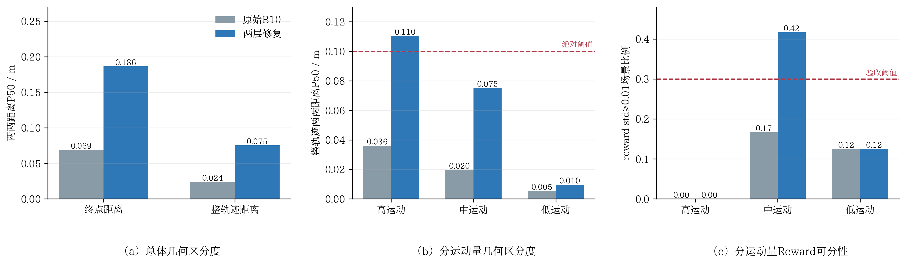

# 两层候选生成修复的训练前最小验证

> 实验时间：10月05日20时16分  
> 实验性质：固定B10、单seed、40场景配对推理诊断；没有更新模型权重。  
> 最终判断：**两层修复显著扩大了候选支持并保持了安全与模仿质量，但未达到预注册的候选区分度和训练就绪门槛，不能认定问题已经解决，也不授权进入后训练。**

## 1. 要验证的命题

本实验只回答一个问题：在第一版训练前门禁失败后，同时加入“中等扰动固定配额”和“场景自适应Guidance”，能否使同一场景的32条最终训练候选同时具有：

1. 足够大的轨迹几何差异；
2. 足够强的安全集合内部Reward排序信号；
3. 不退化的碰撞、可行驶区域和模仿质量；
4. 足够广的有效训练场景覆盖。

只有四项同时成立，才称为“候选生成问题解决”。单纯把轨迹拉开不等于可用于安全约束后训练。

## 2. 严格配对实验协议

两组固定使用同一个B10 Epoch10 EMA checkpoint、同一组40个validation场景、`seed=3407`、6步扩散采样和同一Reward/安全配置。40场景按专家轨迹运动量分层为20个高运动、12个中运动和8个低运动场景。

| 对照组 | 候选生成与压缩 |
|---|---|
| 原始B10 | `noise=0.1`自然采样32条 |
| 两层修复 | B10自然16＋当前策略自然16＋`noise=0.5`中扰动24＋Guided 32，共88条；压缩为8条安全自然、8条安全中扰动Reward精英、8条安全中扰动质量多样和8条全局安全精英 |

第二层Guidance按场景状态自适应：自由运动场景使用对称加减速偏移，存在前向冲突时仅使用减速或零偏移，低运动场景关闭引导并退化为低噪声自然采样。实际Guidance门覆盖率由第一版的20.0%提高到47.5%。

运行前沿用第一版已经固定的阈值，没有根据本次结果事后放宽：终点和整轨迹距离P50分别至少为0.25 m和0.10 m，且均至少达到基线4倍；`safe reward std>=0.01`场景比例至少30%，且相对基线至少增加15个百分点；同时满足安全、ADE及训练目标覆盖门。

## 3. 总体结果

| 指标 | 原始B10 | 两层修复 | 变化 | 预注册判断 |
|---|---:|---:|---:|---|
| 终点两两距离P50 | 0.068983 m | 0.186327 m | 2.70倍 | 未达到0.25 m/4倍 |
| 整轨迹两两距离P50 | 0.023762 m | 0.075276 m | 3.17倍 | 未达到0.10 m/4倍 |
| 安全候选终点距离P50 | 0.068308 m | 0.292721 m | +0.224413 m | 辅助指标明显改善 |
| 安全候选整轨迹距离P50 | 0.022419 m | 0.102597 m | +0.080178 m | 辅助指标达到0.10 m |
| 安全Reward std P50 | 0.000155 | 0.001135 | 7.34倍 | 仍远低于0.01 |
| `safe reward std>=0.01` | 7.5%（3/40） | 15.0%（6/40） | +7.5个百分点 | 未达到30%/+15个百分点 |
| 至少2条安全候选 | 82.5% | 82.5% | 不变 | 通过保持门 |
| no-collision候选比例 | 90.0% | 90.0% | 不变 | 通过 |
| DA合规候选比例 | 90.39% | 90.63% | +0.24个百分点 | 通过 |
| 候选平均ADE | 3.4694 m | 3.4373 m | -0.0320 m | 通过 |

配对bootstrap进一步确认改善不是少数场景造成的偶然现象：

- 终点距离平均增量`+0.213298 m`，95%区间`[+0.143336,+0.293200]`；
- 整轨迹距离平均增量`+0.084587 m`，95%区间`[+0.054149,+0.121471]`；
- 安全Reward std平均增量`+0.010756`，95%区间`[+0.002227,+0.021367]`；
- 安全候选比例增量95%区间为`[0,+0.007031]`，no-collision比例严格不变。

因此，“候选支持扩大且没有牺牲安全/质量”有直接配对证据；但“已经形成普遍有效的Reward排序”不成立。

## 4. 分运动量诊断

总体P50会受到低运动场景影响，因此进一步按预先固定的三类场景拆分：

| 场景层 | 数量 | 整轨迹距离P50：原始→修复 | `reward std>=0.01`：原始→修复 | 解释 |
|---|---:|---:|---:|---|
| 高运动 | 20 | 0.036015→0.110493 m | 0.0%→0.0% | 几何差异已越过0.10 m，但Reward仍无强排序信号 |
| 中运动 | 12 | 0.019557→0.075208 m | 16.7%→41.7% | 几何与Reward可分性均有实质改善 |
| 低运动 | 8 | 0.005305→0.009606 m | 12.5%→12.5% | 低运动保护按设计限制了探索，不能贡献总体几何门 |

最关键的新证据是：20个高运动场景的整轨迹P50已由0.0360 m提高到0.1105 m，但其中没有场景达到`safe reward std>=0.01`。因此当前主要矛盾不再只是“采样轨迹没有拉开”，而是**当前Reward/质量离散门对已经拉开的高运动候选仍不够敏感，无法普遍转化成有效优势排序**。

该结果不能单独证明Reward公式错误；它只证明在当前候选变化尺度、归一化和阈值组合下，Reward响应不足。后续需要对高运动场景逐项分解progress、route、TTC、comfort等分量，区分“Reward确实不敏感”和“变化方向没有触及Reward目标”。

## 5. 训练就绪性

| 指标 | 结果 | 阈值 | 判断 |
|---|---:|---:|---|
| 质量离散门激活场景 | 20.0%（8/40） | ≥25% | 未通过 |
| 具有可信更新目标的场景 | 20.0%（8/40） | ≥20% | 刚好通过下界 |
| 保留场景平均更新目标数 | 8.625 | ≥2 | 通过 |

被保留的8个场景内部有足够目标，但其余32个场景不会贡献rollout策略更新。此时启动训练会把结论混成“候选生成、Reward灵敏度和训练优化”三个因素，无法干净解释，故本次门禁结论仍为no-go。

## 6. 与第一版修复的关系

两层修复不是全面优于第一版：总体终点P50由第一版0.203075 m降至0.186327 m，`reward std>=0.01`场景由7/40降至6/40；但安全集合内部整轨迹P50由0.094267 m提高到0.102597 m，Guidance覆盖由20.0%提高到47.5%，保留场景平均目标数由7.625提高到8.625。

这说明固定中扰动配额成功保证了安全集合内部的轨迹差异，但“扩大Guidance覆盖”没有自动增加有效场景覆盖。下一步不应继续盲目扩大噪声或候选数量，而应先做Reward分量响应审计。

## 7. 可用于论文的阶段性结论

> 在固定B10和40个运动量分层场景上的配对训练前实验表明，结构化中扰动配额与场景自适应Guidance可将最终安全候选的整轨迹两两距离P50由0.0224 m提高至0.1026 m，同时保持碰撞、可行驶区域和平均ADE不退化。然而，有效Reward排序场景仅由7.5%提高至15.0%，且20个高运动场景虽已形成0.1105 m的轨迹差异，却均未达到`reward std>=0.01`。因此，该方法解决了安全候选几何支持不足的一部分，但尚未解决几何差异向有效优势信号转化不足的问题。

不能写成“候选区分度问题已经解决”，也不能据此宣称策略性能改善。

## 8. 后续最小动作

下一步只做冻结B10、同一40场景的Reward分量响应审计，不训练：

1. 对最终安全候选逐场保存总Reward及各分量；
2. 对高运动20场景计算轨迹进度差、各Reward分量标准差和与总Reward的相关性；
3. 检查`0.01`绝对门是否与NuPlan对齐Reward量纲一致，但不因本次失败直接下调阈值；
4. 只有定位到信号压缩来自哪个Reward分量或哪类候选方向后，才修改Reward或Guidance目标并重复同一门禁。

## 9. 证据与复现

- 原始逐场结果：`minimal40_result.json`；
- 图表：`minimal40_pretraining_gate_v2.png`；
- 图表脚本：`make_figure.py`；
- 验证脚本：`scripts/validate_guided_safe_set_minimal.py`；
- 候选压缩：`hdp_nuplan/rl/candidate_safe_set.py`；
- 候选生成与Guidance：`hdp_nuplan/rl/train_epoch_rl.py`。

本结果是单seed、40场景的训练前go/no-go证据，不替代validation-1000或官方闭环统计。
