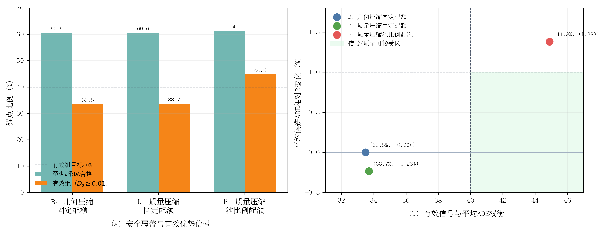

# 质量空间候选压缩消融结果

> 完成时间：10月05日11时06分  
> 最终判定：D、E均未通过总门禁，不启动后训练  
> 最终原始结果：`quality_space_compression_validation1000_v2.json`，SHA-256 `ef9e2fcb2ec60453d6566f7b874df0e9dbc74553c15503195e50021f23ff23d8`

## 1. 完整性与版本说明

validation-1000全部完成，三组共享逐锚点相同的200条候选池。A/B/C/E与第一次完整运行逐项一致。第一次运行暴露D组单槽尺度的实现边界：2.0尺度仅有1个名额时错误地先写入reward最小候选。修正版明确规定单槽取reward最大候选，并重新完成全部1000锚点评价；错误版保留作审计记录但不用于结论。本实验不更新模型参数。

## 2. 主要结果

| 指标 | B：几何/固定配额 | D：质量/固定配额 | E：质量/池比例配额 |
|---|---:|---:|---:|
| 平均DA合格候选数 | 17.957 | 17.957 | **18.234** |
| 至少2条DA合格候选 | 60.6% | 60.6% | **61.4%** |
| `D_s>=0.01`有效组 | 33.5% | 33.7% | **44.9%** |
| `D_s>=0.005`组 | 43.3% | 44.5% | **51.4%** |
| 平均质量离散度`D_s` | 0.022099 | 0.022311 | **0.035667** |
| Top-1原始DA合规 | 70.5% | 70.6% | 70.6% |
| Top-1无碰撞 | **94.4%** | 94.2% | 94.2% |
| Top-1 risk reward | 0.624638 | **0.626600** | **0.626600** |
| Top-1截断TTC（s） | 2.457046 | **2.462741** | **2.462741** |
| Top-1 progress guard | **0.803343** | 0.801748 | 0.801748 |
| Top-1 route cost | **0.222326** | 0.222596 | 0.222596 |
| Top-1 comfort cost | 0.346647 | **0.339263** | **0.339263** |
| 候选平均ADE（m） | 2.228222 | **2.223025** | 2.258968 |
| Oracle ADE（m） | 1.724093 | 1.805563 | **1.714453** |

论文排版可使用矢量版：[quality_space_compression_ablation.pdf](figures/quality_space_compression_ablation.pdf)。

**图4-x 质量空间候选压缩与尺度配额消融。**（a）只改变压缩表示几乎不增加有效组，采用池比例配额后有效组跨过40%，并恢复池内“至少2条合格候选”上限；（b）E的有效信号达到44.9%，但平均候选ADE相对B增加1.38%，超过1%保持门槛，因此落在预注册可接受区域之外。

## 3. 因果解释

### 3.1 D表明压缩表示不是主要原因

D与B使用完全相同的`11/16/2/2/1`尺度配额，唯一改变是把完整XY轨迹最远点替换为五维质量空间极值和最远点。D的有效组只由33.5%提高到33.7%，净增加2/1000；虽然平均ADE略微改善0.233%，但Oracle ADE恶化0.081470 m。这说明在强低噪声配额约束下，改变压缩距离本身既不能显著恢复优势信号，也会丢失部分几何best-of-group覆盖。

### 3.2 E表明中高噪声配额是信号增益的主要来源

E只在D基础上把最终配额由`11/16/2/2/1`改成按200条池比例得到的`7/10/5/5/5`。有效组由33.7%跃升至44.9%，相对B净增加114/1000；至少2条DA合格候选达到61.4%，与200条池上限相同。Oracle ADE改善0.009640 m，说明宽支持包含更好的候选。

代价是候选平均ADE由2.228222 m升至2.258968 m，相对增加1.380%，超过1%门槛。E因此证明了“中高噪声候选名额能够恢复有效优势信号”，但当前池比例配额过强，尚不能作为训练配置。

### 3.3 Top-1门禁失败不能被信号增益抵消

D和E都保留每个尺度的对齐reward最大候选，因此两者Top-1指标相同。相对B，risk提高0.001961、TTC提高0.005695秒、comfort cost降低0.007383，但progress guard下降0.001595；后者仍在容差内。route cost增加0.000270，超过`1e-4`门槛；Top-1无碰撞下降0.2个百分点。

进一步分层表明，无碰撞下降的2个锚点全部来自200条池内没有任何DA合格候选的373个回退场景，在627个有合格候选锚点中no-collision没有下降。这说明该项退化源于“全不安全组如何填满固定32条”的回退规则，而非DA合格集合内选出了碰撞候选。不过该解释不能推翻预注册门禁，D、E仍应判定失败；后续应显式复用B的全不安全回退，而不是事后忽略这2个锚点。

## 4. 预注册判定

| 检查项 | D | E |
|---|---|---|
| 至少1/2条合格候选覆盖 | 通过 | 通过 |
| `D_s>=0.01`不少于40% | **未通过：33.7%** | 通过：44.9% |
| Top-1 DA不下降 | 通过 | 通过 |
| Top-1无碰撞不下降 | **未通过：-0.2 pp** | **未通过：-0.2 pp** |
| Risk、TTC、progress通过 | 通过 | 通过 |
| Route cost增加不超过`1e-4` | **未通过：+0.000270** | **未通过：+0.000270** |
| Comfort cost增加不超过`1e-4` | 通过 | 通过 |
| 平均ADE相对增加不超过1% | 通过：-0.233% | **未通过：+1.380%** |
| **总门禁** | **拒绝** | **拒绝** |

## 5. 当前结论与下一步

本实验形成两个可用于论文的机制结论：

1. 在当前固定低噪声偏置配额下，几何空间与质量空间压缩的有效信号差别很小，压缩距离不是主要瓶颈；
2. 增加1.0～2.0尺度候选的最终名额能够显著增强有效优势信号，但池比例配额会使平均模仿误差越过保持边界。

下一项最小实验应固定质量压缩和B式全不安全回退，只扫描位于`11/16/2/2/1`与`7/10/5/5/5`之间的少量预定义配额，寻找`D_s>=0.01`不低于40%且平均ADE退化不超过1%的边界。由于D与E已经给出两个端点，该扫描应在同一批候选上完成，不重新训练模型，也不再调整reward权重。

## 6. 证据位置

- 最终JSON：`/media/yanjun/拯救者PSSD/Diffusion-Planner-HDP/reward_audit/EXP_CH4_quality_space_compression_1005/quality_space_compression_validation1000_v2.json`
- 最终日志：同目录`full_v2.log`
- 错误边界版本：同目录`quality_space_compression_validation1000.json`与`full.log`
- 审计实现：`scripts/audit_chapter4_da_aware_selection.py`
- 固化协议：[实验协议](实验协议.md)
