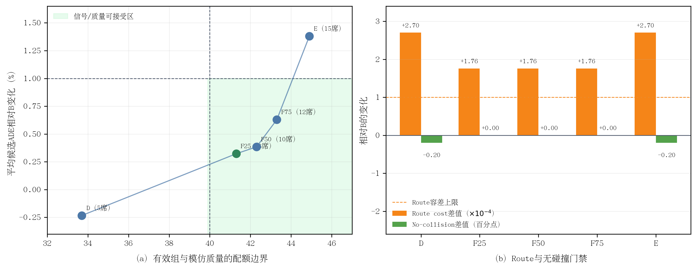

# 中高噪声尺度配额边界实验结果

> 完成时间：10月05日11时15分  
> 结论：F25跨过信号与ADE双门，但route保持门未通过，暂不训练  
> 原始结果：`quota_boundary_validation1000.json`，SHA-256 `c00fed4e806f404432aade7bee3fd7a1d6cca608e463dedc1fd19858a1a775f4`

## 1. 主要结果

| 分支 | `>=1.0`名额 | 至少2条合格 | `D_s>=0.01` | 平均ADE/m | 相对B | Oracle ADE/m |
|---|---:|---:|---:|---:|---:|---:|
| D | 5 | 60.6% | 33.7% | **2.223025** | -0.233% | 1.805563 |
| **F25** | **8** | **61.4%** | **41.3%** | **2.235409** | **+0.323%** | 1.738154 |
| F50 | 10 | 61.4% | 42.3% | 2.236789 | +0.385% | 1.725200 |
| F75 | 12 | 61.4% | 43.3% | 2.242244 | +0.629% | **1.713418** |
| E | 15 | 61.4% | 44.9% | 2.258968 | +1.380% | 1.714453 |

论文排版可使用矢量版：[quota_boundary.pdf](figures/quota_boundary.pdf)。

**图4-x 中高噪声配额边界。**（a）F25以最小的8个中高噪声名额跨过40%有效组门槛，平均ADE只增加0.323%；继续增加名额的信号边际收益逐步减小；（b）F组复用B的全不安全回退后no-collision不再下降，但Top-1 route cost仍超过预注册容差。

## 2. 最小充分配额是F25

从D到F25，中高噪声名额由5增加到8，有效组由33.7%跃升到41.3%，增加7.6个百分点；从F25继续增加到F50、F75和E，有效组只继续增加1.0、2.0和3.6个百分点。因此，信号收益主要发生在最初增加的3个中高噪声名额，后续边际收益明显减小。

F25的平均候选ADE相对B只增加0.323%，明显低于1%门槛；至少2条DA合格候选达到61.4%，恢复到200条池的上限。按照“满足门槛的最小方法强度”原则，F25优先于F50、F75和E。

## 3. 全不安全回退修复得到验证

F25/F50/F75在200条池无任何DA合格候选的373个锚点上复用B索引。三个F组的Top-1 no-collision均为94.4%，与B完全一致，而未复用回退的D/E为94.2%。这构成严格的机制证据：此前2/1000个无碰撞下降来自全不安全场景的回退候选变化，不来自DA合格集合内的候选选择。

## 4. 唯一剩余门禁是route保持

三个F组的Top-1指标完全相同：相对B，risk提高约0.001870，TTC提高0.005915秒，progress guard下降0.000679，comfort cost下降0.004695，DA提高0.1个百分点，no-collision保持；均满足相应门槛。但route cost由0.222326升至0.222502，增加0.000176，超过`1e-4`容差0.000076。

F25因此已通过信号、安全、进度、舒适和模仿质量门，但仍不能因route超限而直接启动训练。该失败幅度很小，但门槛是在运行前固化的，不能事后放宽。

## 5. 科学结论与下一步

本实验给出了清晰的配额剂量响应，并确定F25为下一步唯一需要保留的配额：

> 将最终32条组中的1.0～2.0尺度名额从5增至8，已足以恢复40%以上有效优势信号；更强的宽支持配额只带来较小信号增益和更大模仿偏移。

下一步固定F25，不再扫描配额。应加入相对B Top-1的任务保持资格：在安全资格之后，只允许progress guard不低于B Top-1减0.005、route cost不高于B Top-1加`1e-4`的候选进入优势集合；再检查有效组能否保持40%以上。该实验只新增任务保持资格，是route门失败后的自然单因素修复。

## 6. 证据位置

- 原始JSON：`/media/yanjun/拯救者PSSD/Diffusion-Planner-HDP/reward_audit/EXP_CH4_quota_boundary_1005/quota_boundary_validation1000.json`
- 运行日志：同目录`full.log`
- 实现：`scripts/audit_chapter4_da_aware_selection.py`
- 固化协议：[实验协议](实验协议.md)
