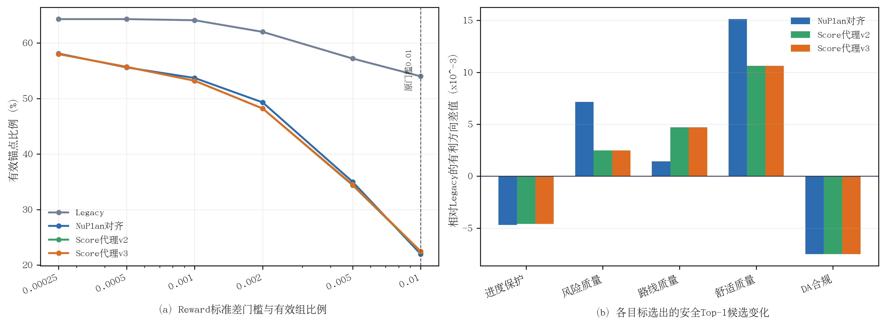

# 固定Repair候选上的Reward排序审计结果

> 完成时间：10月05日09时59分  
> 实验性质：validation-1000只读审计，不更新模型参数  
> 原始结果：`reward_ranking_validation1000.json`，SHA-256 `bc36dd6a022d0155c72b2c5a11e7623fc6fa4bac96ae200bec507a77b9627cae`

## 1. 实验是否严格成立

每个锚点的200条Repair候选池只生成一次，按Repair-100原始legacy选择协议压缩为固定32条，然后由四种reward同时评分。1000个锚点中有667个至少包含一条安全合格候选，647个至少包含两条；四种目标的安全资格集合差异计数为0。因此，下述排序差异来自reward定义，而不是候选噪声、模型权重或安全资格变化。

其余333个无安全候选的锚点不进入“安全集合内部排序”结论。这一比例再次表明，reward设计不能修复候选支持本身不存在的问题。

## 2. Reward排序确实发生了实质变化

| 目标 | 与Legacy同Top-1（全部1000） | 与Legacy同Top-1（667个有安全候选） | Top-1被Pareto支配 | 与Legacy排序相关P50 |
|---|---:|---:|---:|---:|
| Legacy | 100% | 100% | 7.94% | 1.000 |
| NuPlan对齐 | 71.1% | 67.02% | **0%** | 0.9624 |
| Score代理v2 | 69.6% | 65.07% | **0%** | 0.9390 |
| Score代理v3 | 69.6% | 65.07% | **0%** | 0.9390 |

NuPlan对齐目标在220/667个有安全候选锚点中改变了top-1，v2/v3在233/667个锚点中改变了top-1，说明新目标并非只改变reward数值尺度。Legacy选出的安全top-1中7.94%被另一个安全候选在预注册的多指标质量空间中Pareto支配，而三个新目标均为0，说明将路线、舒适或安全质量直接纳入单调聚合，确实减少了“被明显更优候选支配仍排名第一”的现象。

不过，v2和v3在1000个锚点上的top-1完全一致，安全集合内排序相关系数均值为0.99985、P50为1。这说明在碰撞候选已经被过滤且合格候选collision cost几乎为0时，v3新增的连续collision质量不足以改变实际选择；不能把“代码中加入了collision cost”直接写成有效实验贡献。

## 3. Top-1多目标变化

以下差值均在667个具有安全候选的锚点上计算。

| 新目标减Legacy | NuPlan对齐 | Score代理v2 | Score代理v3 | 越大/越小更好 |
|---|---:|---:|---:|---|
| Progress | -0.021659 | -0.011414 | -0.011414 | 越大越好 |
| Progress guard | -0.004694 | -0.004599 | -0.004599 | 越大越好 |
| Risk reward | **+0.007154** | +0.002474 | +0.002474 | 越大越好 |
| 截断8秒最小TTC | **+0.010711 s** | +0.006145 s | +0.006145 s | 越大越好 |
| Collision cost | -0.000001 | -0.000001 | -0.000001 | 越小越好 |
| Route cost | -0.001437 | **-0.004716** | **-0.004716** | 越小越好 |
| Comfort cost | **-0.015123** | -0.010637 | -0.010637 | 越小越好 |
| DA合规率 | **-0.007496** | **-0.007496** | **-0.007496** | 越大越好 |
| ADE | +0.058918 m | +0.132814 m | +0.132814 m | 越小越好 |
| FDE | +0.177904 m | +0.361671 m | +0.361671 m | 越小越好 |

论文排版可使用矢量版：[reward_ranking_audit.pdf](figures/reward_ranking_audit.pdf)。

**图4-x 固定Repair候选上的reward排序审计。**（a）新目标的reward尺度明显收缩，原`reward std≥0.01`门槛会大幅减少有效组；（b）三个新目标均以少量进度保护与DA合规为代价，改善risk、route或comfort质量，v2与v3几乎重合。

NuPlan对齐目标更偏向risk、TTC和comfort，并且ADE/FDE偏移小于v2/v3；v2/v3更偏向真实route cost，进度损失略小。三者都出现DA合规率下降0.7496个百分点：4至5个锚点由不合规候选切换为合规候选，但9至10个锚点发生相反切换，净损失5/667。这与代码一致，因为当前`reward_safety_gate_require_drivable_area=False`，而四种标量目标都没有把实际布尔DA代理作为不可补偿约束。

因此，预注册的六项门槛虽然全部通过，但不能据此立即启动训练。原因不是事后修改门槛，而是审计暴露了协议中遗漏DA这一安全维度；必须如实记录“按原门槛通过，同时发现新的安全缺口”。

## 4. 新Reward的数值尺度会重新制造弱优势信号

| `reward std`门槛 | Legacy有效组 | NuPlan对齐 | Score代理v2 | Score代理v3 |
|---:|---:|---:|---:|---:|
| 0.0005 | 64.3% | 55.6% | 55.7% | 55.7% |
| 0.001 | 64.1% | **53.7%** | 53.2% | 53.2% |
| 0.002 | 62.0% | 49.3% | 48.2% | 48.2% |
| 0.005 | 57.2% | 35.0% | 34.4% | 34.5% |
| **0.01（当前训练门槛）** | **54.0%** | **22.0%** | **22.4%** | **22.5%** |

Legacy安全组reward std的P50为0.01822，而NuPlan对齐和v2/v3分别只有0.00182和0.00165。若保持`rl_min_reward_std=0.01`不变，active group将从54.0%下降到约22%，会重新出现“候选存在但优势信号被固定绝对阈值过滤”的问题。

将新目标阈值机械设置为0.001可把active group恢复到53%左右，但这样会同时改变reward目标和信号门槛，不能被描述为严格的单配置字段消融。更稳健的实现应将门禁改为尺度无关形式，例如组内标准化后的最小跨度、相对range或按旧目标有效组比例预注册校准；随后让Legacy和新目标使用同一尺度无关规则。

## 5. 当前结论与下一步决策

本实验形成三项明确结论：

1. 当前legacy reward确实会在部分场景选中被其他安全候选多指标支配的轨迹，新目标改变排序具有现实作用；
2. v3的连续collision项在现有安全过滤后没有提供可观测增量，当前不值得单独训练v3；
3. 新目标不能原样进入后训练，因为固定绝对reward-std门槛不适配新尺度，而且DA没有进入不可补偿安全约束。

因此，下一项最小实验应仍然保持只读：在同一候选协议上比较“NuPlan对齐reward + 专家有效性条件下的DA安全门”，同时将有效优势门改为尺度无关规则。验收必须包括：DA不下降、安全候选覆盖不能大幅坍缩、risk/TTC/comfort收益保留、progress guard损失不扩大。只有该门控审计通过，才启动B10起点的100步严格后训练对照。

在三种新目标中，**NuPlan对齐目标是当前优先修复对象**：它在risk、TTC、comfort和ADE/FDE保持上优于v2/v3；v2/v3虽改善route更多，但模仿偏移更大，且v3未显示独立价值。这是进入下一轮门控审计的优先级判断，不是已经证明NuPlan对齐训练更优。

## 6. 证据位置

- 原始结果：`/media/yanjun/拯救者PSSD/Diffusion-Planner-HDP/reward_audit/EXP_CH4_reward_ranking_audit_1005/reward_ranking_validation1000.json`
- 完整日志：同目录`full.log`
- 烟雾测试：同目录`smoke8.json`
- 实验实现：`scripts/audit_chapter4_reward_ranking.py`
- 固化协议：[实验协议](实验协议.md)
