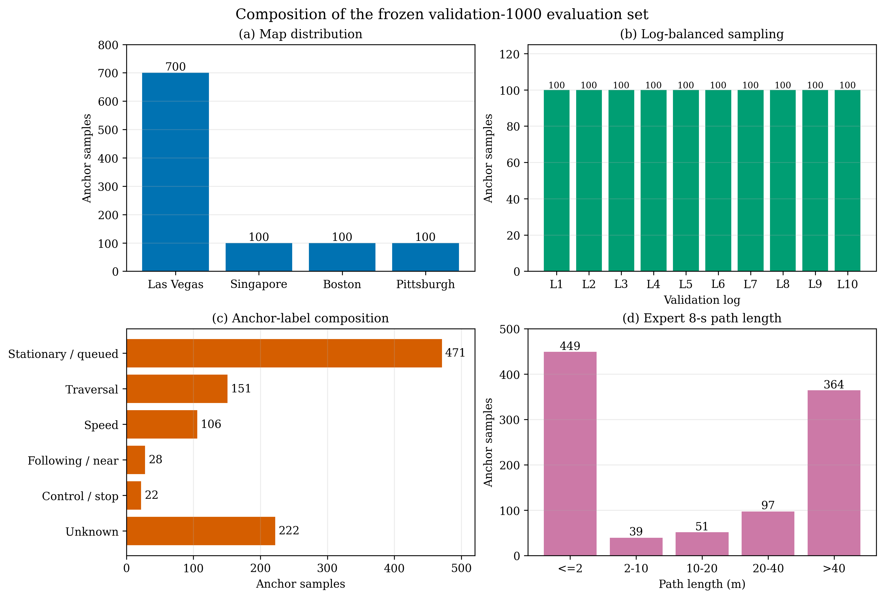
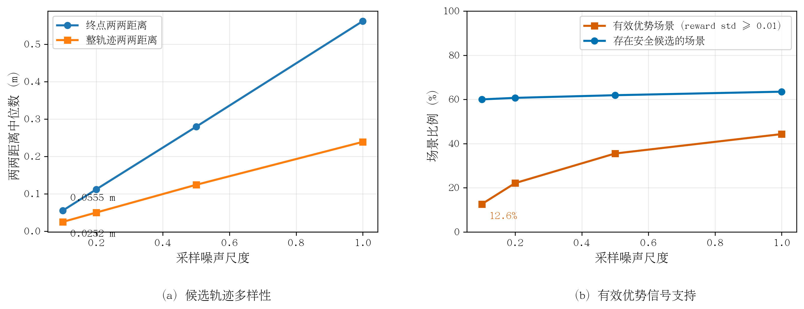
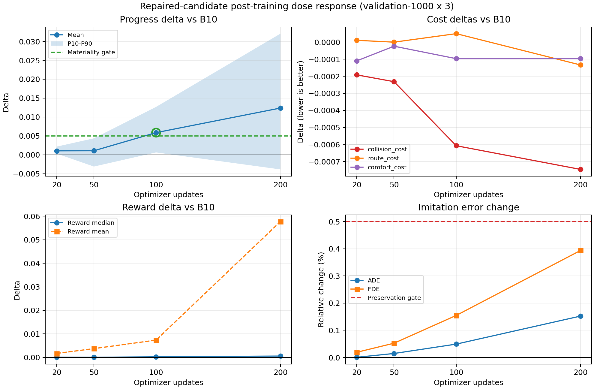
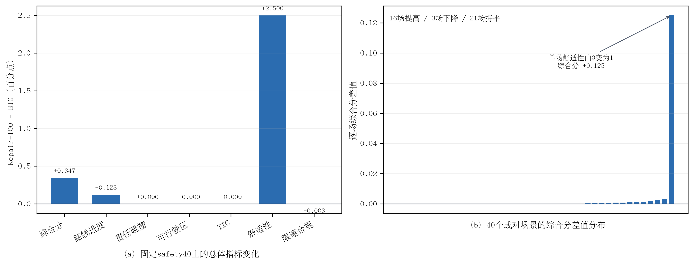

# 第四章阶段性结论与成果

> 汇总时间：10月05日16时25分  
> 适用范围：B10基础扩散规划器的安全约束后训练  
> 当前证据级别：完整离线机制链、严格单因素证据及固定safety40成对非反应式闭环确认

## 1. 第四章目前已经回答的核心问题

第四章目前可以围绕以下科学问题展开：

> 当基础扩散规划器的同场景多候选过于集中时，如何在不放宽安全约束、不显著破坏基础模仿能力的前提下，构造可用的组内优势信号，并将其稳定转化为方向正确的策略变化？

当前已经形成“问题诊断—方法修复—因果对照—剂量响应—候选接受”五段证据链。

## 2. 为什么选择validation-1000，以及该数据集的详细构成

首先需要澄清：`validation-1000`不是“一个场景”，也不是1000个nuPlan官方scene，而是从nuPlan `mini_val`中固定抽取的**1000个以Lidar时刻为锚点的开环规划样本**。这1000个锚点样本实际覆盖156个nuPlan官方scene。它在第四章中承担的是“机制诊断、参数筛选和checkpoint离线门禁”，而不是最终官方闭环结论。

### 2.1 构建方式与固化身份

| 属性 | validation-1000的实际设置 |
|---|---|
| 原始下载数据 | nuPlan mini split中指定为`mini_val`的10个SQLite log，数据库`scene`表共197条官方scene |
| SDK有效scene | nuPlan SDK每log排除最前2个和最后2个scene，剩157个有效官方scene |
| 展开后候选池 | SDK查询枚举有效scene内每个20 Hz `lidar_pc`；`expand_scenarios=True`使每行构成单锚点`NuPlanScenario`，得到62,818个唯一锚点样本 |
| 抽样方式 | `balanced_logs`，从10个独立log中各固定抽取100个锚点样本 |
| 随机种子 | `3407` |
| 最终规模 | 1000个锚点样本，10个log，每log 100个，覆盖156个官方scene |
| 单样本内容 | 以一个Lidar时刻为当前时刻，提取2秒历史、8秒expert未来、邻车及地图/路线特征 |
| 缓存完整性 | 1000/1000预处理成功，0失败，无重复输出名 |
| 固定manifest | `diffusion_planner_validation.json` |
| manifest SHA-256 | `bf025308d6b2da624836033773f06a95c43930fe247d2a5729571fa0707f61ab` |

从原始数据到validation-1000的转换关系为：

```text
10个mini-val SQLite logs
        ↓ 数据库scene表
197个官方scene（通常约20秒）
        ↓ SDK valid_scenes：每log去掉首2+尾2
157个有效官方scene
        ↓ SDK枚举20 Hz lidar_pc，expand_scenarios=True生成单锚点对象
62,818个规划锚点样本
        ↓ balanced_logs，seed=3407，每log 100个
1,000个验证锚点样本（覆盖156个官方scene）
        ↓ 每样本提取2秒历史+8秒未来
1,000个HDP NPZ开环验证样本
```

所谓“去重”指的是按`<map_name>_<lidar_token>.npz`去除重复输出名，**不是把197个官方scene去重成62,818个scene**。每个官方scene内有数百个Lidar时间锚点，不同锚点的2秒历史和8秒未来窗口可以大量重叠。

manifest和随机种子固定后，所有B10、Control、Repair及不同checkpoint都在同一批锚点样本上进行公共随机数配对比较，从而尽量把差异归因于模型或后训练机制，而不是样本换批。

### 2.2 选择validation-1000的五个理由

1. **与B10训练数据隔离。** 分割审计显示，B10训练集与validation-1000在log、NPZ文件和scenario token三个层面的交集都为0，因此可以用作held-out开发验证集。
2. **避免长log主导结果。** 如果从62,818个锚点样本中全局随机抽样，可用锚点更多的log会获得更高权重。每log等额100个使10个驾驶时段在样本数上等权。
3. **足以观察样本级少数现象和分位数。** 1000个锚点样本使比例统计的最小计数分辨率为0.1个百分点，样本级P10约对应第100个锚点，比14或40个锚点更适合诊断“无安全候选”、“弱优势信号”和尾部退化。但这1000个样本只来自156个官方scene和10个log，不是1000个独立驾驶episode；它提高的是开发筛选稳定性，不等价于已完成独立同分布前提下的正式显著性检验。
4. **可支持频繁的同锚点重复对照。** 第四章已在该集合上生成`1000×4个噪声尺度×32候选=128,000`条候选轨迹，并对多个checkpoint执行`validation-1000×3`配对评价。它比官方闭环仿真更适合做噪声扫描、消融和中间checkpoint门禁。
5. **与Test14/safety40职责分离。** validation-1000用于频繁的开环机制诊断；固定`safety40`或Test14用于价格更高、更接近最终结论的闭环确认。两者是“筛选集+确认集”，不是互相替代。

### 2.3 地图、日志、场景类型和运动强度构成



论文排版可使用矢量版：[validation1000_characterization.pdf](figures/validation1000_characterization.pdf)。

**图4-x validation-1000锚点样本的数据构成。** (a)样本来自4张nuPlan地图，其中Las Vegas占70%；(b)10个log各选100个锚点样本，日志级样本数均衡；(c)锚点继承的scenario type为便于展示被重组为6类，静止/排队和unknown占比较高；(d)根据每个锚点的expert未来轨迹的8秒路径长度分箱，数据包含449个静止/微动样本和551个运动样本。

| 地图 | 锚点样本数 | 占比 |
|---|---:|---:|
| Las Vegas Strip | 700 | 70.0% |
| Singapore One North | 100 | 10.0% |
| Boston | 100 | 10.0% |
| Pittsburgh Hazelwood | 100 | 10.0% |

| ID | nuPlan log | 地图 | 下载scene | SDK有效scene | 展开锚点 | 入选锚点 | 实际覆盖scene |
|---|---|---|---:|---:|---:|---:|---:|
| L1 | `2021.06.07.12.54.00_veh-35_01843_02314` | Las Vegas | 24 | 20 | 8,000 | 100 | 19 |
| L2 | `2021.06.07.18.53.26_veh-26_00005_00427` | Las Vegas | 22 | 18 | 7,200 | 100 | 18 |
| L3 | `2021.06.08.12.54.54_veh-26_04262_04732` | Las Vegas | 24 | 20 | 8,006 | 100 | 20 |
| L4 | `2021.06.08.14.35.24_veh-26_02555_03004` | Las Vegas | 24 | 20 | 8,009 | 100 | 20 |
| L5 | `2021.06.08.16.31.33_veh-38_01589_02072` | Las Vegas | 25 | 21 | 8,401 | 100 | 21 |
| L6 | `2021.07.24.20.37.45_veh-17_00015_00375` | Las Vegas | 19 | 15 | 6,000 | 100 | 15 |
| L7 | `2021.07.24.23.50.16_veh-17_01696_02071` | Las Vegas | 20 | 16 | 6,400 | 100 | 16 |
| L8 | `2021.08.09.17.55.59_veh-28_00021_00307` | Boston | 15 | 11 | 4,400 | 100 | 11 |
| L9 | `2021.08.24.13.12.55_veh-45_00386_00472` | Pittsburgh | 5 | 1 | 401 | 100 | 1 |
| L10 | `2021.10.05.07.10.04_veh-52_01442_01802` | Singapore | 19 | 15 | 6,001 | 100 | 15 |
| **合计** | — | — | **197** | **157** | **62,818** | **1,000** | **156** |

| 用于图表展示的锚点标签组 | 样本数 | 占比 | 含义 |
|---|---:|---:|---|
| 静止/排队 | 471 | 47.1% | `stationary`、`stationary_in_traffic`、静止等灯 |
| 穿越类 | 151 | 15.1% | 路口、交通灯路口、接送区、人行横道 |
| 速度等级 | 106 | 10.6% | 低/中/高速度幅值 |
| 跟车/邻近交互 | 28 | 2.8% | 慢前车、无前车跟车、邻近车辆或行人 |
| 控制/停车 | 22 | 2.2% | 停止线、停车标志、跟车制动等 |
| Unknown | 222 | 22.2% | 缓存中无更细scenario type标签 |

上表的6类是为了论文图表可读性对24个原始nuPlan scenario type的**二次展示分组**，不是nuPlan官方新定义的类别。完整原始类型计数保存在图表数据JSON中。

| Expert 8秒路径长度 | 锚点样本数 | 占比 |
|---|---:|---:|
| `<=2 m` | 449 | 44.9% |
| `2–10 m` | 39 | 3.9% |
| `10–20 m` | 51 | 5.1% |
| `20–40 m` | 97 | 9.7% |
| `>40 m` | 364 | 36.4% |

Expert 8秒路径长度的P10/P50/P90分别为`0.0018/12.5929/77.0344 m`。因此该集合并非全部是简单静止样本，但静止/微动样本确实占44.9%，所以后续报告必须同时分层报告`<=2 m`和`>2 m`锚点样本，不应只报告总体均值。

每个缓存样本中当前时刻可见邻车数的P10/P50/P90为`11/32/32`，其中759/1000个样本达到32辆上限。这说明大量样本含有交互对象，但由于输入表示将邻车截断为最多32辆，该统计只能表明“达到模型表示上限”，不能当作场景真实交通密度的无截断估计。

1000个锚点样本覆盖156/157个SDK有效官方scene。每个已覆盖scene的入选锚点数中位数为6，P10/P90为3/9；但L9只有1个有效scene，这100个锚点都来自该scene。这说明validation-1000的官方scene覆盖很高，但样本间不是独立的。

### 2.4 与B10训练集的独立性审计

| 审计项 | B10训练集 | validation-1000 | 交集 |
|---|---:|---:|---:|
| log | 44 | 10 | 0 |
| manifest锚点样本 | 306,801 | 1,000 | — |
| unique scenario token | 306,801 | 1,000 | 0 |
| NPZ文件 | 306,801 | 1,000 | 0 |

该审计通过了log、token和缓存文件三重检查。因此，将validation-1000用于B10及其后训练checkpoint的比较是合理的；但它在多次调参和checkpoint选择后已经成为**development validation set**，不能再当作未见过的最终测试集。

### 2.5 必须公开的局限

- 它平衡的是log，不是scenario type；因此静止/排队和unknown样本占比偏高。
- 1000个锚点样本只对应156个官方scene，而且同scene窗口重叠；将N=1000直接当成1000个独立样本会高估有效样本量。正式置信区间应至少按官方scene或log进行聚类重采样。
- Las Vegas占70%，不是四张地图等额抽样；结果不应解读为地图均衡的泛化结论。
- 跟车/邻近交互和控制/停车组仅有28和22个锚点样本，罕见安全关键类型的覆盖不足。
- 当前reward诊断使用缓存expert/邻车未来，属于开环或近似闭环评价，无法替代reactive closed-loop simulation。
- 因此，validation-1000最适合回答“修复是否改变候选支持、优势信号和离线安全代理量”，不足以单独回答“官方闭环安全性是否改善”。

数据构成图的可机读数据：[validation1000_characterization.json](figures/validation1000_characterization.json)。该JSON及PNG/PDF的SHA-256分别为`d94152c8...0d00`、`fd212667...1b19`和`f58e2b40...026c`。原始抽样、缓存检查和分割审计报告位于`tmp/mini_val_balanced_1000_seed3407_v1/`。

## 3. 结论一：原始后训练的首要瓶颈是候选支持与有效优势信号不足

在B10、validation-1000、32候选、`noise=0.1`下：

- 终点两两距离P50仅`0.055530 m`；
- 整轨迹两两距离P50仅`0.025200 m`；
- 按`reward std>=0.01`计算，只有12.6%锚点样本具有较明确的安全集合内部排序信号；
- 400/1000锚点样本无任何合格候选，589/1000锚点样本的32条候选全部合格，安全资格呈现明显的样本级“全有或全无”；
- Expert未来轨迹超过2 m的运动锚点样本中，有安全候选的比例只有48.28%。

代码审计确认每条候选使用独立高斯噪声，不存在误复制同一噪声的实现错误。几何差异随`noise_scale`近似线性增长，这一受控尺度实验支持：原配置将VP-SDE终端初始噪声缩小到0.1是候选几何差异过小的主要直接因素之一，而group维度实现错误不是原因。该实验不排除单专家监督、强场景条件和模型支持集较窄的共同影响。

这一结论意味着：原始后训练不能只靠增大group size或延长训练来解决，因为在狭支持集中增加采样数量并不会自动创造安全、有区分度的学习目标。

### 3.1 实验图表证据



论文排版可使用矢量版：[B10_candidate_support_bottleneck.pdf](figures/B10_candidate_support_bottleneck.pdf)。

**图4-x B10候选支持与有效优势信号诊断。** (a)随着初始噪声尺度增大，候选终点和整轨迹差异近似同步增长，表明原始`noise=0.1`直接压缩了候选差异；(b)在原始尺度下，仅12.6%锚点样本具有`reward std>=0.01`的较强组内排序信号。原始尺度的安全资格结构和按Expert路径长度的覆盖分层不再放入本图，由紧随其后的两张数值表报告。

| Noise scale | 终点距离P50/m | 整轨迹距离P50/m | `reward std>=0.01`样本 | 无合格候选 | 32条全合格 | 混合边界 |
|---:|---:|---:|---:|---:|---:|---:|
| 0.1 | 0.055530 | 0.025200 | 12.6% | 400 | 589 | 11 |
| 0.2 | 0.112021 | 0.050084 | 22.1% | 393 | 585 | 22 |
| 0.5 | 0.279462 | 0.124225 | 35.5% | 381 | 571 | 48 |
| 1.0 | 0.561602 | 0.238900 | 44.3% | 365 | 548 | 87 |

| 锚点样本分层（Expert 8秒路径） | 样本数 | 有安全候选的比例 |
|---|---:|---:|
| 静止/微动（`<=2 m`） | 449 | 74.39% |
| 运动（`>2 m`） | 551 | 48.28% |

图表由冻结的validation-1000原始结果JSON直接生成，未重新运行模型推理。原始JSON：`tmp/chapter4_candidate_diagnostics/b10_validation1000_noise_sweep_v2.json`，SHA-256 `1ccf3f472866ef4b69b8ddab86f40a8c8c4d0171a6cfbe096c27f3bda0b117b6`。运动分层仅从同一1000个锚点样本的缓存expert轨迹重算路径长度，不改变候选或reward结果。

## 4. 结构化安全多样性候选生成方法及有效性验证

### 4.1 研究目的与基本思路

上一节表明，原始`noise_scale=0.1`配置下的同场景候选轨迹高度集中，难以稳定形成兼具安全资格和reward区分度的候选组。由此提出以下假设：**先在更宽的扩散初始噪声尺度上扩展候选搜索支持，再使用安全优先与质量受控的子集选择，可以在不明显破坏B10基础轨迹质量的前提下，提高安全集合内部的候选多样性和有效优势信号比例。**

为验证该假设，本文设计“多尺度扩大搜索池—安全多样性压缩”两阶段候选生成方法，以Repair表示。该方法不改变B10模型参数和最终后训练组规模，只修改rollout阶段的候选提案与选择方式。

### 4.2 多尺度候选搜索池

对于给定场景，从冻结的B10生成200条候选轨迹。第\(i\)条候选的扩散终端状态为

\[
x_T^{(i)}=\sigma_i z_i,\qquad z_i\sim\mathcal N(0,I),
\]

其中\(\sigma_i\)表示候选级初始噪声尺度。候选池按`0.1×40+0.5×64+1.0×32+1.5×32+2.0×32`构成。其中，低噪声候选用于保留B10原有分布附近的质量锚点，中高噪声候选用于搜索原窄支持集之外的安全可行轨迹。

### 4.3 安全优先的候选子集选择

奖励计算器首先为200条候选计算总reward及其progress、collision、risk、TTC、route和comfort等分项量。本实验中，安全合格集合定义为

\[
\mathcal E_s=
\left\{
\tau_i\mid
r_i^{\mathrm{risk}}\ge 0.3,
\mathrm{TTC}_i\ge1.0\ \mathrm{s},
\mathrm{noCollision}_i=1
\right\}.
\]

随后，使用`0.1×11+0.5×16+1.0×2+1.5×2+2.0×1`的固定尺度配额将搜索池压缩为32条训练候选。在每个噪声尺度内，首先以安全合格候选中reward最小和最大的轨迹作为种子，以保留安全集合内的奖励跨度；再使用整轨迹最远点采样补齐该尺度配额。对已选集合\(\mathcal S\)，下一条轨迹的选择规则为

\[
i^*=\arg\max_{i\notin\mathcal S}
\min_{j\in\mathcal S}
\left\|\operatorname{vec}(\tau_i^{xy})-
\operatorname{vec}(\tau_j^{xy})\right\|_2.
\]

该规则使最终子集尽量覆盖不同的整段轨迹形态。当某一尺度下的安全合格候选数量少于该尺度配额时，允许未合格候选补足固定组规模，但保留其不合格标记，不将其重新标记为安全回归目标。因此，本方法应准确理解为“安全优先选择”，而非对所有不合格候选进行无条件删除。

固定配额对宽探索候选进行了显式限制：最终组中`noise≥1.5`的候选仅占`3/32`。因此，高噪声候选主要承担扩展搜索支持的作用，而不会因几何差异较大而无约束地主导优势估计。

### 4.4 实验设置与验收指标

实验固定B10 Epoch10 EMA权重、validation-1000、`seed=3407`、6步DPM-Solver、同一reward与安全配置，并对原始`0.1×32`和Repair `200→32`使用公共基础噪声进行对照。该实验只评价候选生成，全过程不更新任何模型参数。验收同时考察数值有限性、几何多样性、有效优势信号、安全覆盖、平均模仿质量、组内上界以及奖励—进度对齐，共11项预注册门槛。

### 4.5 结果与分析

**表4-x 原始候选与Repair候选的validation-1000对照结果**

| 指标 | 原始`0.1×32` | Repair `200→32` | 变化及验收结果 |
|---|---:|---:|---:|
| 有限候选比例 | 100% | 100% | 通过 |
| 终点两两距离P50 | 0.055530 m | **0.526807 m** | 9.49倍，通过 |
| 整轨迹两两距离P50 | 0.025200 m | **0.222074 m** | 8.81倍，通过 |
| `reward std≥0.01`锚点样本 | 12.6% | **54.7%** | +42.1 pp，通过 |
| 至少2条安全候选的锚点样本 | 59.6% | **64.7%** | +5.1 pp，通过 |
| 运动锚点样本中至少2条安全候选 | 47.73% | **54.26%** | +6.53 pp，通过 |
| 候选平均ADE | 2.208324 m | 2.229766 m | +0.971%，通过 |
| Oracle best-of-group ADE | 2.168482 m | **1.720371 m** | -0.448111 m，通过 |
| 安全reward最佳候选ADE | 2.202350 m | **2.087904 m** | -0.114446 m，通过 |
| 无碰撞候选比例 | 92.469% | **92.572%** | +0.103 pp，通过 |
| 安全集reward–progress相关系数P50 | 0.948394 | 0.797770 | 仍高于0.5门槛，通过 |

表4-x表明，Repair将终点和整轨迹多样性分别提高到原始方案的9.49倍和8.81倍，而且`reward std≥0.01`的锚点样本比例从12.6%提高到54.7%。这说明增加的不只是轨迹外观差异，而是安全集合内可供组相对学习利用的奖励差异。

从安全支持看，至少具有2条安全候选的锚点样本提高5.1个百分点，在Expert路径长度大于2 m的运动锚点样本中提高6.53个百分点。然而，安全覆盖的增幅明显小于几何多样性的增幅，表明增大探索范围并不会自动使所有困难场景产生安全候选。

从质量保持看，候选平均ADE增加0.971%，但仍处于预注册的1%容差内；与此同时，Oracle best-of-group ADE降低0.448111 m，安全reward最佳候选ADE降低0.114446 m，无碰撞候选比例未下降。这表明固定尺度配额在扩大候选支持的同时，限制了宽探索对平均模仿质量的破坏。需要注意，安全集reward–progress相关系数P50从0.948394降低到0.797770，因此本实验支持“对齐关系仍然保持”，而不支持“奖励—进度对齐进一步增强”。

### 4.6 本节小结与证据边界

上述11项验收门槛全部通过，证明结构化多尺度搜索与安全多样性选择能够修复原始候选组的厘米级集中问题，并在基本保持平均轨迹质量和碰撞代理指标的同时，为后训练提供更充分的安全集内部优势信号。但该结论来自冻结B10的只读候选评价，尚不能说明候选改善一定能够转化为参数更新后的策略改进。

## 5. 候选生成修复对后训练信号与策略变化的影响

### 5.1 实验问题与对照设计

第4节证明了Repair能够改善冻结模型的候选支持，但该结果仍属于训练前的提案集评价。本节进一步回答：**更多的安全候选差异能否真正转化为更充分的后训练信号，并使策略沿预期方向发生可观察变化？**

为隔离候选生成机制的影响，设置两个后训练对照组：Control使用原始`noise=0.1×32`候选，Repair使用第4节的`200→32`候选。两组共用同一B10 Epoch10 EMA起点、数据、`seed=2026`、group size、reward、安全过滤、expert/reference anchor、学习率和20次optimizer update，唯一处理因素为候选生成方式。训练完成后，使用`validation-1000×3`公共随机数配对评价，每个模型共形成3000对轨迹比较。

### 5.2 训练侧有效优势信号

**表4-x 原始候选与Repair候选的后训练信号对比**

| 训练侧指标 | Control | Repair | 变化 |
|---|---:|---:|---:|
| reward std均值 | 0.002393 | **0.046273** | 19.33倍 |
| active group比例 | 5.0% | **42.5%** | 8.5倍 |
| 有回归目标batch比例 | 10.0% | **75.0%** | 7.5倍 |
| 安全合格候选比例 | 57.42% | 57.81% | +0.39 pp |
| 无合格候选group比例 | 42.5% | **35.0%** | -7.5 pp |
| 实际optimizer update | 20 | 20 | 一致 |

Repair将组内reward标准差提高到Control的19.33倍，使达到`reward std≥0.01`的active group由5.0%增加到42.5%，有回归目标的batch由10.0%增加到75.0%。与此同时，两组安全合格候选总比例仅相差0.39个百分点。因此，有效优势信号的提升并非来自安全门槛的放宽，而主要来自搜索支持和子集结构的改变。

### 5.3 短程更新后的配对验证结果

**表4-x 20步后训练checkpoint相对B10的配对差值**

| 指标 | Control - B10 | Repair - B10 | 结果解读 |
|---|---:|---:|---|
| reward均值 | +0.008589 | +0.001682 | Control均值受少量极端差值影响 |
| reward P50 | +0.000052 | **+0.000078** | Repair中位数更高 |
| progress均值 | -0.000198 | **+0.001050** | Repair方向更优 |
| progress P10/P50/P90 | — | **+0.000323/+0.000964/+0.002159** | Repair三个分位点均为正 |
| progress提高比例 | 62.4% | **94.9%** | Repair一致性更高 |
| collision cost | -0.000014 | **-0.000192** | 负值表示代价下降 |
| no-collision | +0.000333 | +0.000333 | 平均改变相同 |
| comfort cost | -0.000010 | **-0.000110** | Repair方向更优 |
| route cost | **-0.000039** | +0.000011 | Repair存在极小路线代价增加 |
| ADE | -0.000197 m | +0.000017 m | 均基本不变 |
| FDE | +0.000503 m | +0.001107 m | 均为极小偏移 |

尽管Control的reward均值增量更大，其配对差值标准差为0.232862，而中位数仅为`+0.000052`，表明平均值受少量极端样本拉动。Repair的reward差值标准差为0.006475，中位数为`+0.000078`；reward提高比例为64.57%，也高于Control的61.87%。因此，不能仅依据reward均值认定Control更优。

更关键的是，Repair相对B10的progress均值为正，且P10、P50和P90均为正，94.9%的配对样本progress提高；Control的progress均值则为负。Repair同时表现为collision cost和comfort cost下降，ADE、FDE及航向误差基本不变。这说明更充分的优势信号已能够引起方向可观察的短程策略变化，但20次更新的变化量仍然很小。

### 5.4 本节小结与证据边界

在本受控实验范围内，两组的唯一处理差异为候选生成方式，因此训练信号增强可归因于Repair机制，而非更换reward、提高学习率或放宽安全资格。然而，当前结果仅支持“Repair改善了优势学习信号并使短程变化方向更合理”，不支持“20步后训练已实现稳定或闭环性能提升”。

## 6. 安全约束后训练的剂量响应与checkpoint选择

### 6.1 实验目的

第5节的20步实验验证了Repair的短程更新方向，但策略变化幅度较小，难以据此判断后训练收益能否随更新累积。因此，本节关注后训练剂量与策略变化之间的关系：**增加optimizer update能否持续扩大收益，以及更强更新是否会引起尾部锚点样本退化或基础模仿能力偏移。**

### 6.2 实验设置与多指标接受门禁

本实验从同一B10 Epoch10 EMA权重出发，固定`seed=2026`和单次Repair rollout，连续执行200次optimizer update，并在20、50、100和200步保存不可覆盖的中间checkpoint。固定单次rollout可排除不同候选采样带来的训练目标变化，使各checkpoint之间的差异主要反映更新次数。训练期间active group比例为41.75%，有回归目标batch比例为67.0%，200次更新均已实际执行。

每个checkpoint都使用相同的`validation-1000×3`公共随机数配对评价。接受门禁不仅要求reward中位数为正和progress平均增量达到`0.005`，还要求progress P10非负、collision cost不增加、no-collision不下降、route/comfort cost处于容差内，以及ADE/FDE相对退化不超过0.5%。该门禁用于计算性筛选，不等价于统计显著性检验。

### 6.3 剂量响应实验结果

**表4-x 不同后训练更新次数下checkpoint相对B10的配对差值**

| 更新步数 | Reward均值 | Reward P50 | Progress均值 | Progress P10 | Collision cost | Route cost | Comfort cost | ADE相对变化 | FDE相对变化 | 门禁 |
|---:|---:|---:|---:|---:|---:|---:|---:|---:|---:|---|
| 20 | +0.001682 | +0.000078 | +0.001050 | +0.000323 | -0.000192 | +0.000011 | -0.000110 | +0.0008% | +0.0192% | 未通过：progress幅度不足 |
| 50 | +0.003740 | +0.000045 | +0.001075 | -0.003108 | -0.000232 | -0.000000 | -0.000024 | +0.0148% | +0.0526% | 未通过：幅度不足且P10为负 |
| **100** | **+0.007354** | **+0.000255** | **+0.005864** | **+0.000631** | **-0.000607** | **+0.000050** | **-0.000097** | **+0.0492%** | **+0.1547%** | **全部通过** |
| 200 | +0.057735 | +0.000573 | +0.012373 | -0.003865 | -0.000746 | -0.000134 | -0.000097 | +0.1524% | +0.3937% | 未通过：progress P10为负 |



**图4-x Repair后训练的剂量响应。** 图中比较20、50、100和200次optimizer update后的平均收益、尾部进度、安全与模仿能力变化。所有差值均以B10为参考；对cost、ADE和FDE而言，负值表示改善。

从平均收益看，reward和progress总体随更新次数增加，100步和200步的progress平均增量分别为`+0.005864`和`+0.012373`。然而，尾部锚点样本并未呈现单调改善：50步的progress P10降至`-0.003108`，100步恢复为`+0.000631`，200步又降至`-0.003865`。因此，平均progress提高不能代表所有锚点样本一致改善。

在基础能力保持方面，ADE/FDE退化随更新次数逐步扩大，从20步的0.0008%/0.0192%增加到200步的0.1524%/0.3937%。虽然200步仍未超过0.5%的单指标保持线，但其reward均值`+0.057735`远高于中位数`+0.000573`，且差值标准差达0.587229，表明平均收益受少数大幅变化样本影响。

### 6.4 100步checkpoint的选择依据

100步是四个checkpoint中唯一通过全部预注册门禁的候选。其progress平均提高`0.005864`，P10为`+0.000631`，90.9%的配对样本progress提高；collision cost下降`0.000607`（相对下降0.686%），no-collision均值不变，comfort cost下降`0.000097`。同时，route cost只增加`0.000050`，仍在`1×10^{-4}`容差内；ADE和FDE分别退化0.0492%和0.1547%，均低于0.5%保持门槛。

相比之下，200步checkpoint虽然平均reward、progress和collision cost更优，但progress P10由正转负，progress提高比例由90.9%降至86.37%，ADE/FDE偏移继续扩大。按照“改善平均任务收益的同时保持尾部一致性和基础能力”的安全约束目标，100步checkpoint比200步checkpoint更符合当前的多目标选择准则。

### 6.5 本节小结与证据边界

实验表明，Repair提供的优势信号可以随更新累积为可测量的策略变化，但平均收益、尾部一致性与基础模仿能力之间存在可观察的权衡，后训练效果并不随更新次数单调变好。这一结果说明，保留中间checkpoint并对reward、progress尾部、collision、route、comfort及ADE/FDE执行联合接受门禁，是安全约束后训练中不可由“选择最后checkpoint”替代的策略选择环节。

当前结论仍属于固定缓存未来下的离线/开环证据。`validation-1000×3`的三次重复共用相同的1000个锚点样本，本实验尚未报告按官方scene或log聚类的bootstrap置信区间，因此预注册门禁只是确定性计算筛选，不应表述为统计显著性结论。100步checkpoint仅是进入固定`safety40`配对闭环评测的离线候选，尚不是已经证明优于B10的最终策略。

## 7. Repair-100的固定safety40成对闭环验证

### 7.1 实验设置

为检验validation-1000上的离线改善能否转化为官方闭环收益，将B10和唯一通过全部离线门禁的Repair-100在固定`midterm_safety40_v1`上重新评测。该开发集包含40个唯一场景、8个日志和五个预注册分组。两个模型使用相同当前代码、场景顺序、推理seed 0和单worker配置，均完整完成40/40场仿真，runner failure为0。仿真模式为官方`closed_loop_nonreactive_agents`；训练阶段的`200→32`候选搜索不在推理阶段使用。

预注册门禁要求：两模型完成全部成对场景，Repair-100无新增责任碰撞，且平均综合分、路线进度、DA和TTC均不下降。新增责任碰撞不能由其他连续指标改善抵消。

### 7.2 闭环结果

| 官方指标 | B10 | Repair-100 | 差值 | 8日志聚类95%区间 | 胜/负/平 |
|---|---:|---:|---:|---:|---:|
| 综合score | 0.896331 | **0.899805** | **+0.003474** | [+0.000203, +0.009993] | 16/3/21 |
| 沿Expert路线进度 | 0.951599 | **0.952828** | **+0.001229** | [+0.000352, +0.002113] | 17/3/20 |
| 无责任碰撞 | 0.937500 | 0.937500 | 0 | [0, 0] | 0/0/40 |
| 可行驶区域合规 | 0.975000 | 0.975000 | 0 | [0, 0] | 0/0/40 |
| TTC合规 | 0.900000 | 0.900000 | 0 | [0, 0] | 0/0/40 |
| 舒适性 | 0.950000 | **0.975000** | **+0.025000** | [0, +0.078947] | 1/0/39 |
| 限速合规 | 0.995509 | 0.995475 | -0.000034 | [-0.000101, 0] | 0/2/38 |



**图4-x Repair-100相对B10的固定safety40成对闭环结果。**（a）总体指标均值变化；（b）40场综合分差值分布及主要增量来源。

Repair-100通过全部预注册门禁。综合分提高0.347个百分点，路线进度提高0.123个百分点，且没有新增责任碰撞、DA或TTC退化。五个预注册分组的路线进度均值均未下降，其中车辆交互组的增量最大。

但综合分改善具有明显集中性：token `eb1efeeaad7c54fb`的舒适性由0变为1，使单场综合分增加0.125，对总体平均综合分增量的贡献约为90.0%。去掉该单场增量后，其余场景对应的40场等权均值仍约为`+0.000349`，方向为正但幅度很小。三个综合分下降场景的差值仅为`-0.000221/-0.000163/-0.000117`，均未伴随新增责任碰撞、DA、TTC或舒适性退化。

### 7.3 Reward对齐结论

100步checkpoint的离线progress为`+0.005864`，闭环官方路线进度为`+0.001229`；离线reward为`+0.007354`，闭环综合分为`+0.003474`。方向一致，但闭环增益更小且大部分综合分增量来自单场舒适性翻转。因此，当前结果支持“reward提供了部分方向正确的任务改进信号”，不支持“reward与官方闭环目标已经充分对齐”。

安全侧的分辨率缺口仍然存在：离线collision cost下降`0.000607`，官方责任碰撞、TTC和DA却全部保持不变，既没有新增安全失败，也没有修复B10已有的非满分场景。Repair-100实际使用`reward_objective_mode=legacy`，标量reward直接组合risk、follow、lane与progress guard；collision主要通过候选过滤和risk/TTC门控生效，而配置中的route、collision和comfort权重在legacy分支不直接进入标量排序。基于这一缺口，第7.4节进一步执行固定候选上的reward排序审计。

### 7.4 固定候选上的Reward排序审计

在B10、validation-1000和Repair `200→32`候选协议下，每个锚点只生成一次轨迹，再使用完全相同的32条候选比较legacy、NuPlan对齐、score-proxy v2和v3。1000个锚点中667个至少具有一条安全候选，四种目标的安全资格集合差异为0。

NuPlan对齐目标在220/667个安全锚点中改变top-1，v2/v3改变233/667个。Legacy top-1中7.94%被另一个安全候选在多指标质量空间Pareto支配，三个新目标均为0，证明reward缺失的route/comfort/safety分量会实际影响排序，而不只是日志展示。

但审计也揭示两个训练前缺口。第一，新目标的reward std尺度缩小约一个数量级；保持`rl_min_reward_std=0.01`会使有效组从Legacy的54.0%降至22%左右。第二，三种新目标选出的top-1均使DA合规率下降0.7496个百分点，因为当前DA既未进入不可补偿安全门，也未直接进入标量目标。v2与v3在1000个锚点上的top-1完全一致，说明连续collision项在碰撞过滤之后没有形成可观察增量。

因此，不能直接启动新reward训练。下一项最小实验应验证“NuPlan对齐reward+专家有效性条件下的DA门”，并把优势有效性门改为尺度无关规则；只有安全覆盖、DA、risk/TTC/comfort和progress guard联合通过后，才进入100步后训练。完整结果见[固定候选Reward排序审计](../EXP_CH4_reward_ranking_audit/结果分析.md)。

### 7.5 NuPlan对齐Reward、DA硬门与尺度无关优势门验证

针对第7.4节发现的DA退化和reward尺度问题，在相同B10、validation-1000和Repair `200→32`候选上，进一步验证NuPlan对齐reward、expert条件有效的DA硬门以及归一化质量空间离散度门。DA门仅在expert也满足当前lane corridor代理时激活，共覆盖780/1000个锚点。

在Legacy和DA门分支均具有安全候选的622个共同锚点上，DA门使Top-1原始DA合规提高2.733个百分点，risk reward提高0.005730，截断TTC提高0.005867秒，route/comfort cost分别下降0.001672/0.015018；progress guard下降0.004435，仍在预注册0.005容差内。至少1条和2条合格候选的覆盖分别由66.7%/64.7%降至62.2%/59.7%，下降4.5/5.0个百分点，后者恰在预注册边界。

然而，按五个`[0,1]`质量分量的加权组内离散度`D_s>=0.01`定义有效组时，只有32.6%的锚点有效，未达到40%门槛。因此总门禁9/10项通过但整体拒绝，尚未启动新reward训练。事后敏感性显示`D_s>=0.005`可得到41.9%，但不能据此直接降低门槛；必须先审计`[0.005,0.01)`内约93个边界锚点是否具有稳定且有物理意义的候选差异。

该负结果进一步说明：安全约束后训练的瓶颈不仅是reward公式，还包括“施加硬安全门后，剩余候选是否仍提供足够可靠的组内学习信号”。完整证据见[对齐Reward与DA门审计](../EXP_CH4_aligned_da_gate_audit/结果分析.md)。

### 7.6 优势门边界稳定性审计

对`0.005<=D_s<0.01`的93个边界锚点进行256次质量空间小扰动审计。84.95%的边界组Top-1稳定性达到0.8，88.17%具有预注册的物理量差异，但完整排序平均Spearman仅0.873505，低于0.90门槛；93组中只有60组同时满足Top-1稳定、物理差异和完整排序稳定。即使只纳入完整排序稳定的70组，总有效覆盖也只有39.6%，仍低于40%。因此，不能仅通过把`D_s`阈值事后降低到0.005来授权训练。

边界组的物理差异明显由comfort主导：82/93组具有comfort差异，而progress、TTC和risk分别只有43/13/19组。该结果说明较低阈值区域并非纯浮点噪声，但也没有形成足够稳定、均衡的任务信号。完整证据见[优势门边界稳定性审计](../EXP_CH4_advantage_boundary_audit/结果分析.md)。

### 7.7 DA-aware候选压缩顺序与搜索池上限审计

在完全相同的200条候选池上，比较当前Repair、DA资格前移、DA资格前移并改用对齐reward三种压缩方案。DA资格前移使至少2条合格候选和`D_s>=0.01`有效组均净增加9/1000，分别达到60.6%和33.5%，但未达到预注册的+3个百分点与40%门槛。进一步改用对齐reward没有增加有效组，反而减少2个无碰撞Top-1并使route cost增加0.000194，因此两个修复分支均被拒绝。

搜索池上限分解显示，未压缩的200条池中至少2条DA合格候选覆盖为61.4%，`D_s>=0.01`有效组为39.6%；压缩到32条后分别降至60.6%和33.5%。逐锚点有64个池内有效组被DA-aware几何压缩丢失，仅3个反向新增，净损失61个。这证明当前同时存在两层瓶颈：373/1000个锚点在200条池内就没有DA合格候选，属于生成支持上限；另一方面，整轨迹几何最远点压缩不能保持归一化reward质量空间差异，又额外损失6.1个百分点有效组。

因此下一步不启动后训练，也不继续修改标量reward权重；先对“几何最远点压缩”与“质量向量极值保留+质量空间最远点压缩”做严格单因素比较，并单独检验固定低噪声偏置配额和池比例配额。完整证据见[DA-aware候选压缩顺序消融](../EXP_CH4_da_aware_selection/结果分析.md)。

### 7.8 质量空间压缩与尺度配额消融

在相同200条池上，将完整XY轨迹几何最远点替换为五维归一化质量空间极值与最远点。固定`11/16/2/2/1`配额时，有效组仅由33.5%提高到33.7%，说明压缩距离不是主要瓶颈。改用与200条池比例一致的`7/10/5/5/5`配额后，有效组达到44.9%，但平均候选ADE相对B增加1.38%，越过1%保持边界。

该实验把原因定位到中高噪声候选的最终名额，而不是单纯的几何/质量距离选择。完整证据见[质量空间候选压缩消融](../EXP_CH4_quality_space_compression/结果分析.md)。

### 7.9 中高噪声配额边界

在固定质量空间压缩下，将低噪声偏置端点与池比例端点按25%、50%、75%预定义插值。最温和的F25配额`10/14/3/3/2`把1.0～2.0尺度名额从5增至8，有效组达到41.3%，平均ADE仅增加0.323%，至少2条DA合格候选覆盖恢复到200条池上限61.4%。F50/F75虽把有效组进一步提高到42.3%/43.3%，但属于不必要的更强扰动。

F25修复了信号和模仿质量双门；全不安全场景复用B回退后no-collision也完全保持。唯一剩余失败项是Top-1 route cost相对B增加0.000176，超过`1e-4`容差。完整证据见[中高噪声配额边界](../EXP_CH4_quota_boundary/结果分析.md)。

### 7.10 Route/Progress硬任务保持门的负结果

在F25上新增相对B Top-1的route/progress不可补偿候选资格后，Top-1 route cost相对B下降0.000779，route退化被修复；但平均合格候选数由18.059降至5.655，至少2条合格候选覆盖由61.4%降至40.7%，有效组由41.3%降至18.5%。

该结果证明任务保持条件的方向正确，但不能与collision/risk/TTC/DA一样在组统计前硬删除候选。完整证据见[任务保持硬资格实验](../EXP_CH4_task_preserving_gate/结果分析.md)。

### 7.11 任务保持优势权重屏蔽审计

将route/progress约束后移到优势权重层后，F25的413个有效组保持不变，其中381组仍有至少1条任务合规正优势候选，组保留率92.25%，通过90%门槛。但屏蔽后只保留26.32%的原始正优势质量，低于50%门槛；42.41%和46.38%的正优势质量分别违反route和progress边界，两者存在重叠。

381个保留组中，193组只有1条合规正优势候选。若沿用当前按全部安全候选数恢复组权重的归一化，放大倍数P50/P90达到15.56/103.16，最大832.96倍。因此优势屏蔽不能直接接入现有损失；需要合规候选内部归一化与最小优势间隔。完整证据见[任务保持优势权重屏蔽审计](../EXP_CH4_advantage_update_mask/结果分析.md)。

### 7.12 任务合规均匀正目标与优势间隔

为避免稀疏目标被重新放大，将任务合规且标准化优势超过固定间隔的候选定义为均匀权重目标。在validation-1000上，`margin=0.1`保留380/413个质量有效组，组保留率92.01%，保留组平均4.40条目标，满足预注册的“组保留率不少于90%、平均至少2条目标”规则；更大的`0.25/0.5`间隔只保留83.54%/57.87%有效组，均被拒绝。完整证据见[任务合规正目标实验](../EXP_CH4_constraint_positive_targets/结果分析.md)。

### 7.13 正式接入与20步Smoke负结果

F25质量压缩、`D_s>=0.01`组门、route/progress更新掩码和`margin=0.1`均匀正目标已接入正式rollout—replay—loss链路。1000训练场景smoke完整执行20/20个optimizer step，未出现非有限loss或掩码越权；相对B10 EMA，最终EMA相对L2变化为`9.40e-6`，证明策略发生了小而受控的实际变化。

但`validation-1000×3`未通过方向门禁：对齐reward均值`+0.002132`而P50为`-2.18e-6`，progress均值/P10/P50分别为`-0.002219/-0.005529/-0.001102`，collision/comfort cost还分别增加`0.000110/0.000125`。因此未进入safety40，也未延长训练。

同训练manifest只读复核显示，F25质量有效组只有27.6%，明显低于validation的41.3%；`margin=0.1`仅保留86.23%的有效组，也没有达到validation上制定的90%门槛。训练日志26.7%的实际有效组与独立复核一致，排除了实现计数错误。完整证据见[约束正样本20步Smoke](../EXP_CH4_constraint_posttraining_smoke/结果分析.md)。

### 7.14 Rollout、Expert与Reference梯度冲突审计

在固定64个训练场景、15个具有rollout目标的batch上，对20步candidate EMA的decoder进行只读梯度审计。`0.1×Expert`梯度范数P50为0.239816，是rollout P50 0.092608的2.735倍，并在80%的有效batch中尺度更大；`0.1×Reference`梯度P50仅0.000219，约为rollout的0.2%，不是当前瓶颈。

RL—Expert cosine的P50为+0.500，但33.3%的有效batch为负。该结果说明固定expert权重在稀疏均匀目标下会普遍稀释rollout信号，并在部分场景发生局部方向冲突；但不支持“anchor普遍反转RL方向”的简单解释。完整证据见[三目标梯度冲突审计](../EXP_CH4_gradient_conflict_audit/结果分析.md)。

### 7.15 Guided Safe-Set训练前最小门禁

为避免在候选区分度仍不足时直接训练，在固定B10、单seed和40个运动量分层validation场景上进行了不更新权重的配对门禁。新方案使用16条B10自然候选、16条当前策略自然候选、24条中等扰动候选和32条Guided候选构成88条池，再压缩为8条安全优先自然候选、12条安全精英和12条安全质量多样候选。

结果显示，终点两两距离P50由0.068983 m提高到0.203075 m，整轨迹两两距离P50由0.023762 m提高到0.072774 m，配对bootstrap增量的95%区间均严格大于0；碰撞候选比例保持90.0%，DA合规候选比例由90.39%提高到91.02%，平均ADE未退化。因此，新的候选构造确实产生了稳定的几何支持增量，并通过安全与质量保持门。

但预注册区分度门没有通过：两项几何P50均只达到约3倍而非要求的4倍，`safe reward std>=0.01`场景仅由3/40增至7/40，质量离散门和可信更新目标均只覆盖8/40场景。Guidance门覆盖率同为20%，提示引导覆盖不足可能是当前首要限制，但本次未保存逐场门控对应关系，不能据此断言因果。

因此当前结论是“显著缓解但尚未解决”，不授权启动新后训练。完整证据见[Guided Safe-Set训练前门禁](../EXP_CH4_guided_safe_set_pretrain_gate_1005/结果分析.md)。

针对该负结果，代码同时加入两层直接修复：最终32条显式保留8条中噪声安全精英和8条中噪声安全多样候选；自由走廊采用对称加减速Guidance，前向冲突场景仅允许减速/零偏移，低运动场景关闭引导。随后沿用完全相同的B10、40场景、seed、6步采样和预注册阈值完成第二版门禁。

第二版中，安全候选整轨迹距离P50由0.022419 m提高到0.102597 m，Guidance覆盖率由20.0%提高到47.5%，碰撞、DA和平均ADE保持门全部通过；但总体整轨迹距离P50只有0.075276 m，`safe reward std>=0.01`场景仅由3/40提高到6/40，质量离散门仍只覆盖8/40场景。尤其是20个高运动场景的整轨迹P50已达到0.110493 m，却没有任何场景达到`reward std>=0.01`。这表明两层修复已实质改善安全候选几何支持，但几何差异仍未普遍转化为Reward排序信号，当前仍不授权训练。完整证据见[两层修复训练前门禁](../EXP_CH4_guided_safe_set_pretrain_gate_v2_1005/结果分析.md)。

### 7.16 当前88→32方法的validation-1000正式复核

为将40场景门禁扩展到与历史Repair完全相同的validation-1000场景总体，固定B10、seed=3407、batch size 4和6步DPM，重新比较原始`0.1×32`与当前四分支`88→32`方法。原始基线的整轨迹P50、平均ADE与Oracle ADE均精确复现历史结果。

当前方法将终点两两距离P50由0.055530 m提高至0.146333 m（2.64倍），整轨迹两两距离P50由0.025200 m提高至0.056044 m（2.22倍），`safe reward std>=0.01`场景由3.0%提高至10.6%。同时，候选平均ADE改善0.161%，Oracle ADE改善0.101478 m，无碰撞候选比例提高0.256个百分点。

该结果证明当前方法以较小的88条池获得了保守但真实的支持扩展，并保持了平均质量和安全代理；但它未通过旧Repair的终点0.25 m、整轨迹0.10 m、有效reward组40%及安全覆盖增益5个百分点等强多样性门槛。因此，当前方法不能被表述为在几何覆盖上取代或超过Repair，其准确定位是“低成本、质量保持、足以构造全量训练目标的保守探索方案”。完整证据见[validation-1000当前多扩散候选采样对照实验](../EXP_CH4_guided_safe_set_candidate_validation/validation1000多扩散候选采样对照实验.md)。

### 7.17 结论边界

本实验回答了中期阶段的最低闭环问题：修复后的候选生成和100步安全约束后训练能够产生可测量的官方非反应式闭环进度收益，同时未观察到预注册安全指标退化。它仍是固定开发集、单训练seed和单推理seed结果，不构成反应式闭环安全保证，也不能声称碰撞率已经降低。

完整结果审计见[Repair-100固定safety40结果分析](../EXP_CH4_repair100_safety40/结果分析.md)。

## 8. 目前已形成的成果

### 8.1 可作为第四章核心的方法成果

1. **结构化安全多样性候选生成**：多尺度过采样、安全优先筛选、reward边界保留、轨迹最远点选择和固定尺度配额；
2. **安全候选集内部的组相对优势更新**：不从全不安全的候选组中强行选择学习目标，并过滤过弱reward差异；
3. **基础能力保持的后训练更新**：实现expert anchor、reference anchor、非负优势权重、确定性update和编码器冻结；
4. **剂量响应与多目标checkpoint接受机制**：在reward/progress、collision、route、comfort、ADE/FDE之间选择安全平衡点。

其中第1项已形成比较清晰的方法原型和单因素证据；第2—4项已实现并形成阶段实验支持，但是否构成独立方法创新，还需结合文献对比和闭环消融后谨慎表述。

### 8.2 已形成的实验成果

- validation-1000四尺度候选分布诊断，共128,000条候选轨迹；
- Repair方法多版本迭代及1000锚点样本11项预注册验收；
- 原始候选/Repair候选的严格单因素20步后训练对照；
- 20/50/100/200步单rollout剂量响应实验；
- 每个checkpoint的`validation-1000×3`公共随机数配对评价；
- 已选出唯一通过全部离线门禁的100步Repair checkpoint。
- B10与Repair-100在固定safety40上的40对官方非反应式闭环验证，两个模型均40/40成功且Repair-100通过全部预注册门禁。
- validation-1000固定32候选上的四种reward排序审计，共用同一批轨迹且安全资格集合差异为0。
- NuPlan对齐reward、expert条件DA硬门和尺度无关质量离散度的联合审计；10项预注册门禁中9项通过，因有效组覆盖不足未授权训练。
- `D_s`边界组的256次扰动稳定性审计；Top-1与物理差异多数稳定，但完整排序未过门，拒绝事后放宽阈值。
- 相同200条池上的三臂DA-aware压缩顺序消融，以及200池到32组的信号保留率分解。
- 几何/质量压缩表示与低噪声偏置/池比例配额的二维消融，确认尺度配额是信号增益的主要来源。
- D—F25—F50—F75—E五档配额剂量响应，确定F25是跨过40%信号门且ADE保持的最小宽支持方案。
- Route/Progress硬任务资格单因素实验，形成“约束方向正确但资格层位置错误”的负结果。
- 任务保持优势权重屏蔽审计，量化有效组保留率、正优势质量保留率及潜在权重放大风险。
- 任务合规均匀正目标的四档优势间隔消融，选出validation上的`margin=0.1`。
- 正式约束后训练链路的1000场景、20步端到端smoke及`validation-1000×3`方向门禁。
- 同训练manifest候选支持与目标覆盖复核，确认训练/验证分布差异。
- 固定64训练场景上的三目标decoder梯度尺度与两两方向冲突审计。
- 40场景运动量分层的Guided Safe-Set训练前配对门禁，包含预注册阈值、逐场结果和配对bootstrap区间。
- 两层候选生成修复的严格复验及分运动量诊断，区分了“安全候选几何支持改善”和“Reward响应仍不足”两个层次。

#### 8.2.1 全量 rollout 后候选组逐级筛选结果

表 4-X 给出了全量 rollout 后候选组逐级筛选及有效训练目标的统计结果。候选级比例与场景组级比例使用不同分母，因此表中同时列出统计单位，不能把 92.6656% 的安全候选比例解释成 92.6656% 的场景最终参与了 RL 更新。

**表 4-X　全量 rollout 后候选组逐级筛选及有效训练目标统计**

| 阶段 | 统计单位 | 数量 | 相对比例 | 筛选条件或含义 |
|---|---|---:|---:|---|
| 完成全量 rollout | 场景组 | 306,801 | 全部场景组的 100% | 每个场景均完成候选生成并写入 Replay |
| 初始 proposal pool | 候选轨迹 | 26,998,488 | 每组 88 条 | 冻结参考、当前策略、中噪声和 guided 四类候选 |
| 压缩后固定候选集 | 候选轨迹 | 9,817,632 | 每组 32 条 | 依据安全、Reward、质量多样性和来源配额执行 88→32 压缩 |
| 通过硬安全资格 | 候选轨迹 | 9,097,563 | 压缩候选的 92.6656% | 有限值、无碰撞，且 DA 门激活时满足 DA 合规 |
| 通过任务保持更新掩码 | 候选轨迹 | 2,390,231 | 压缩候选的 24.3463% | 不劣于冻结 B10 的路线/进度边界，且 Reward 不低于参考 |
| 有效激活组 | 场景组 | 37,145 | 全部场景组的 12.1072% | 至少 2 条硬安全候选，且五维质量离散度不低于 0.01 |
| 含最终训练目标的组 | 场景组 | 30,159 | 全部场景组的 9.8302%；激活组的 81.1926% | 至少一条候选满足参考相对优势 $A_i\ge0.1$ |
| 最终 RL 回归目标 | 候选轨迹 | 167,730 | 压缩候选的 1.7085%；每目标组平均 5.5615 条 | 同时通过硬安全、任务保持、组激活和正优势门 |
| optimizer 实际覆盖 | 目标场景组 | 30,159 | 目标组的 100% | 无放回采样并完成 30,159 次更新 |

表中候选级数量来自对正式实验 307 个磁盘 Replay 分片的逐分片精确重构，而不是根据四舍五入后的日志百分比估算。结果表明，306,801 个场景全部进入 rollout，但最终只有 30,159 个场景组、167,730 条候选形成 RL 回归目标。这种稀疏性是安全与任务保持契约主动筛选的结果，也说明“全量后训练”不等于让全部场景无条件产生强化学习梯度。完整流程与证据路径见[HDP 全量306,801场景安全约束后训练流程详解](../../../HDP_全量306801场景安全约束后训练流程详解.md)。

### 8.3 已形成的负结果和科学认识

- 扩散模型能生成多条轨迹，不等于候选集具有足够的可学习差异；
- 单纯增大统一噪声可提高多样性，但会带来平均轨迹质量损失，并且不能解决持续无安全支持的场景；
- 更大reward std不会自动转化为更好的验证进度；
- reward均值上升可能由少量尾部样本拉动，不能代替中位数、P10和多目标安全指标；
- 更新步数越多并不必然更好：200步平均收益更大，但样本尾部一致性低于100步。
- 离线collision proxy改善不等于稀疏官方责任碰撞指标改善；本次闭环安全指标保持不变而非提高。
- 综合分均值改善可被单场离散指标翻转主导，必须同时报告逐场分布和敏感性分析。
- 新reward的数值尺度与legacy不同，固定绝对reward-std门槛会把有效组比例从54%压缩至约22%。
- 仅替换标量reward不能保证DA不退化；DA需要作为不可补偿约束单独验证。
- DA硬门可以修复Top-1 DA退化，但会降低安全候选覆盖，且门后可靠优势信号仍不足。
- `0.005<=D_s<0.01`边界信号并非纯数值噪声，但完整排序稳定性不足且质量差异由comfort主导，不能直接降阈值。
- DA资格前移只能小幅恢复合格候选；当前几何压缩从200条池额外丢失6.1个百分点有效组，说明几何多样性不等于reward质量空间多样性。
- 200条池本身也只有39.6%有效组且37.3%锚点完全无DA合格候选，压缩修复和生成支持扩展需要分层解决。
- 仅改变几何/质量压缩距离不能修复信号；将中高噪声名额由5增至8才是跨过40%门槛的最小充分变化。
- Route/Progress硬资格会把有效组从41.3%压至18.5%，说明安全资格与任务保持约束不能放在同一层处理。
- 优势层屏蔽可保留92.25%的有效组，但当前reward仅有26.32%的正优势质量满足route/progress双约束，表明高优势方向仍明显错配。
- 对少量剩余正优势沿用原安全候选数归一化会产生P90超过100倍的权重放大，不能直接接入训练。
- validation上选定的`margin=0.1`在训练manifest上仅保留86.23%有效组，低于90%门槛，说明候选支持与目标覆盖阈值不能跨分布直接外推。
- 候选级route/progress合规不保证函数逼近后的策略级指标单调；20步模型reward均值上升但progress分布整体下降。
- 均匀稀疏目标使`0.1×Expert`梯度在80%的有效batch中大于rollout梯度；统一anchor权重不能代表统一的实际梯度占比。
- Guided Safe-Set两轮门禁均将候选几何差异稳定提高约3倍且安全/质量不退化；两层修复使安全候选整轨迹P50超过0.10 m，但有效Reward组仅为15.0%，说明几何支持改善仍未充分转化为可学习排序信号。

### 8.4 已形成的工程和可复现基础

- 多尺度候选采样接口；
- 安全多样性候选筛选模块；
- RL rollout、reward scorer、scene-level replay buffer、group advantage、EMA、expert/reference anchor的完整后训练链路；
- 按实际optimizer step保存不可覆盖中间checkpoint的能力；
- 公共随机数配对评价、预注册门禁、SHA-256身份固化、源码变化审计和实验状态文件；
- 候选生成相关测试、安全更新测试及可复现脚本。
- 固定safety40 benchmark、官方仿真runner、逐场指标摘要、8日志聚类bootstrap、五组分层结果和闭环接受门禁。
- 固定候选多reward排序审计、Pareto支配诊断、尺度敏感性分析和训练候选门禁。
- expert条件DA硬门、归一化质量空间离散度及浮点边界容差审计。
- 边界组质量扰动、Top-1/完整排序稳定性和物理差异诊断。
- 200条搜索池安全支持上限、各噪声尺度DA合格来源和32条压缩信号保留诊断。
- 质量空间极值/FPS候选压缩、预定义配额插值和全不安全组确定性回退审计。
- 逐锚点相对B的route/progress任务保持门、优势质量分解与归一化放大诊断。
- 质量组门、独立任务更新掩码、均匀正目标和优势间隔的正式replay/loss实现及CPU/GPU掩码契约测试。
- 外置PSSD训练输出、源代码快照、失败启动保留、checkpoint/结果SHA-256与跨文件系统安全时间戳。
- 不更新参数的rollout/expert/reference梯度范数、余弦冲突和组合方向审计工具。
- 严格包含历史10k、再新增20k分层样本的30k嵌套训练manifest，44个训练log各681～682条，覆盖49种原始scenario type且与Test14零token重叠。
- Replay容量随manifest自动扩展，消除10k/30k rollout被FIFO 1,024静默截断的问题；Guided Safe-Set支持按完整目标契约进行50%有效组优先采样。

## 9. 目前尚不能声称的结论

1. **不能声称已获得普适、稳定的官方闭环提升**：当前只在固定40场开发集和单训练/推理seed下观察到小幅改善，且综合分增量高度集中。
2. **不能声称已证明reactive interaction安全性**：当前reward审计使用固定邻车未来。
3. **不能声称具有训练seed统计稳定性**：按当前计划未执行第二训练seed。
4. **不能声称有理论安全保证**：当前是轨迹级门控、优势过滤、anchor和checkpoint接受的经验型安全约束。
5. **不能将现有每个组件都直接写成原创贡献**：各组件的文献边界和独立消融仍需在最终论文中严格区分。
6. **不能声称责任碰撞率已经降低**：Repair-100与B10的责任碰撞、TTC和DA均值完全相同，当前只证明未观察到新增退化。

## 10. 第四章目前的完成度判断

目前已经具备：

```text
基线失效诊断
    -> 可执行的方法修复
    -> validation-1000静态验收
    -> 严格单因素后训练对照
    -> 20/50/100/200步剂量响应
    -> 唯一离线候选checkpoint
    -> 固定safety40成对官方非反应式闭环确认
    -> 约束目标层设计与正式20步Smoke负结果
```

因此，第四章已经形成“瓶颈诊断—候选修复—严格消融—剂量响应—checkpoint选择—闭环确认”的中期最低实验闭环。当前下一项最高优先级问题转为：

> 如何使训练分布上的候选支持和任务合规目标覆盖达到预定门槛，并保证候选级合规目标产生方向一致的策略级梯度？

下一步应先建立训练分布感知的目标覆盖预检，再只读验证按实际梯度尺度限制expert/rollout比值、并仅处理负余弦batch的局部冲突策略。只有训练manifest上的目标覆盖门和梯度尺度/冲突门同时通过，才允许新的20步实验；当前checkpoint不得直接延长到100步。

## 11. 主要证据位置

- 候选分布诊断：`EXP_CH4_B10_candidate_diagnostics/实验设计与历史原因分析.md`
- 候选修复：`EXP_CH4_candidate_generation_repair/候选生成修复与验收.md`
- 单因素对照：`EXP_CH4_candidate_repair_posttraining_ablation/结果分析.md`
- 剂量响应：`EXP_CH4_repair_dose_response/结果分析.md`
- 固定safety40闭环：`EXP_CH4_repair100_safety40/结果分析.md`
- 候选修复实现：`hdp_nuplan/model/diffusion_utils/candidate_noise.py`、`hdp_nuplan/rl/candidate_selection.py`、`hdp_nuplan/rl/train_epoch_rl.py`
- 实验状态：`tmp/midterm_posttraining/EXP_CH4_repair_dose_response_1004/matrix_state.json`
- validation-1000抽样报告：`tmp/mini_val_balanced_1000_seed3407_v1/sampling_report.json`
- validation-1000缓存完整性：`tmp/mini_val_balanced_1000_seed3407_v1/cache_validation_report.json`
- B10训练/验证分割审计：`tmp/mini_val_balanced_1000_seed3407_v1/train_val_split_audit.json`
- validation-1000构成统计与作图脚本：`scripts/plot_validation1000_characterization.py`
- Reward排序审计：`EXP_CH4_reward_ranking_audit/结果分析.md`
- 对齐Reward与DA门审计：`EXP_CH4_aligned_da_gate_audit/结果分析.md`
- 优势门边界审计：`EXP_CH4_advantage_boundary_audit/结果分析.md`
- DA-aware压缩顺序及搜索池上限：`EXP_CH4_da_aware_selection/结果分析.md`
- 质量空间候选压缩：`EXP_CH4_quality_space_compression/结果分析.md`
- 中高噪声配额边界：`EXP_CH4_quota_boundary/结果分析.md`
- Route/Progress硬任务资格：`EXP_CH4_task_preserving_gate/结果分析.md`
- 任务保持优势权重屏蔽：`EXP_CH4_advantage_update_mask/结果分析.md`
- 任务合规均匀正目标：`EXP_CH4_constraint_positive_targets/结果分析.md`
- 正式约束后训练20步Smoke：`EXP_CH4_constraint_posttraining_smoke/结果分析.md`
- 三目标梯度冲突审计：`EXP_CH4_gradient_conflict_audit/结果分析.md`
- Guided Safe-Set训练前门禁：`EXP_CH4_guided_safe_set_pretrain_gate_1005/结果分析.md`
- 两层候选生成修复训练前门禁：`EXP_CH4_guided_safe_set_pretrain_gate_v2_1005/结果分析.md`
- 当前88→32方法validation-1000正式复核：`EXP_CH4_guided_safe_set_candidate_validation/validation1000多扩散候选采样对照实验.md`
- 30k嵌套训练集、完整Replay与有效组采样：`EXP_CH4_train30k_replay_expansion/实施与审计记录.md`
