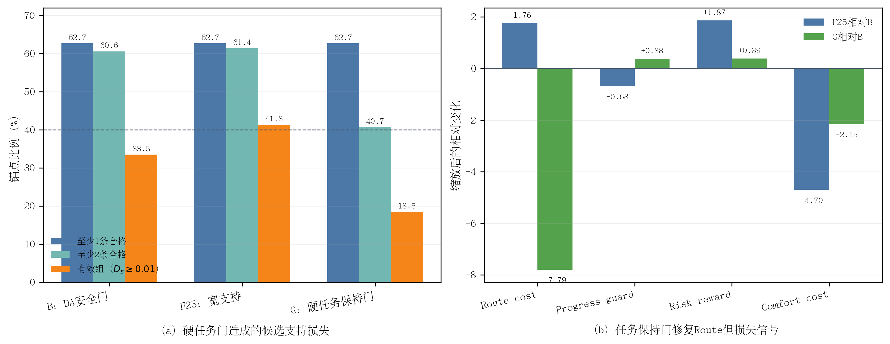

# F25任务保持硬资格实验结果

> 完成时间：10月05日15时07分  
> 最终判定：route修复但有效信号严重不足，拒绝硬资格方案  
> 原始结果：`task_preserving_gate_validation1000.json`，SHA-256 `92fa9b25d611ddefa44ffeb65ba74d841c166f0bc02cd2021934f403811d67ef`

## 1. 主要结果

| 指标 | B | F25 | G：F25+硬任务门 |
|---|---:|---:|---:|
| 平均合格候选数 | 17.957 | 18.059 | **5.655** |
| 至少1条合格候选 | 62.7% | 62.7% | 62.7% |
| 至少2条合格候选 | 60.6% | **61.4%** | **40.7%** |
| `D_s>=0.01`有效组 | 33.5% | **41.3%** | **18.5%** |
| 平均`D_s` | 0.022099 | **0.031222** | 0.014540 |
| Top-1 route cost | 0.222326 | 0.222502 | **0.221546** |
| Top-1 progress guard | 0.803343 | 0.802664 | **0.803719** |
| Top-1 no-collision | 94.4% | 94.4% | 94.4% |
| Top-1 risk reward | 0.624638 | **0.626508** | 0.625027 |
| Top-1 comfort cost | 0.346647 | 0.341952 | **0.344496** |
| 平均候选ADE（m） | 2.228222 | 2.235409 | **2.224942** |

论文排版可使用矢量版：[task_preserving_gate.pdf](figures/task_preserving_gate.pdf)。

**图4-x F25任务保持硬资格实验。**（a）G保持至少1条候选覆盖，但至少2条候选和有效组分别降至40.7%和18.5%；（b）硬门修复了F25的route小幅退化并保持其他Top-1方向，但代价是可学习信号大幅消失。

## 2. Route退化被修复

G的Top-1 route cost相对B下降0.000779，明显通过“增加不超过`1e-4`”门槛；progress guard提高0.000376，no-collision和DA均不下降。平均候选ADE相对B降低0.003279 m。由此可确认，逐候选route/progress资格在约束方向上有效，并非实现失效。

## 3. 资格层约束造成不可接受的支持坍缩

任务门将平均合格候选数从F25的18.059降至5.655。至少2条合格候选覆盖从61.4%降至40.7%，下降20.7个百分点；`D_s>=0.01`有效组从41.3%降至18.5%，下降22.8个百分点。虽然每个原本有安全候选的锚点至少保留B Top-1自身，因此“至少1条”仍为62.7%，但大量场景只剩1条或质量近似的候选，无法计算可靠组内优势。

该结果说明，route与progress保持本身有必要，但把它们加入候选资格层会同时参与均值、方差和优势集合计算，从源头删除过多比较样本。它解决了目标方向，却破坏了学习信号。

## 4. 科学结论

本实验支持以下结论：

> 安全资格与任务保持约束不应采用完全相同的作用位置。collision、risk、TTC和DA适合作为候选不可补偿资格；route/progress若同样在组统计前硬删除，会使安全候选支持坍缩。更合适的位置是在保留F25完整安全组统计后，阻断任务违规候选的正向更新权重。

因此G被拒绝，不进入训练，也不放宽已固化的route/progress阈值。下一步固定F25候选和安全资格，用完整安全组计算`D_s`及优势，仅对route/progress违规的正优势样本置零，再审计有效组保留率和正优势质量。

## 5. 证据位置

- 原始JSON：`/media/yanjun/拯救者PSSD/Diffusion-Planner-HDP/reward_audit/EXP_CH4_task_preserving_gate_1005/task_preserving_gate_validation1000.json`
- 运行日志：同目录`full.log`
- 实现：`scripts/audit_chapter4_da_aware_selection.py`
- 固化协议：[实验协议](实验协议.md)
